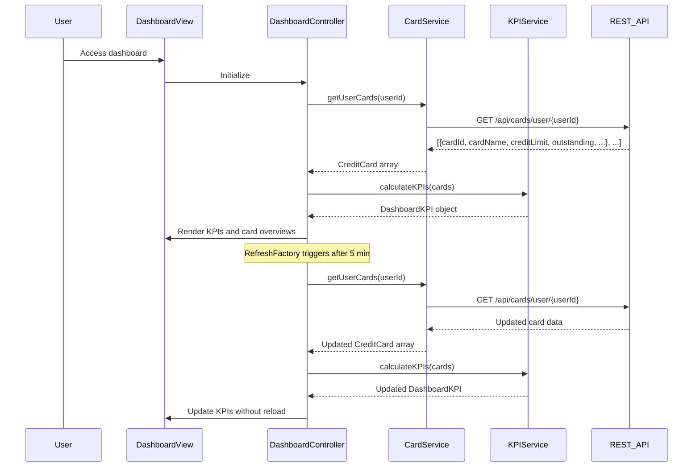

# Low-Level Design: Dashboard KPIs and Credit Card Overview
**Epic ID:** QE-10558

## a. Architecture Mapping

- **dashboardModule** (AngularJS Module) - Root module for dashboard functionality
- **DashboardController** (Controller) - Manages dashboard state, KPI display, and real-time refresh
- **CardService** (Service) - Fetches credit card portfolio data from REST API
- **KPIService** (Service) - Calculates aggregated KPI metrics from raw card data
- **kpiWidget** (Directive) - Reusable component for displaying individual KPI cards
- **cardOverview** (Directive) - Displays individual credit card summary with key metrics
- **RefreshFactory** (Factory) - Manages periodic data refresh intervals

**Folder Structure:**
```
/app
  /modules
    /dashboard
      /controllers
        - dashboardController.js
      /services
        - cardService.js
        - kpiService.js
      /directives
        - kpiWidget.js
        - cardOverview.js
      /factories
        - refreshFactory.js
      /views
        - dashboard.html
      - dashboardModule.js
```

## b. Component Specifications

| Component Name | Artifact Type | Responsibility | Key Dependencies |
|----------------|---------------|----------------|------------------|
| dashboardModule | Module | Registers dashboard components and configures routing | ngRoute, ngResource |
| DashboardController | Controller | Orchestrates dashboard data loading, KPI display, handles refresh triggers | CardService, KPIService, RefreshFactory, $scope, $interval |
| CardService | Service | Retrieves user's credit card portfolio from REST API | $http, $q, API_CONFIG |
| KPIService | Service | Computes total credit limit, available credit, outstanding amount, utilization percentage | None |
| kpiWidget | Directive | Renders individual KPI metric with icon, label, value, and trend indicator | None |
| cardOverview | Directive | Displays single card summary including card name, limit, balance, available credit | None |
| RefreshFactory | Factory | Provides auto-refresh mechanism with configurable interval (default 5 minutes) | $interval |

## c. Data Model

**CreditCard Object:**
```javascript
{
  cardId: String,
  cardName: String,
  cardType: String, // 'visa', 'mastercard', 'amex'
  creditLimit: Number,
  outstandingAmount: Number,
  availableCredit: Number,
  monthlySpend: Number,
  lastUpdated: Date
}
```

**DashboardKPI Object:**
```javascript
{
  totalCreditLimit: Number,
  totalOutstanding: Number,
  totalAvailableCredit: Number,
  overallUtilization: Number, // percentage
  totalMonthlySpend: Number,
  cardCount: Number
}
```

## d. Data Flow

User logs in and navigates to dashboard → DashboardController initializes and calls CardService to fetch user's credit card portfolio → CardService sends GET request to `/api/cards/user/{userId}` → API returns array of CreditCard objects → KPIService receives card array and calculates aggregated metrics (sum of limits, sum of outstanding, sum of available, utilization percentage) → DashboardController updates $scope with DashboardKPI object and card array → kpiWidget directives render portfolio-level KPIs → cardOverview directives render individual card summaries → RefreshFactory triggers periodic refresh every 5 minutes → Controller re-fetches data and updates UI without page reload.

## e. Primary Sequence Diagram



## f. Implementation Notes

- Use AngularJS $interval service for periodic data refresh; cancel interval on $scope.$destroy to prevent memory leaks
- Implement KPI calculations in pure JavaScript service for testability and performance
- Use Bootstrap grid (col-md-3 for KPI cards, col-md-6 for card overviews) for responsive layout
- Apply AngularJS one-time binding (::) for static card properties to optimize digest cycle performance
- Leverage $http interceptors for authentication and global error handling

## g. Error Handling

HTTP interceptor-based error handling with user notification via Bootstrap modal for API failures; retry mechanism on network errors.

## h. Security Notes

Requires token-based auth via existing SSO; JWT token passed in Authorization header for all API requests.