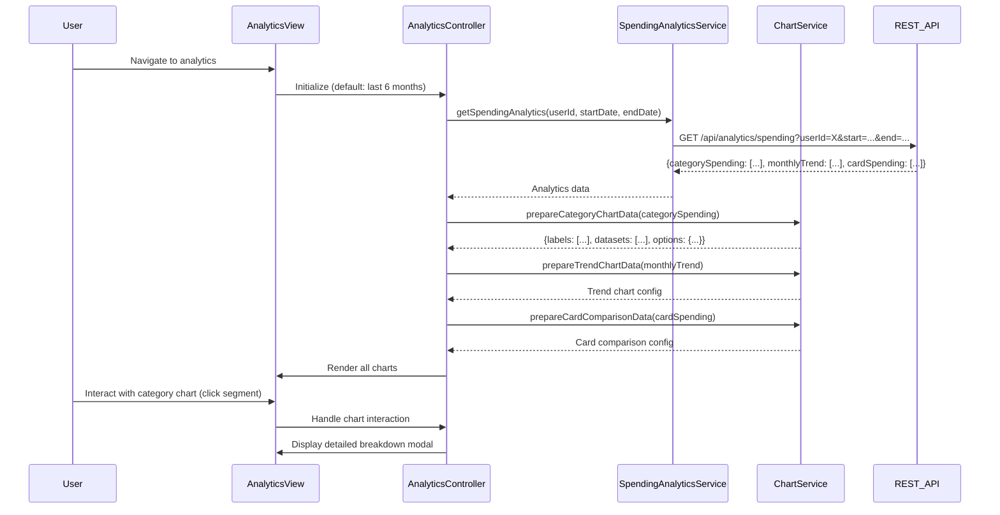

# Low-Level Design: Spending Analytics and Insights
**Epic ID:** QE-10559

## a. Architecture Mapping

- **analyticsModule** (AngularJS Module) - Root module for analytics functionality
- **AnalyticsController** (Controller) - Manages analytics view state, chart interactions, and data requests
- **SpendingAnalyticsService** (Service) - Fetches aggregated spending data from REST API
- **ChartService** (Service) - Prepares data for visualization library and manages chart configurations
- **categoryChart** (Directive) - Renders category-wise spending pie/donut chart
- **trendChart** (Directive) - Renders monthly spending trend line chart
- **cardComparisonChart** (Directive) - Renders card-wise spending bar chart

**Folder Structure:**
```
/app
  /modules
    /analytics
      /controllers
        - analyticsController.js
      /services
        - spendingAnalyticsService.js
        - chartService.js
      /directives
        - categoryChart.js
        - trendChart.js
        - cardComparisonChart.js
      /views
        - analytics.html
      - analyticsModule.js
```

## b. Component Specifications

| Component Name | Artifact Type | Responsibility | Key Dependencies |
|----------------|---------------|----------------|------------------|
| analyticsModule | Module | Registers analytics components, configures routing, imports chart library | ngRoute, chart.js or d3.js |
| AnalyticsController | Controller | Loads spending data, manages time period selection, handles chart interactions | SpendingAnalyticsService, ChartService, $scope |
| SpendingAnalyticsService | Service | Retrieves aggregated spending data by category, month, and card from REST API | $http, $q, API_CONFIG |
| ChartService | Service | Transforms raw spending data into chart-ready formats, provides chart configuration objects | None |
| categoryChart | Directive | Renders interactive pie/donut chart showing category-wise spending breakdown | ChartService, chart.js |
| trendChart | Directive | Renders line chart displaying monthly spending trends over selected period | ChartService, chart.js |
| cardComparisonChart | Directive | Renders bar chart comparing spending across multiple credit cards | ChartService, chart.js |

## c. Data Model

**CategorySpending Object:**
```javascript
{
  category: String, // 'Food & Dining', 'Fuel', 'Shopping', etc.
  amount: Number,
  transactionCount: Number,
  percentage: Number
}
```

**MonthlyTrend Object:**
```javascript
{
  month: String, // 'YYYY-MM'
  totalSpend: Number,
  categoryBreakdown: Array<{category: String, amount: Number}>
}
```

**CardSpending Object:**
```javascript
{
  cardId: String,
  cardName: String,
  totalSpend: Number,
  categoryBreakdown: Array<{category: String, amount: Number}>
}
```

**AnalyticsRequest Object:**
```javascript
{
  userId: String,
  startDate: Date,
  endDate: Date,
  cardIds: Array<String> // optional filter
}
```

## d. Data Flow

User navigates to analytics view → AnalyticsController initializes with default time period (last 6 months) → SpendingAnalyticsService calls REST API endpoint `/api/analytics/spending` with AnalyticsRequest parameters → API returns aggregated data including CategorySpending array, MonthlyTrend array, and CardSpending array → ChartService transforms raw data into chart-specific formats (labels, datasets, colors) → AnalyticsController updates $scope with chart data → categoryChart, trendChart, and cardComparisonChart directives render interactive visualizations → User interacts with charts (hover, click) to view detailed tooltips or drill down into specific categories/months → User changes time period filter → Controller re-fetches data and updates all charts.

## e. Primary Sequence Diagram



## f. Implementation Notes

- Use Chart.js library integrated via angular-chart.js wrapper for declarative chart directives
- Implement ChartService as stateless service with pure functions for data transformation
- Apply AngularJS $watch on time period filter to automatically refresh charts on user selection change
- Use Bootstrap responsive grid for chart layout (col-md-6 for side-by-side charts, col-md-12 for full-width trend)
- Leverage AngularJS $q promises for coordinating multiple API calls if category, trend, and card data come from separate endpoints

## g. Error Handling

HTTP interceptor captures API errors; fallback to empty state with user-friendly message displayed in chart containers; retry option provided.

## h. Security Notes

Requires token-based auth via existing SSO; all analytics API calls include Authorization header with JWT token.