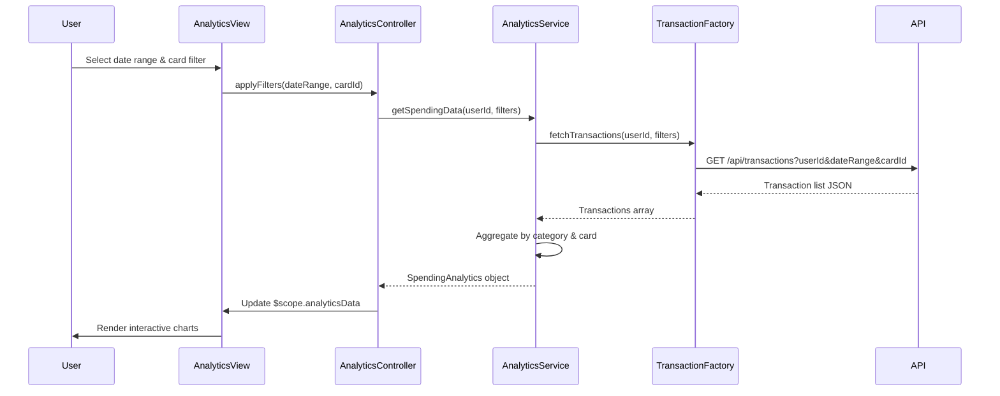

# Low-Level Design: Spending Analytics and Insights
**Epic ID:** QE-10690  
**Application Stack:** AngularJS 1.x, JavaScript ES6, HTML5, CSS3, Bootstrap, REST APIs, MVC Architecture

---

## a. Architecture Mapping

- **Analytics UI Component** → AngularJS Module (`app.analytics`) + Controller (`AnalyticsController`) + Directive (`spendingChart`)
- **Analytics Service** → AngularJS Service (`AnalyticsService`) for business logic and data aggregation
- **Transaction Service Integration** → AngularJS Factory (`TransactionFactory`) for REST API calls
- **Analytics Engine** → Server-side API endpoint consumed via `$http`
- **Dashboard Service Integration** → AngularJS Service (`DashboardService`) for trend data sharing

**Recommended Folder Structure:**
```
/app
  /modules
    /analytics
      analytics.module.js
      analytics.controller.js
      analytics.service.js
      analytics.directives.js
  /shared
    /factories
      transaction.factory.js
    /services
      dashboard.service.js
  /assets
    /css
    /js
```

---

## b. Component Specifications

| Component Name | Artifact Type | Responsibility | Key Dependencies |
|----------------|---------------|----------------|------------------|
| `app.analytics` | Module | Encapsulates all analytics feature components | `ngRoute`, `chart.js` |
| `AnalyticsController` | Controller | Manages analytics view state, handles user interactions, coordinates data fetching | `AnalyticsService`, `$scope` |
| `AnalyticsService` | Service | Aggregates spending data by category and card, caches results, calculates trends | `TransactionFactory`, `$q` |
| `TransactionFactory` | Factory | Fetches transaction data from REST API `/api/transactions` | `$http`, `$log` |
| `DashboardService` | Service | Provides shared trend data to dashboard and analytics modules | `$rootScope` |
| `spendingChart` | Directive | Renders interactive category-wise and card-wise spending charts using Chart.js | `AnalyticsService` |
| `trendFilter` | Directive | Provides date range and card selection filters for analytics | `AnalyticsController` |

---

## c. Data Model

**SpendingAnalytics (JavaScript Object):**
```javascript
{
  userId: String,
  dateRange: { startDate: Date, endDate: Date },
  categorySpending: [
    { category: String, amount: Number, percentage: Number }
  ],
  cardWiseSpending: [
    { cardId: String, cardName: String, totalSpend: Number }
  ],
  monthlyTrends: [
    { month: String, totalSpend: Number }
  ]
}
```

**Category (Enum):**
`['Food & Dining', 'Fuel', 'Shopping', 'Travel', 'Entertainment', 'Utilities', 'Healthcare', 'Education', 'Miscellaneous']`

---

## d. Data Flow

User selects date range and card filters in the Analytics view → `AnalyticsController` invokes `AnalyticsService.getSpendingData()` → Service calls `TransactionFactory.fetchTransactions()` which hits REST API `/api/transactions?userId=X&dateRange=Y` → API returns transaction list → `AnalyticsService` aggregates data by category and card, caches result → Controller updates `$scope.analyticsData` → `spendingChart` directive watches scope and re-renders interactive Chart.js visualizations → User interacts with charts (drill-down) triggering controller methods to filter and update view.

---

## e. Primary Sequence Diagram



---

## f. Implementation Notes

- Use AngularJS Dependency Injection to inject `AnalyticsService` and `TransactionFactory` into `AnalyticsController` for testability and modularity.
- Implement client-side caching in `AnalyticsService` using a simple object cache with TTL to avoid redundant API calls and meet 3-second render requirement.
- Leverage Chart.js library integrated via custom AngularJS directive (`spendingChart`) with two-way data binding to `$scope.analyticsData`.
- Use ES6 arrow functions, `const`/`let`, and template literals for cleaner, modern JavaScript code within services and controllers.
- REST API integration via `$http` service with promise-based handling (`$q`) for asynchronous data fetching and error propagation.

---

## g. Error Handling

HTTP interceptor captures API errors; user-friendly notifications displayed via Bootstrap alerts; failed requests logged to console.

---

## h. Security Notes

Standard input validation and secure API calls assumed; token-based authentication via existing SSO for API requests.

---