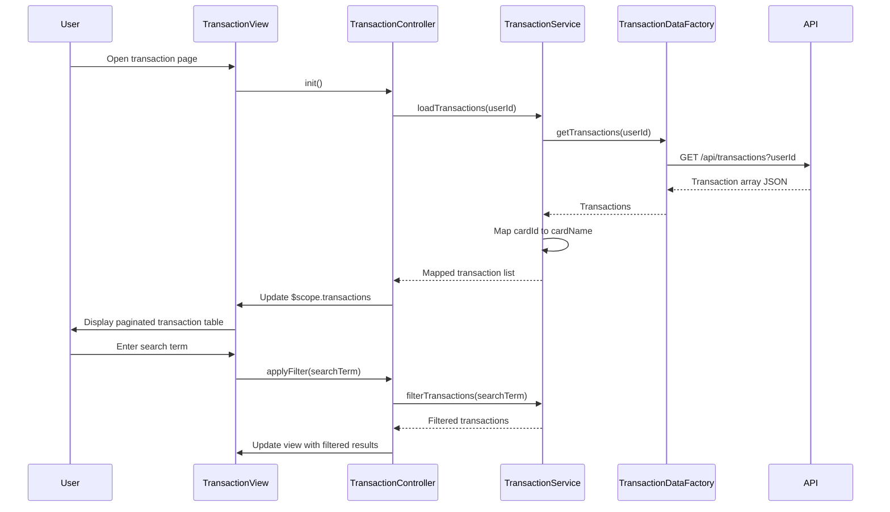

# Low-Level Design: Transaction Management and Monitoring
**Epic ID:** QE-10691  
**Application Stack:** AngularJS 1.x, JavaScript ES6, HTML5, CSS3, Bootstrap, REST APIs, MVC Architecture

---

## a. Architecture Mapping

- **Transaction UI Component** → AngularJS Module (`app.transactions`) + Controller (`TransactionController`) + View Template (HTML5)
- **Transaction Management Service** → AngularJS Service (`TransactionService`) for business logic and filtering
- **Transaction Data Service Integration** → AngularJS Factory (`TransactionDataFactory`) for REST API `/api/transactions`
- **Credit Card Service Integration** → AngularJS Factory (`CreditCardFactory`) for REST API `/api/cards`
- **Pagination & Filtering** → AngularJS Directive (`transactionList`) with Bootstrap pagination component

**Recommended Folder Structure:**
```
/app
  /modules
    /transactions
      transactions.module.js
      transactions.controller.js
      transactions.service.js
      transactions.directives.js
  /shared
    /factories
      transaction-data.factory.js
      credit-card.factory.js
  /views
    transactions.html
```

---

## b. Component Specifications

| Component Name | Artifact Type | Responsibility | Key Dependencies |
|----------------|---------------|----------------|------------------|
| `app.transactions` | Module | Encapsulates transaction management feature | `ngRoute`, `ui.bootstrap` |
| `TransactionController` | Controller | Manages transaction list view, handles search/filter inputs, pagination state | `TransactionService`, `$scope` |
| `TransactionService` | Service | Applies client-side filtering, sorting, and pagination logic; coordinates data retrieval | `TransactionDataFactory`, `CreditCardFactory` |
| `TransactionDataFactory` | Factory | Fetches transaction records from REST API `/api/transactions` with query params | `$http`, `$q` |
| `CreditCardFactory` | Factory | Fetches credit card list from REST API `/api/cards` to map transactions to cards | `$http` |
| `transactionList` | Directive | Renders paginated transaction table with search/filter controls using Bootstrap | `TransactionController` |
| `transactionSearch` | Directive | Provides real-time search input with debouncing for transaction filtering | `TransactionService` |

---

## c. Data Model

**Transaction (JavaScript Object):**
```javascript
{
  transactionId: String,
  cardId: String,
  cardName: String,
  amount: Number,
  category: String,
  merchant: String,
  transactionDate: Date,
  description: String,
  status: String // 'posted', 'pending'
}
```

**TransactionFilter (JavaScript Object):**
```javascript
{
  searchTerm: String,
  cardId: String,
  dateRange: { startDate: Date, endDate: Date },
  category: String
}
```

---

## d. Data Flow

User opens Transaction view → `TransactionController` initializes and calls `TransactionService.loadTransactions(userId)` → Service invokes `TransactionDataFactory.getTransactions()` and `CreditCardFactory.getCards()` in parallel → REST APIs return transaction list and card list → Service maps cardId to cardName and stores in `$scope.transactions` → User enters search term or applies filter → Controller updates `$scope.filter` → Service re-filters transaction array client-side and updates view with paginated results → User clicks pagination control → Controller updates `$scope.currentPage` → Directive re-renders visible transaction subset.

---

## e. Primary Sequence Diagram



---

## f. Implementation Notes

- Use AngularJS `$http` service with query parameters for efficient server-side filtering by userId, cardId, and date range to meet 1-second retrieval NFR.
- Implement client-side pagination using `ui.bootstrap.pagination` directive with configurable page size (default 50 transactions per page).
- Apply debouncing (300ms) to search input using `ng-model-options` to reduce unnecessary filtering operations during user typing.
- Use ES6 `Array.filter()` and `Array.sort()` methods in `TransactionService` for client-side filtering and sorting logic.
- Leverage AngularJS two-way data binding to synchronize filter inputs and transaction list view automatically.

---

## g. Error Handling

HTTP interceptor-based error handling with try/catch blocks in service methods; user notifications via Bootstrap toast alerts.

---

## h. Security Notes

Requires token-based auth via existing SSO; API requests include authorization headers; input sanitization applied to search terms.

---