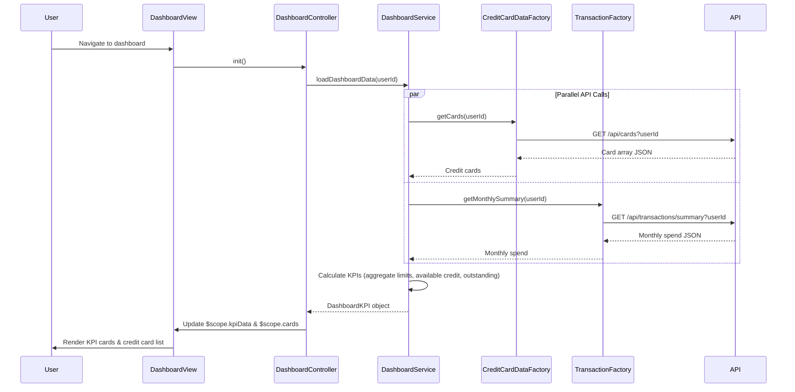

# Low-Level Design: Dashboard KPIs and Credit Card Overview
**Epic ID:** QE-10692  
**Application Stack:** AngularJS 1.x, JavaScript ES6, HTML5, CSS3, Bootstrap, REST APIs, MVC Architecture

---

## a. Architecture Mapping

- **Dashboard UI Component** → AngularJS Module (`app.dashboard`) + Controller (`DashboardController`) + View Template (HTML5)
- **Dashboard Service** → AngularJS Service (`DashboardService`) for KPI calculation and data aggregation
- **Credit Card Data Service Integration** → AngularJS Factory (`CreditCardDataFactory`) for REST API `/api/cards`
- **Transaction Service Integration** → AngularJS Factory (`TransactionFactory`) for REST API `/api/transactions/summary`
- **KPI Display Components** → AngularJS Directives (`kpiCard`, `creditCardList`)

**Recommended Folder Structure:**
```
/app
  /modules
    /dashboard
      dashboard.module.js
      dashboard.controller.js
      dashboard.service.js
      dashboard.directives.js
  /shared
    /factories
      credit-card-data.factory.js
      transaction.factory.js
  /views
    dashboard.html
```

---

## b. Component Specifications

| Component Name | Artifact Type | Responsibility | Key Dependencies |
|----------------|---------------|----------------|------------------|
| `app.dashboard` | Module | Encapsulates dashboard feature and KPI display | `ngRoute`, `ngAnimate` |
| `DashboardController` | Controller | Manages dashboard view state, coordinates KPI data loading, handles user interactions | `DashboardService`, `$scope` |
| `DashboardService` | Service | Aggregates credit card data and transaction summaries, calculates KPIs (monthly spend, total limit, available credit, outstanding) | `CreditCardDataFactory`, `TransactionFactory`, `$q` |
| `CreditCardDataFactory` | Factory | Fetches credit card information and balances from REST API `/api/cards` | `$http` |
| `TransactionFactory` | Factory | Fetches monthly spend summary from REST API `/api/transactions/summary` | `$http` |
| `kpiCard` | Directive | Renders individual KPI card (monthly spend, credit limit, available credit, outstanding) with responsive Bootstrap styling | `DashboardController` |
| `creditCardList` | Directive | Displays list of user's credit cards with key details (card name, limit, outstanding, available credit) | `DashboardService` |

---

## c. Data Model

**DashboardKPI (JavaScript Object):**
```javascript
{
  userId: String,
  monthlySpend: Number,
  totalCreditLimit: Number,
  availableCredit: Number,
  outstandingAmount: Number,
  lastUpdated: Date
}
```

**CreditCard (JavaScript Object):**
```javascript
{
  cardId: String,
  cardName: String,
  cardType: String, // 'Visa', 'MasterCard', 'Amex'
  creditLimit: Number,
  outstandingBalance: Number,
  availableCredit: Number,
  lastTransactionDate: Date
}
```

---

## d. Data Flow

User navigates to Dashboard → `DashboardController` initializes and calls `DashboardService.loadDashboardData(userId)` → Service invokes `CreditCardDataFactory.getCards()` and `TransactionFactory.getMonthlySummary()` in parallel using `$q.all()` → REST APIs return card data and monthly spend summary → Service aggregates total credit limit, calculates available credit (sum of all cards' available credit), sums outstanding amounts, and stores in `$scope.kpiData` → `kpiCard` directives render KPI values with responsive Bootstrap grid → `creditCardList` directive displays individual card details → Dashboard loads within 2 seconds per NFR.

---

## e. Primary Sequence Diagram



---

## f. Implementation Notes

- Use AngularJS `$q.all()` to execute parallel REST API calls to `CreditCardDataFactory` and `TransactionFactory` for optimized load time under 2 seconds.
- Implement responsive Bootstrap grid (`col-xs-12 col-sm-6 col-md-3`) in `kpiCard` directive template to ensure mobile, tablet, and desktop compatibility.
- Calculate `availableCredit` in `DashboardService` as `totalCreditLimit - outstandingAmount` across all cards using ES6 `Array.reduce()`.
- Use AngularJS `ng-repeat` with `track by cardId` in `creditCardList` directive for efficient DOM rendering and updates.
- Apply CSS3 transitions and AngularJS `ngAnimate` for smooth KPI card loading animations.

---

## g. Error Handling

HTTP interceptor captures API failures; user-friendly error messages displayed via Bootstrap alert component; retry logic not implemented.

---

## h. Security Notes

Requires token-based auth via existing SSO; all API endpoints secured with authorization headers; WCAG 2.1 accessibility compliance enforced.

---