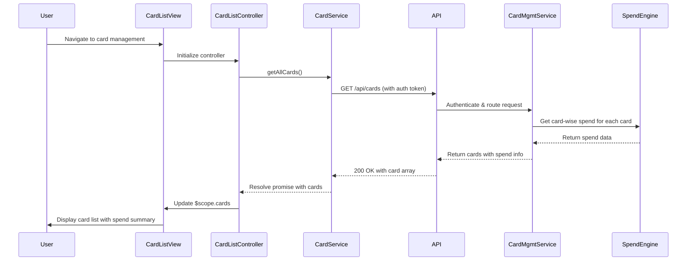

# Low-Level Design: Multi-Card Management and Tracking
**Epic ID:** QE-10693  
**Tech Stack:** AngularJS 1.x, JavaScript ES6, HTML5, CSS3, Bootstrap, REST APIs, MVC Architecture

---

## a. Architecture Mapping

- **Card Management Module** → AngularJS Module (`app.cardManagement`)
- **Card List Controller** → AngularJS Controller (`CardListController`)
- **Card Details Controller** → AngularJS Controller (`CardDetailsController`)
- **Card Service** → AngularJS Service (`CardService`) - handles API calls for card CRUD operations
- **Spend Analytics Service** → AngularJS Service (`SpendAnalyticsService`) - fetches card-wise spend data
- **Card Display Directive** → AngularJS Directive (`cardTile`) - renders individual card tiles

**Recommended Folder Structure:**
```
/app
  /modules
    /card-management
      /controllers (CardListController.js, CardDetailsController.js)
      /services (CardService.js, SpendAnalyticsService.js)
      /directives (cardTile.js)
      /views (card-list.html, card-details.html)
      card-management.module.js
```

---

## b. Component Specifications

| Name | Artifact Type | Responsibility | Key Dependencies |
|------|---------------|----------------|------------------|
| CardListController | Controller | Manages card list view, filtering, and selection | CardService, SpendAnalyticsService, $scope |
| CardDetailsController | Controller | Displays individual card details and spend patterns | CardService, SpendAnalyticsService, $routeParams, $scope |
| CardService | Service | Handles REST API calls for card CRUD operations (GET /api/cards, POST /api/cards, GET /api/cards/:id) | $http, AuthService |
| SpendAnalyticsService | Service | Fetches card-wise spending metrics (GET /api/cards/:id/spend) | $http, $q |
| cardTile | Directive | Renders individual card tile with card details and quick spend summary | None |
| AuthService | Service | Provides authentication token for secure API calls | $http, $window |

---

## c. Data Model

**Card Object:**
```javascript
{
  cardId: String,           // Unique card identifier
  cardNumber: String,       // Masked card number (e.g., "**** **** **** 1234")
  cardHolderName: String,
  issuer: String,           // Card issuer (e.g., "Visa", "MasterCard")
  expiryDate: String,       // Format: "MM/YY"
  creditLimit: Number,
  availableCredit: Number,
  outstandingAmount: Number,
  status: String            // "active" | "inactive" | "blocked"
}
```

**CardSpend Object:**
```javascript
{
  cardId: String,
  monthlySpend: Number,
  categoryBreakdown: Array, // [{category: String, amount: Number}]
  lastTransactionDate: String
}
```

---

## d. Data Flow

User navigates to card management view → CardListController initializes and calls CardService.getAllCards() → CardService makes GET /api/cards with auth token → API Gateway authenticates and routes to Card Management Service → Service retrieves cards from repository and aggregates spend data via Spend Calculation Engine → Response returned to CardService → CardListController populates $scope.cards and renders card list using cardTile directive → User selects a card → CardDetailsController fetches detailed card info and spend analytics via CardService and SpendAnalyticsService → UI updates with card-specific details and spending patterns.

---

## e. Primary Sequence Diagram



---

## f. Implementation Notes

- Use AngularJS Dependency Injection to inject CardService and SpendAnalyticsService into controllers
- Implement CardService using $http with interceptor for automatic token attachment and error handling
- Use $q promises for async operations; chain .then() for success and .catch() for error handling
- Leverage ng-repeat with track by cardId for efficient card list rendering
- Apply Bootstrap grid (col-md-4) for responsive card tile layout; use ng-class for conditional styling based on card status

---

## g. Error Handling

HTTP interceptor captures 401/403 errors and redirects to login; CardService wraps API calls in try/catch with user-friendly error notifications via toastr or $mdToast.

---

## h. Security Notes

Requires token-based auth via existing SSO; card numbers masked on display; API calls secured with JWT tokens in Authorization header.