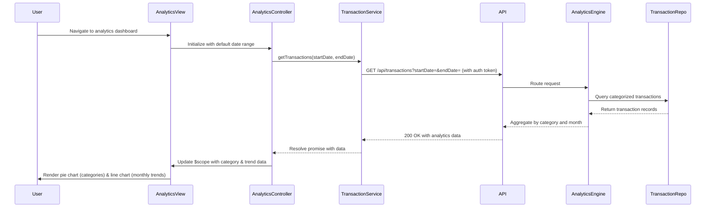

# Low-Level Design: Transaction Analytics and Category Insights
**Epic ID:** QE-10694  
**Tech Stack:** AngularJS 1.x, JavaScript ES6, HTML5, CSS3, Bootstrap, REST APIs, MVC Architecture

---

## a. Architecture Mapping

- **Analytics Module** → AngularJS Module (`app.analytics`)
- **Analytics Controller** → AngularJS Controller (`AnalyticsController`)
- **Transaction Service** → AngularJS Service (`TransactionService`) - fetches transaction data
- **Analytics Service** → AngularJS Service (`AnalyticsService`) - processes and aggregates analytics data
- **Chart Directive** → AngularJS Directive (`spendChart`) - renders interactive charts using Chart.js or D3.js
- **Category Filter** → AngularJS Filter (`categoryFilter`) - filters transactions by category

**Recommended Folder Structure:**
```
/app
  /modules
    /analytics
      /controllers (AnalyticsController.js)
      /services (TransactionService.js, AnalyticsService.js)
      /directives (spendChart.js)
      /filters (categoryFilter.js)
      /views (analytics-dashboard.html)
      analytics.module.js
```

---

## b. Component Specifications

| Name | Artifact Type | Responsibility | Key Dependencies |
|------|---------------|----------------|------------------|
| AnalyticsController | Controller | Manages analytics dashboard, filters, and date range selection | TransactionService, AnalyticsService, $scope, $filter |
| TransactionService | Service | Fetches transaction data from API (GET /api/transactions?startDate=&endDate=&category=) | $http, AuthService |
| AnalyticsService | Service | Aggregates transaction data by category and month; calculates trends | $q |
| spendChart | Directive | Renders pie/bar/line charts using Chart.js; binds to analytics data | Chart.js library |
| categoryFilter | Filter | Filters transaction array by selected category | None |

---

## c. Data Model

**Transaction Object:**
```javascript
{
  transactionId: String,
  cardId: String,
  amount: Number,
  category: String,        // One of 9 predefined categories
  merchantName: String,
  transactionDate: String, // ISO 8601 format
  description: String
}
```

**CategorySpend Object:**
```javascript
{
  category: String,
  totalAmount: Number,
  transactionCount: Number,
  percentage: Number       // % of total spend
}
```

**MonthlyTrend Object:**
```javascript
{
  month: String,           // Format: "YYYY-MM"
  totalSpend: Number,
  categoryBreakdown: Array // [{category: String, amount: Number}]
}
```

---

## d. Data Flow

User accesses analytics dashboard → AnalyticsController initializes and calls TransactionService.getTransactions(dateRange) → TransactionService makes GET /api/transactions with date filters and auth token → API Gateway routes to Analytics Service → Analytics Service queries Transaction Processing Service for categorized transactions → Transaction Data Repository returns transaction records → Analytics Engine aggregates data by category and month → Response returned to TransactionService → AnalyticsController passes data to AnalyticsService for client-side aggregation → AnalyticsService calculates category totals, percentages, and monthly trends → Controller updates $scope with analytics data → spendChart directive renders interactive pie chart (category distribution) and line chart (monthly trends) → User applies filters or searches → Controller re-aggregates and updates charts.

---

## e. Primary Sequence Diagram



---

## f. Implementation Notes

- Use AngularJS $http service with promise chaining for async transaction data fetching
- Integrate Chart.js via spendChart directive; use isolated scope with two-way binding for chart data
- Implement client-side caching using $cacheFactory for transaction data to reduce API calls on filter changes
- Use ng-repeat with orderBy filter to display transaction list sorted by date descending
- Apply Bootstrap date picker for date range selection; validate date range on controller before API call

---

## g. Error Handling

HTTP interceptor handles API errors; TransactionService returns rejected promise with error message; AnalyticsController displays error notification and fallback empty state UI.

---

## h. Security Notes

Standard input validation and secure API calls assumed; transaction data filtered by authenticated user ID server-side.