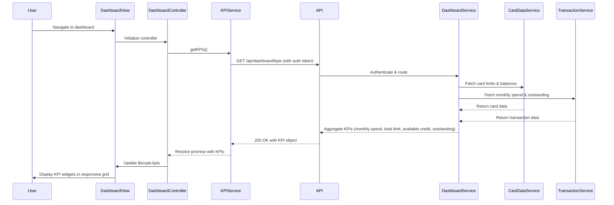

# Low-Level Design: Dashboard and KPI Management
**Epic ID:** QE-10695  
**Tech Stack:** AngularJS 1.x, JavaScript ES6, HTML5, CSS3, Bootstrap, REST APIs, MVC Architecture

---

## a. Architecture Mapping

- **Dashboard Module** → AngularJS Module (`app.dashboard`)
- **Dashboard Controller** → AngularJS Controller (`DashboardController`)
- **KPI Service** → AngularJS Service (`KPIService`) - fetches aggregated KPI data from API
- **Card Summary Service** → AngularJS Service (`CardSummaryService`) - retrieves card-level summaries
- **KPI Widget Directive** → AngularJS Directive (`kpiWidget`) - renders individual KPI card/tile
- **Refresh Service** → AngularJS Service (`RefreshService`) - manages real-time data refresh using $interval

**Recommended Folder Structure:**
```
/app
  /modules
    /dashboard
      /controllers (DashboardController.js)
      /services (KPIService.js, CardSummaryService.js, RefreshService.js)
      /directives (kpiWidget.js)
      /views (dashboard.html)
      dashboard.module.js
```

---

## b. Component Specifications

| Name | Artifact Type | Responsibility | Key Dependencies |
|------|---------------|----------------|------------------|
| DashboardController | Controller | Orchestrates dashboard initialization, KPI data loading, and refresh | KPIService, CardSummaryService, RefreshService, $scope |
| KPIService | Service | Fetches aggregated KPI metrics (GET /api/dashboard/kpis) | $http, AuthService |
| CardSummaryService | Service | Retrieves card-level summaries for consolidated view (GET /api/cards/summary) | $http, $q |
| RefreshService | Service | Manages periodic data refresh using $interval (every 30-60 seconds) | $interval, $rootScope |
| kpiWidget | Directive | Renders individual KPI tile with metric name, value, and icon | None |

---

## c. Data Model

**KPI Object:**
```javascript
{
  userId: String,
  monthlySpend: Number,
  totalCreditLimit: Number,
  availableCredit: Number,
  outstandingAmount: Number,
  lastUpdated: String      // ISO 8601 timestamp
}
```

**CardSummary Object:**
```javascript
{
  cardId: String,
  cardName: String,        // e.g., "Visa *1234"
  currentBalance: Number,
  creditLimit: Number,
  utilizationPercentage: Number
}
```

---

## d. Data Flow

User navigates to dashboard → DashboardController initializes and calls KPIService.getKPIs() and CardSummaryService.getCardSummaries() concurrently → Both services make GET requests to respective API endpoints with auth token → API Gateway authenticates and routes to Dashboard Service → Dashboard Service orchestrates calls to Credit Card Data Service (fetches card details, limits, balances) and Transaction Processing Service (fetches monthly spend, outstanding amounts) → Services query Data Repository → Aggregated KPI and card summary data returned to Dashboard Service → API responses returned to KPIService and CardSummaryService → DashboardController updates $scope.kpis and $scope.cardSummaries → UI renders responsive dashboard with KPI widgets (using kpiWidget directive) and card summary table → RefreshService triggers periodic refresh every 60 seconds → Controller re-fetches KPI data and updates UI without full page reload.

---

## e. Primary Sequence Diagram



---

## f. Implementation Notes

- Use AngularJS $q.all() to fetch KPIs and card summaries in parallel for faster dashboard load
- Implement KPIService with $http and response caching ($http cache: true) for 30-second TTL
- Use RefreshService with $interval to poll KPIService.getKPIs() every 60 seconds; cancel interval on $scope.$destroy
- Leverage Bootstrap grid (col-md-3 for KPI widgets, col-md-12 for card summary table) for responsive layout
- Apply ng-class to highlight critical KPIs (e.g., low available credit in red, high utilization in amber)

---

## g. Error Handling

HTTP interceptor captures API errors; KPIService returns rejected promise; DashboardController displays error notification and shows cached/stale data with warning indicator.

---

## h. Security Notes

Requires token-based auth via existing SSO; KPI data filtered by authenticated user ID server-side; API calls secured with JWT tokens.