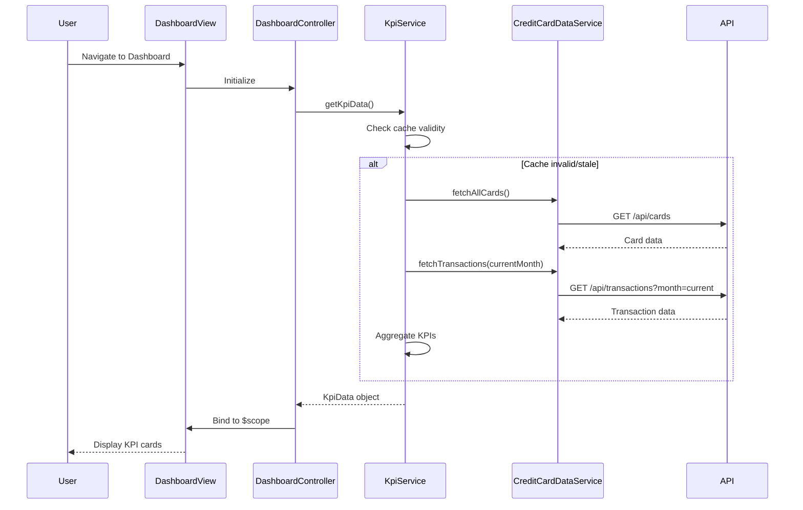

# Low-Level Design: Dashboard and KPI Management
**Epic ID:** QE-10726  
**Epic Title:** PERFTEST20261112131756-Dashboard and KPI Management

---

## a. Architecture Mapping

| HLD Component | AngularJS Artifact | Type |
|---------------|-------------------|------|
| Dashboard UI Component | dashboardModule | Module |
| Dashboard UI Component | DashboardController | Controller |
| KPI Aggregation Service | KpiService | Service/Factory |
| Credit Card Data Service | CreditCardDataService | Service |
| User Authentication Service | AuthService | Service |
| API Gateway | ApiInterceptor | Factory/Interceptor |

**Recommended Folder Structure:**
```
app/
├── modules/
│   └── dashboard/
│       ├── dashboard.module.js
│       ├── dashboard.controller.js
│       ├── dashboard.view.html
│       └── dashboard.css
├── services/
│   ├── kpi.service.js
│   ├── creditcard-data.service.js
│   └── auth.service.js
├── shared/
│   ├── interceptors/
│   │   └── api.interceptor.js
│   └── constants/
│       └── api.constants.js
└── assets/
    └── styles/
        └── dashboard.css
```

---

## b. Component Specifications

| Component Name | Artifact Type | Responsibility | Key Dependencies |
|----------------|---------------|----------------|------------------|
| dashboardModule | Module | Root module for dashboard feature, defines routing and DI | ngRoute, ngResource |
| DashboardController | Controller | Manages dashboard view state, fetches KPI data, handles user interactions | KpiService, $scope, $interval |
| KpiService | Service | Aggregates and caches KPI metrics (monthly spend, credit limit, available credit, outstanding) | CreditCardDataService, $http, $q |
| CreditCardDataService | Service | Fetches credit card details and transaction data from backend APIs | $http, $q, ApiConstants |
| AuthService | Service | Validates user authentication, manages session tokens | $http, $window, $q |
| ApiInterceptor | Factory | Intercepts HTTP requests/responses, adds auth tokens, handles errors | $q, AuthService |
| DashboardView | HTML Template | Renders KPI cards, responsive layout using Bootstrap grid | Bootstrap CSS, AngularJS directives |

---

## c. Data Model

**KpiData (JavaScript Object):**
```javascript
{
  monthlySpend: Number,        // Total spend for current month
  totalCreditLimit: Number,    // Sum of all card credit limits
  availableCredit: Number,     // Total available credit across cards
  outstandingAmount: Number,   // Total outstanding balance
  lastUpdated: Date,           // Timestamp of last data refresh
  userId: String               // User identifier
}
```

**CreditCard (JavaScript Object):**
```javascript
{
  cardId: String,
  cardNumber: String,          // Masked card number
  cardType: String,            // Visa, MasterCard, etc.
  creditLimit: Number,
  availableCredit: Number,
  outstandingBalance: Number,
  lastTransactionDate: Date
}
```

---

## d. Data Flow

User navigates to Dashboard → DashboardController initializes and calls KpiService.getKpiData() → KpiService checks cache; if stale, calls CreditCardDataService.fetchAllCards() and CreditCardDataService.fetchTransactions() → Services make REST API calls via $http with ApiInterceptor adding auth tokens → Backend returns card and transaction data → KpiService aggregates data (sums credit limits, calculates available credit, computes monthly spend from transactions) → Aggregated KpiData object returned to DashboardController → Controller binds data to $scope → View updates KPI cards with two-way data binding → $interval triggers periodic refresh every 5 minutes.

---

## e. Primary Sequence Diagram



---

## f. Implementation Notes

- Use AngularJS 1.x module pattern with dependency injection for all services and controllers.
- Implement KpiService as a singleton using `.service()` with in-memory caching (5-minute TTL) to meet 2-second load requirement.
- Use $http for REST API calls; configure ApiInterceptor to attach JWT tokens from AuthService.
- Leverage Bootstrap 3/4 grid system (col-md-3, col-sm-6, col-xs-12) for responsive KPI card layout.
- Use $interval for periodic data refresh; cancel interval on $scope.$destroy to prevent memory leaks.

---

## g. Error Handling

ApiInterceptor handles HTTP errors globally; displays user-friendly notifications via toastr/alert; retries failed requests once before showing error.

---

## h. Security Notes

Requires token-based authentication via existing SSO; AuthService validates session before API calls; ApiInterceptor attaches bearer tokens to all requests.