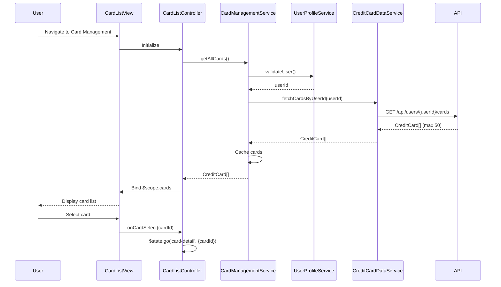

# Low-Level Design: Credit Card Management
**Epic ID:** QE-10727  
**Epic Title:** PERFTEST20261112131756-Credit Card Management

---

## a. Architecture Mapping

| HLD Component | AngularJS Artifact | Type |
|---------------|-------------------|------|
| Card Management UI | cardManagementModule | Module |
| Card Management UI | CardListController | Controller |
| Card Management UI | CardDetailController | Controller |
| Card Management Service | CardManagementService | Service |
| Credit Card Data Repository | CreditCardDataService | Service |
| User Profile Service | UserProfileService | Service |
| Spend Analysis Engine | SpendAnalysisService | Service |
| Card Listing Interface | cardListDirective | Directive |

**Recommended Folder Structure:**
```
app/
├── modules/
│   └── card-management/
│       ├── card-management.module.js
│       ├── controllers/
│       │   ├── card-list.controller.js
│       │   └── card-detail.controller.js
│       ├── directives/
│       │   └── card-list.directive.js
│       ├── views/
│       │   ├── card-list.view.html
│       │   └── card-detail.view.html
│       └── styles/
│           └── card-management.css
├── services/
│   ├── card-management.service.js
│   ├── creditcard-data.service.js
│   ├── user-profile.service.js
│   └── spend-analysis.service.js
└── shared/
    └── filters/
        └── card-filter.js
```

---

## b. Component Specifications

| Component Name | Artifact Type | Responsibility | Key Dependencies |
|----------------|---------------|----------------|------------------|
| cardManagementModule | Module | Root module for card management, defines routing and state management | ui.router, ngResource |
| CardListController | Controller | Manages card list view, handles filtering, sorting, and card selection | CardManagementService, $scope, $state |
| CardDetailController | Controller | Displays individual card details, card-wise spending, and transaction history | CardManagementService, SpendAnalysisService, $stateParams |
| CardManagementService | Service | Orchestrates card data retrieval, validation, and caching for up to 50 cards | CreditCardDataService, UserProfileService, $q |
| CreditCardDataService | Service | Fetches card information, balances, and transactions from backend repository | $http, $q, ApiConstants |
| UserProfileService | Service | Validates card ownership and enforces data isolation per user account | $http, AuthService, $q |
| SpendAnalysisService | Service | Aggregates card-wise spending data by card ID | CreditCardDataService, $q |
| cardListDirective | Directive | Reusable component for rendering card list with filtering and selection | CardManagementService |

---

## c. Data Model

**CreditCard (JavaScript Object):**
```javascript
{
  cardId: String,              // Unique card identifier
  userId: String,              // Owner user ID
  cardNumber: String,          // Masked (e.g., "**** **** **** 1234")
  cardHolderName: String,
  cardType: String,            // "Visa", "MasterCard", "Amex"
  issuer: String,              // Bank name
  creditLimit: Number,
  availableCredit: Number,
  outstandingBalance: Number,
  dueDate: Date,
  lastTransactionDate: Date,
  status: String               // "Active", "Blocked", "Expired"
}
```

**CardSpendSummary (JavaScript Object):**
```javascript
{
  cardId: String,
  totalSpend: Number,          // Total spend for selected period
  transactionCount: Number,
  averageTransactionAmount: Number,
  period: String               // "monthly", "yearly"
}
```

---

## d. Data Flow

User navigates to Card Management view → CardListController initializes and calls CardManagementService.getAllCards() → Service calls UserProfileService.validateUser() to confirm ownership → UserProfileService returns userId → CardManagementService calls CreditCardDataService.fetchCardsByUserId(userId) → CreditCardDataService makes GET /api/users/{userId}/cards API call → Backend returns array of CreditCard objects (max 50) → Service caches cards and returns to controller → Controller binds cards to $scope.cards → View renders card list using cardListDirective with ng-repeat → User selects a card → $state.go('card-detail', {cardId}) transitions to CardDetailController → Controller calls SpendAnalysisService.getCardSpend(cardId) → Service fetches transactions and aggregates spend by cardId → CardSpendSummary returned and bound to view.

---

## e. Primary Sequence Diagram



---

## f. Implementation Notes

- Use ui.router for state management; define 'card-list' and 'card-detail' states with URL parameters.
- Implement CardManagementService with in-memory cache (LRU, max 50 cards) to meet 1-second retrieval requirement.
- Use ng-repeat with track by cardId for efficient card list rendering; apply filters for search/sort.
- Enforce data isolation by validating userId in UserProfileService before every card data fetch.
- Use ES6 arrow functions and const/let in services; leverage $q promises for async operations.

---

## g. Error Handling

Global error interceptor catches API failures; displays user notifications; handles 403 errors (ownership validation failure) with redirect to dashboard.

---

## h. Security Notes

Requires token-based auth via existing SSO; UserProfileService enforces data isolation by validating card ownership per userId before data access.