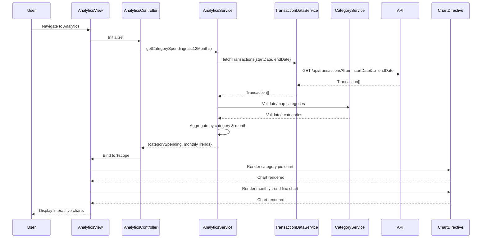

# Low-Level Design: Analytics and Spending Insights
**Epic ID:** QE-10728  
**Epic Title:** PERFTEST20261112131756-Analytics and Spending Insights

---

## a. Architecture Mapping

| HLD Component | AngularJS Artifact | Type |
|---------------|-------------------|------|
| Analytics UI | analyticsModule | Module |
| Analytics UI | AnalyticsController | Controller |
| Analytics Service | AnalyticsService | Service |
| Transaction Data Service | TransactionDataService | Service |
| Category Classification Engine | CategoryService | Service |
| Charting Library | chartDirective | Directive (wraps Chart.js/D3) |
| Historical Data Store | (Backend API) | External |

**Recommended Folder Structure:**
```
app/
├── modules/
│   └── analytics/
│       ├── analytics.module.js
│       ├── analytics.controller.js
│       ├── views/
│       │   ├── analytics.view.html
│       │   └── category-breakdown.view.html
│       └── styles/
│           └── analytics.css
├── services/
│   ├── analytics.service.js
│   ├── transaction-data.service.js
│   └── category.service.js
├── directives/
│   ├── chart.directive.js
│   ├── category-chart.directive.js
│   └── trend-chart.directive.js
└── shared/
    └── constants/
        └── categories.constants.js
```

---

## b. Component Specifications

| Component Name | Artifact Type | Responsibility | Key Dependencies |
|----------------|---------------|----------------|------------------|
| analyticsModule | Module | Root module for analytics feature, defines routing and chart library integration | ngRoute, chart.js |
| AnalyticsController | Controller | Manages analytics view state, fetches spending data, handles filter interactions | AnalyticsService, CategoryService, $scope |
| AnalyticsService | Service | Aggregates spending data by category and time period, computes trends | TransactionDataService, $q, $http |
| TransactionDataService | Service | Fetches transaction history (12 months) from backend APIs | $http, $q, ApiConstants |
| CategoryService | Service | Provides category definitions and maps transactions to 9 predefined categories | CategoriesConstants |
| chartDirective | Directive | Reusable chart component wrapping Chart.js for rendering pie/bar/line charts | Chart.js library |
| categoryChartDirective | Directive | Specialized directive for category-wise spending breakdown (pie chart) | chartDirective, AnalyticsService |
| trendChartDirective | Directive | Specialized directive for monthly spend trend visualization (line chart) | chartDirective, AnalyticsService |

---

## c. Data Model

**Transaction (JavaScript Object):**
```javascript
{
  transactionId: String,
  cardId: String,
  userId: String,
  amount: Number,
  currency: String,
  category: String,            // One of 9 predefined categories
  merchant: String,
  transactionDate: Date,
  description: String
}
```

**CategorySpending (JavaScript Object):**
```javascript
{
  category: String,            // "Food & Dining", "Fuel", etc.
  totalAmount: Number,
  transactionCount: Number,
  percentage: Number           // % of total spend
}
```

**MonthlyTrend (JavaScript Object):**
```javascript
{
  month: String,               // "2024-01", "2024-02", etc.
  totalSpend: Number,
  categoryBreakdown: Array     // Array of CategorySpending objects
}
```

**Categories (Constant Array):**
```javascript
[
  "Food & Dining",
  "Fuel",
  "Shopping",
  "Travel",
  "Entertainment",
  "Utilities",
  "Healthcare",
  "Education",
  "Miscellaneous"
]
```

---

## d. Data Flow

User navigates to Analytics view → AnalyticsController initializes and calls AnalyticsService.getCategorySpending(period) → Service calls TransactionDataService.fetchTransactions(startDate, endDate) with 12-month range → TransactionDataService makes GET /api/transactions API call → Backend returns Transaction array → AnalyticsService iterates transactions, uses CategoryService.getCategory(transaction) to ensure valid category assignment → Service aggregates amounts by category into CategorySpending objects, calculates percentages → Service also groups by month to create MonthlyTrend array → AnalyticsService returns {categorySpending: CategorySpending[], monthlyTrends: MonthlyTrend[]} → Controller binds data to $scope → View invokes categoryChartDirective and trendChartDirective with bound data → Directives render Chart.js pie and line charts → User interacts with filters (date range, category selection) → Controller updates query parameters and re-fetches data.

---

## e. Primary Sequence Diagram



---

## f. Implementation Notes

- Use Chart.js (v2.x or v3.x) wrapped in AngularJS directives for chart rendering; configure responsive: true for mobile support.
- Implement AnalyticsService with caching (session storage) to avoid redundant API calls; cache TTL 10 minutes.
- Use $http with query parameters for date range filtering; backend should return pre-categorized transactions.
- CategoryService uses a constant array for 9 categories; transactions without valid category default to "Miscellaneous".
- Leverage ES6 Array methods (map, filter, reduce) for aggregation logic in AnalyticsService.

---

## g. Error Handling

Global API interceptor handles HTTP errors; displays user-friendly error messages; falls back to cached data if available; logs errors to console.

---

## h. Security Notes

Requires token-based auth via existing SSO; TransactionDataService validates userId before fetching transactions; standard input validation applied to date range filters.