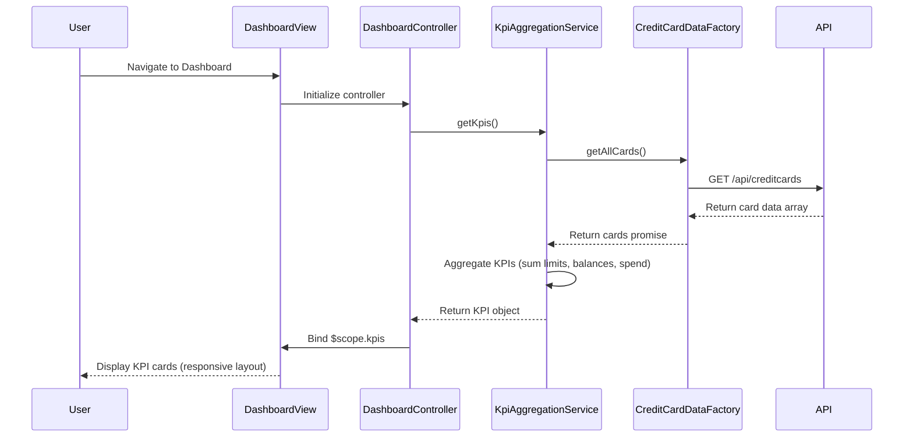

# Low-Level Design: Dashboard KPIs and Credit Card Overview
**Epic ID:** QE-10729

## a. Architecture Mapping

**HLD Component → AngularJS Artifact Mapping:**
- User Browser → AngularJS Module: `creditCardApp.dashboard`
- Dashboard UI Component → Controller: `DashboardController` + View: `dashboard.html`
- KPI Aggregation Service → Service: `KpiAggregationService`
- Credit Card Data Service → Factory: `CreditCardDataFactory`
- Data Repository → REST API integration via `$http` service

**Recommended Folder Structure:**
```
/app
  /modules
    /dashboard
      dashboard.module.js
      dashboard.controller.js
      dashboard.html
  /services
    kpi-aggregation.service.js
  /factories
    credit-card-data.factory.js
  /models
    kpi.model.js
  /styles
    dashboard.css
```

## b. Component Specifications

| Component Name | Artifact Type | Responsibility | Key Dependencies |
|----------------|---------------|----------------|------------------|
| creditCardApp.dashboard | Module | Root module for dashboard feature | angular, ngRoute, ngResource |
| DashboardController | Controller | Manages dashboard state, fetches KPIs, handles user interactions | KpiAggregationService, $scope |
| KpiAggregationService | Service | Aggregates KPI data from multiple cards, performs calculations | CreditCardDataFactory, $q |
| CreditCardDataFactory | Factory | Fetches credit card data from REST API, manages data caching | $http, $q |
| dashboard.html | View/Template | Renders KPI cards (monthly spend, credit limit, available credit, outstanding) with responsive layout | Bootstrap grid, ng-repeat, ng-if |
| KpiModel | Model/Plain Object | Defines structure for KPI data objects | None |

## c. Data Model

**KPI Model:**
```javascript
const KpiModel = {
  monthlySpend: Number,        // Total spend for current month
  totalCreditLimit: Number,    // Sum of all card limits
  availableCredit: Number,     // Total available credit across cards
  outstandingAmount: Number,   // Total outstanding balance
  lastUpdated: Date            // Timestamp of last data refresh
};
```

**CreditCard Model:**
```javascript
const CreditCardModel = {
  cardId: String,              // Unique card identifier
  cardNumber: String,          // Masked card number
  cardType: String,            // Visa, MasterCard, etc.
  creditLimit: Number,         // Card credit limit
  availableCredit: Number,     // Available credit on card
  outstandingBalance: Number,  // Current outstanding amount
  currentMonthSpend: Number    // Spend in current month
};
```

## d. Data Flow

User navigates to the dashboard view, triggering DashboardController initialization. The controller invokes KpiAggregationService.getKpis(), which calls CreditCardDataFactory.getAllCards() to fetch credit card data via REST API ($http GET /api/creditcards). The factory returns a promise with card data; KpiAggregationService aggregates monthly spend, total credit limit, available credit, and outstanding amounts across all cards. Aggregated KPI data is bound to $scope.kpis in the controller, and the view (dashboard.html) renders KPI cards using Bootstrap responsive grid and AngularJS data binding (ng-bind), updating the UI instantly.

## e. Primary Sequence Diagram



## f. Implementation Notes

- Use AngularJS module pattern with dependency injection for all services and controllers
- Implement promise-based async handling with $q for chaining API calls and error propagation
- Cache credit card data in CreditCardDataFactory for 5 minutes to reduce API calls and improve performance
- Use Bootstrap grid system (col-xs, col-sm, col-md, col-lg) for responsive KPI card layout across devices
- Apply ES6 arrow functions and const/let for cleaner, block-scoped code in services

## g. Error Handling

HTTP interceptor-based error handling with user-friendly toast notifications for API failures and network errors.

## h. Security Notes

Requires token-based authentication via existing SSO; all API calls include Authorization header with JWT token.