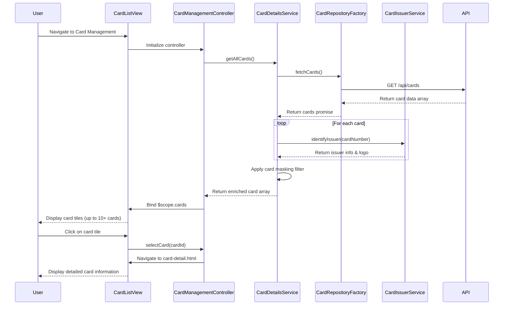

# Low-Level Design: Multiple Credit Card Management
**Epic ID:** QE-10730

## a. Architecture Mapping

**HLD Component → AngularJS Artifact Mapping:**
- User Interface → AngularJS Module: `creditCardApp.cardManagement`
- Card Management Module → Controller: `CardManagementController` + View: `card-list.html`, `card-detail.html`
- Card Details Service → Service: `CardDetailsService`
- Card Data Repository → Factory: `CardRepositoryFactory`
- Card Issuer Identification Service → Service: `CardIssuerService`

**Recommended Folder Structure:**
```
/app
  /modules
    /card-management
      card-management.module.js
      card-management.controller.js
      card-list.html
      card-detail.html
  /services
    card-details.service.js
    card-issuer.service.js
  /factories
    card-repository.factory.js
  /directives
    card-tile.directive.js
  /filters
    card-mask.filter.js
  /models
    card.model.js
  /styles
    card-management.css
```

## b. Component Specifications

| Component Name | Artifact Type | Responsibility | Key Dependencies |
|----------------|---------------|----------------|------------------|
| creditCardApp.cardManagement | Module | Root module for card management feature | angular, ngRoute |
| CardManagementController | Controller | Manages card list display, card selection, navigation between cards | CardDetailsService, $scope, $location |
| CardDetailsService | Service | Retrieves card details, coordinates with repository and issuer service | CardRepositoryFactory, CardIssuerService, $q |
| CardRepositoryFactory | Factory | Fetches card data from REST API, handles CRUD operations | $http, $q |
| CardIssuerService | Service | Identifies card issuer/brand from card number, returns logo/branding | None (rule-based logic) |
| cardTileDirective | Directive | Reusable card tile component for displaying individual card summary | None |
| cardMaskFilter | Filter | Masks card number to show only last 4 digits | None |
| CardModel | Model/Plain Object | Defines structure for credit card data | None |

## c. Data Model

**Card Model:**
```javascript
const CardModel = {
  cardId: String,              // Unique card identifier
  cardNumber: String,          // Full card number (16 digits)
  maskedCardNumber: String,    // Masked format: **** **** **** 1234
  cardHolderName: String,      // Name on card
  cardType: String,            // Visa, MasterCard, Amex, Discover
  issuerName: String,          // Bank/issuer name
  creditLimit: Number,         // Maximum credit limit
  availableCredit: Number,     // Currently available credit
  outstandingBalance: Number,  // Current balance owed
  expiryDate: String,          // MM/YY format
  status: String,              // Active, Inactive, Blocked
  issuerLogo: String           // URL to issuer logo image
};
```

## d. Data Flow

User navigates to the card management view, triggering CardManagementController initialization. The controller calls CardDetailsService.getAllCards(), which invokes CardRepositoryFactory.fetchCards() to retrieve card data via REST API ($http GET /api/cards). For each card, CardIssuerService.identifyIssuer(cardNumber) determines the card brand and logo. The service returns an array of enriched card objects with masked card numbers (via cardMaskFilter) and issuer branding. The controller binds $scope.cards to the data, and card-list.html renders card tiles using the cardTileDirective with ng-repeat. When a user clicks a card tile, the controller navigates to card-detail.html, passing the selected cardId, and displays detailed card information with secure masking.

## e. Primary Sequence Diagram



## f. Implementation Notes

- Use AngularJS custom directive (cardTileDirective) with isolated scope for reusable card tile component
- Implement cardMaskFilter as a stateless AngularJS filter to mask card numbers consistently across views
- CardIssuerService uses BIN (Bank Identification Number) lookup logic to identify card type from first 6 digits
- Apply ng-cloak directive to prevent flash of unstyled content during card list rendering
- Use $location service for navigation between card list and card detail views with cardId as route parameter

## g. Error Handling

Try/catch blocks in service methods with $q.reject for promise-based error propagation; user notified via toast on API failures.

## h. Security Notes

Card numbers are masked client-side using cardMaskFilter; full card numbers never stored in browser storage; API enforces authorization checks per card access.