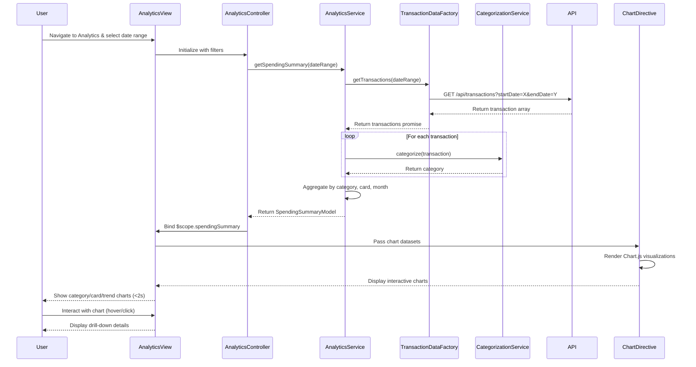

# Low-Level Design: Spending Analytics and Insights
**Epic ID:** QE-10731

## a. Architecture Mapping

**HLD Component → AngularJS Artifact Mapping:**
- User Dashboard → AngularJS Module: `creditCardApp.analytics`
- Analytics UI Module → Controller: `AnalyticsController` + View: `analytics.html`
- Visualization Engine → Directive: `chartDirective` (wraps Chart.js)
- Analytics Service → Service: `AnalyticsService`
- Transaction Data Service → Factory: `TransactionDataFactory`
- Categorization Engine → Service: `CategorizationService`
- Transaction Database → REST API integration via `$http`

**Recommended Folder Structure:**
```
/app
  /modules
    /analytics
      analytics.module.js
      analytics.controller.js
      analytics.html
  /services
    analytics.service.js
    categorization.service.js
  /factories
    transaction-data.factory.js
  /directives
    chart.directive.js
  /models
    transaction.model.js
    spending-summary.model.js
  /styles
    analytics.css
```

## b. Component Specifications

| Component Name | Artifact Type | Responsibility | Key Dependencies |
|----------------|---------------|----------------|------------------|
| creditCardApp.analytics | Module | Root module for analytics feature | angular, ngRoute, chart.js |
| AnalyticsController | Controller | Manages analytics view state, filters, chart data binding | AnalyticsService, $scope, $filter |
| AnalyticsService | Service | Aggregates spending data by category/card/time, prepares chart datasets | TransactionDataFactory, CategorizationService, $q |
| TransactionDataFactory | Factory | Fetches transaction history from REST API with date range filters | $http, $q |
| CategorizationService | Service | Maps transactions to 9 predefined categories using rule-based logic | None |
| chartDirective | Directive | Wraps Chart.js library for rendering interactive bar/pie/line charts | Chart.js library |
| TransactionModel | Model/Plain Object | Defines structure for transaction data | None |
| SpendingSummaryModel | Model/Plain Object | Defines structure for aggregated spending data | None |

## c. Data Model

**Transaction Model:**
```javascript
const TransactionModel = {
  transactionId: String,       // Unique transaction ID
  cardId: String,              // Associated card ID
  amount: Number,              // Transaction amount
  merchantName: String,        // Merchant/vendor name
  category: String,            // One of 9 predefined categories
  transactionDate: Date,       // Date of transaction
  description: String          // Transaction description
};
```

**SpendingSummary Model:**
```javascript
const SpendingSummaryModel = {
  categoryBreakdown: Object,   // { "Food & Dining": 1200, "Fuel": 300, ... }
  cardWiseSpend: Object,       // { "card-001": 2500, "card-002": 1800, ... }
  monthlyTrend: Array,         // [{ month: "Jan", spend: 3000 }, { month: "Feb", spend: 3500 }, ...]
  totalSpend: Number,          // Total spend for selected period
  dateRange: Object            // { startDate: Date, endDate: Date }
};
```

**Predefined Categories:**
```javascript
const CATEGORIES = [
  "Food & Dining", "Fuel", "Shopping", "Travel", 
  "Entertainment", "Utilities", "Healthcare", "Education", "Miscellaneous"
];
```

## d. Data Flow

User navigates to the analytics view and optionally selects date range filters, triggering AnalyticsController initialization. The controller calls AnalyticsService.getSpendingSummary(dateRange), which invokes TransactionDataFactory.getTransactions(dateRange) to fetch transaction history via REST API ($http GET /api/transactions?startDate=X&endDate=Y). The factory returns transaction data; AnalyticsService passes each transaction through CategorizationService.categorize(transaction) to assign one of nine predefined categories. AnalyticsService then aggregates spending by category, by card, and by month, producing a SpendingSummaryModel object. The controller binds this data to $scope.spendingSummary and passes category/card datasets to chartDirective instances. The directive renders interactive Chart.js visualizations (pie chart for categories, bar chart for card-wise spend, line chart for monthly trends) within 2 seconds, and the user can interact with charts for drill-down insights.

## e. Primary Sequence Diagram



## f. Implementation Notes

- Use AngularJS custom directive (chartDirective) to encapsulate Chart.js initialization and data binding with two-way scope binding
- CategorizationService implements rule-based keyword matching (e.g., "restaurant", "cafe" → "Food & Dining") for transaction categorization
- Apply AngularJS $filter service for date range filtering and currency formatting in views
- Implement lazy loading of Chart.js library using script injection to reduce initial page load time
- Use $q.all to parallelize multiple API calls if fetching transactions for multiple cards simultaneously

## g. Error Handling

HTTP interceptor captures API errors; try/catch in aggregation logic with fallback to empty datasets; user notified via inline error messages in chart containers.

## h. Security Notes

Standard input validation and secure API calls assumed; transaction data filtered server-side by authenticated user context to prevent unauthorized access.