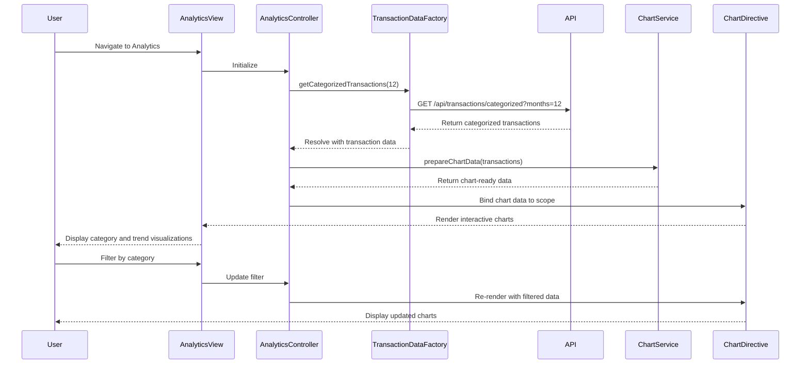

# Low-Level Design: QE-10732 - Spending Analytics and Category Insights

## a. Architecture Mapping

- **Analytics UI** → AngularJS Module (`creditCard.analytics`) with Controller (`AnalyticsController`) and Directives for chart rendering
- **Visualization Service** → AngularJS Service (`ChartService`) for data transformation and chart configuration
- **Transaction Data Service** → AngularJS Factory (`TransactionDataFactory`) for API calls to fetch transaction data
- **Categorization Engine** → Backend REST API endpoint (`/api/transactions/categorized`) consumed by `TransactionDataFactory`
- **Transaction Repository** → Backend data store accessed via REST API

**Recommended Folder Structure:**
```
app/
├── modules/
│   └── analytics/
│       ├── analytics.module.js
│       ├── controllers/
│       │   └── analytics.controller.js
│       ├── services/
│       │   ├── chart.service.js
│       │   └── transaction-data.factory.js
│       ├── directives/
│       │   └── spending-chart.directive.js
│       └── views/
│           └── analytics.html
```

## b. Component Specifications

| Name | Artifact Type | Responsibility | Key Dependencies |
|------|---------------|----------------|------------------|
| `creditCard.analytics` | Module | Root module for analytics feature | `ngRoute`, `chart.js` (or similar charting library) |
| `AnalyticsController` | Controller | Manages analytics view state, fetches data, handles user interactions | `ChartService`, `TransactionDataFactory`, `$scope` |
| `ChartService` | Service | Transforms transaction data into chart-ready format, configures chart options | None |
| `TransactionDataFactory` | Factory | Fetches categorized transaction data from REST API, caches results | `$http`, `$q` |
| `spendingChartDirective` | Directive | Renders interactive charts for category-wise and monthly spend visualization | `ChartService`, Chart.js library |

## c. Data Model

**Transaction Model:**
```javascript
{
  transactionId: String,
  cardId: String,
  amount: Number,
  category: String, // 'Food & Dining', 'Fuel', 'Shopping', 'Travel', 'Entertainment', 'Utilities', 'Healthcare', 'Education', 'Miscellaneous'
  transactionDate: Date,
  description: String
}
```

**Category Spend Model:**
```javascript
{
  category: String,
  totalSpend: Number,
  transactionCount: Number,
  percentage: Number
}
```

**Monthly Trend Model:**
```javascript
{
  month: String, // 'YYYY-MM'
  totalSpend: Number,
  categoryBreakdown: Array<CategorySpend>
}
```

## d. Data Flow

User navigates to Analytics view → `AnalyticsController` initializes and calls `TransactionDataFactory.getCategorizedTransactions()` → Factory makes GET request to `/api/transactions/categorized?months=12` → Backend Categorization Engine processes and returns categorized transaction data → Factory resolves promise with data → Controller passes data to `ChartService.prepareChartData()` → Service transforms data into chart-compatible format → Controller binds chart data to `$scope` → `spendingChartDirective` renders interactive charts using Chart.js → User interacts with charts (filter, drill-down) → Controller updates chart data and re-renders visualization.

## e. Primary Sequence Diagram



## f. Implementation Notes

- Use AngularJS 1.x with ES6 modules and classes for controller and service definitions
- Implement dependency injection via `$inject` annotation to ensure minification safety
- Leverage `$http` interceptors for centralized API error handling and loading state management
- Integrate Chart.js or D3.js via custom AngularJS directive for interactive, responsive visualizations
- Cache transaction data in `TransactionDataFactory` using `$cacheFactory` to minimize redundant API calls during filter/drill-down operations

## g. Error Handling

Interceptor-based error handling with `$http` interceptor; API failures display user-friendly notifications via toast/modal service.

## h. Security Notes

Standard input validation and secure API calls assumed; token-based authentication via existing SSO for API access.