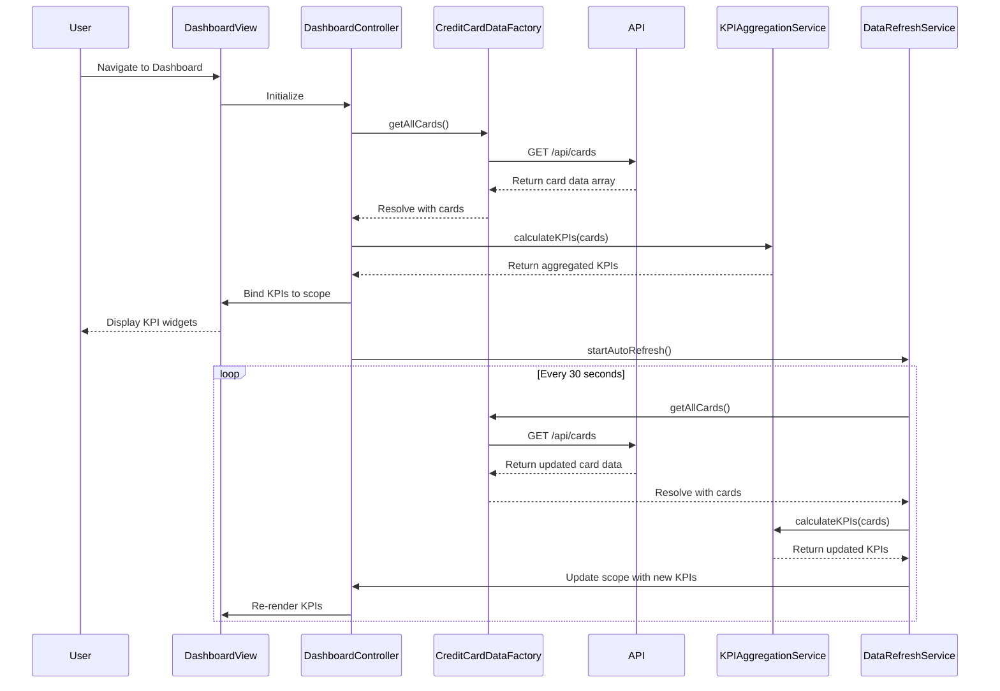

# Low-Level Design: QE-10733 - Credit Card Dashboard and KPI Management

## a. Architecture Mapping

- **User Dashboard UI** → AngularJS Module (`creditCard.dashboard`) with Controller (`DashboardController`) and View (`dashboard.html`)
- **KPI Aggregation Service** → AngularJS Service (`KPIAggregationService`) for computing KPIs from raw card data
- **Credit Card Data Source** → AngularJS Factory (`CreditCardDataFactory`) for REST API calls to fetch card data
- **Real-time Data Refresh Service** → AngularJS Service (`DataRefreshService`) using `$interval` for periodic polling

**Recommended Folder Structure:**
```
app/
├── modules/
│   └── dashboard/
│       ├── dashboard.module.js
│       ├── controllers/
│       │   └── dashboard.controller.js
│       ├── services/
│       │   ├── kpi-aggregation.service.js
│       │   ├── credit-card-data.factory.js
│       │   └── data-refresh.service.js
│       └── views/
│           └── dashboard.html
```

## b. Component Specifications

| Name | Artifact Type | Responsibility | Key Dependencies |
|------|---------------|----------------|------------------|
| `creditCard.dashboard` | Module | Root module for dashboard feature | `ngRoute`, `creditCard.common` |
| `DashboardController` | Controller | Manages dashboard state, orchestrates KPI display and refresh | `KPIAggregationService`, `CreditCardDataFactory`, `DataRefreshService`, `$scope` |
| `KPIAggregationService` | Service | Computes monthly spend, total credit limit, available credit, outstanding amount from card data | None |
| `CreditCardDataFactory` | Factory | Fetches credit card data (balances, limits, transactions) from REST API | `$http`, `$q` |
| `DataRefreshService` | Service | Manages periodic data refresh using `$interval` for real-time KPI updates | `$interval`, `CreditCardDataFactory`, `KPIAggregationService` |

## c. Data Model

**Credit Card Model:**
```javascript
{
  cardId: String,
  cardType: String, // 'Visa', 'MasterCard', etc.
  cardNumber: String, // Masked, e.g., '**** **** **** 1234'
  creditLimit: Number,
  availableBalance: Number,
  outstandingAmount: Number,
  currentMonthSpend: Number
}
```

**KPI Model:**
```javascript
{
  monthlySpend: Number,
  totalCreditLimit: Number,
  availableCredit: Number,
  outstandingAmount: Number
}
```

## d. Data Flow

User navigates to Dashboard → `DashboardController` initializes and calls `CreditCardDataFactory.getAllCards()` → Factory makes GET request to `/api/cards` → API returns array of credit card objects → Factory resolves promise → Controller passes card data to `KPIAggregationService.calculateKPIs(cards)` → Service computes aggregated KPIs (sum of monthly spend, total limits, available credit, outstanding amounts) → Controller binds KPI data to `$scope` → View renders KPI widgets → `DataRefreshService` triggers periodic refresh via `$interval` → Updated data flows through same pipeline → UI updates KPIs without full page reload.

## e. Primary Sequence Diagram



## f. Implementation Notes

- Use AngularJS 1.x with ES6 arrow functions and template literals for cleaner code
- Implement dependency injection via `$inject` array notation for minification compatibility
- Use `$http` service for REST API calls with promise-based error handling
- Leverage Bootstrap grid system and CSS3 media queries for responsive dashboard layout across devices
- Implement `DataRefreshService` with configurable refresh interval (default 30 seconds) using `$interval`; ensure proper cleanup on scope destroy to prevent memory leaks

## g. Error Handling

Interceptor-based error handling with try/catch in controller methods; API failures trigger user notification via toast service.

## h. Security Notes

Requires token-based auth via existing SSO; card numbers masked at API level before transmission to client.