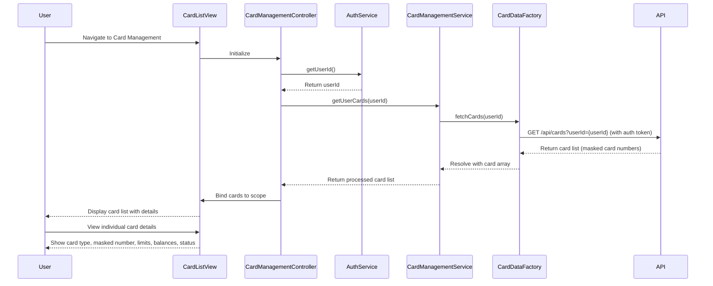

# Low-Level Design: QE-10734 - Multiple Credit Card Management

## a. Architecture Mapping

- **User Interface** → AngularJS Module (`creditCard.management`) with Controller (`CardManagementController`) and View (`card-list.html`)
- **Authentication Service** → AngularJS Service (`AuthService`) for user session and token management
- **Card Management Service** → AngularJS Service (`CardManagementService`) for business logic and card operations
- **Credit Card Data Repository** → Backend REST API (`/api/cards`) consumed via AngularJS Factory (`CardDataFactory`)

**Recommended Folder Structure:**
```
app/
├── modules/
│   └── card-management/
│       ├── card-management.module.js
│       ├── controllers/
│       │   └── card-management.controller.js
│       ├── services/
│       │   ├── auth.service.js
│       │   ├── card-management.service.js
│       │   └── card-data.factory.js
│       └── views/
│           └── card-list.html
```

## b. Component Specifications

| Name | Artifact Type | Responsibility | Key Dependencies |
|------|---------------|----------------|------------------|
| `creditCard.management` | Module | Root module for card management feature | `ngRoute`, `creditCard.common` |
| `CardManagementController` | Controller | Manages card list view, handles user interactions, displays card details | `CardManagementService`, `AuthService`, `$scope` |
| `AuthService` | Service | Manages user authentication state, retrieves user ID and auth token | `$window`, `$http` |
| `CardManagementService` | Service | Orchestrates card data retrieval, applies business logic (e.g., sorting, filtering) | `CardDataFactory` |
| `CardDataFactory` | Factory | Fetches card details from REST API, handles API communication | `$http`, `$q`, `AuthService` |

## c. Data Model

**Credit Card Model:**
```javascript
{
  cardId: String,
  userId: String,
  cardType: String, // 'Visa', 'MasterCard', 'Amex', etc.
  cardNumber: String, // Masked format: '**** **** **** 1234'
  cardLabel: String, // User-defined label, e.g., 'Personal Card'
  creditLimit: Number,
  availableBalance: Number,
  outstandingAmount: Number,
  status: String, // 'Active', 'Blocked', 'Expired'
  expiryDate: String // 'MM/YY'
}
```

**Card List Response Model:**
```javascript
{
  userId: String,
  cards: Array<CreditCard>,
  totalCards: Number
}
```

## d. Data Flow

User navigates to Card Management view → `CardManagementController` initializes and calls `AuthService.getUserId()` to retrieve authenticated user ID → Controller calls `CardManagementService.getUserCards(userId)` → Service delegates to `CardDataFactory.fetchCards(userId)` → Factory makes GET request to `/api/cards?userId={userId}` with auth token in header → API returns card list with masked card numbers → Factory resolves promise with card array → Service applies any sorting/filtering logic → Controller binds card data to `$scope.cards` → View renders card list with card details (type, masked number, limits, balances, status) → User views consolidated portfolio.

## e. Primary Sequence Diagram



## f. Implementation Notes

- Use AngularJS 1.x with ES6 classes for services and controllers; transpile with Babel if needed
- Implement dependency injection using `$inject` annotation for production minification safety
- Use `$http` interceptor to automatically attach auth token to all API requests
- Leverage Bootstrap card components and CSS3 flexbox for responsive card grid layout
- Implement card masking validation in `CardDataFactory` to ensure only last 4 digits are visible; reject any API response that exposes full card numbers

## g. Error Handling

Interceptor-based error handling; API failures caught via `$http` interceptor and displayed to user via modal notification service.

## h. Security Notes

Requires token-based auth via existing SSO; card numbers masked server-side (last 4 digits only) before API response; client validates masking format.