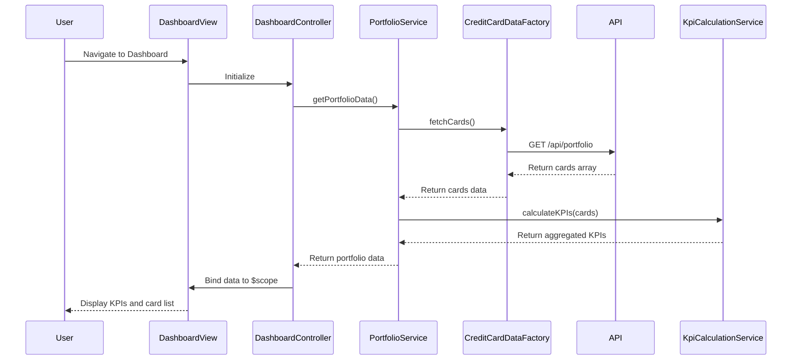

# Low-Level Design: Credit Card Portfolio Management and KPI Dashboard
**Epic ID:** QE-10735  
**Epic Label:** PERFTEST20261112133744

---

## a. Architecture Mapping

**HLD Component → AngularJS Artifact Mapping:**

- **User Interface - Dashboard** → Module: `creditCard.dashboard`, Controller: `DashboardController`, View: `dashboard.html`
- **API Gateway** → Service: `ApiGatewayService` (HTTP interceptor-based)
- **Portfolio Service** → Service: `PortfolioService` (business logic for portfolio aggregation)
- **Credit Card Data Source** → Factory: `CreditCardDataFactory` (REST API wrapper)
- **KPI Calculation Engine** → Service: `KpiCalculationService` (client-side KPI computation)

**Recommended Folder Structure:**
```
app/
├── modules/
│   └── dashboard/
│       ├── dashboard.module.js
│       ├── dashboard.controller.js
│       ├── dashboard.html
│       └── dashboard.css
├── services/
│   ├── portfolio.service.js
│   ├── kpi-calculation.service.js
│   └── api-gateway.service.js
├── factories/
│   └── credit-card-data.factory.js
└── assets/
    └── css/bootstrap.min.css
```

---

## b. Component Specifications

| Component Name | Artifact Type | Responsibility | Key Dependencies |
|---|---|---|---|
| `creditCard.dashboard` | Module | Root module for dashboard feature, declares all dashboard components | `ngRoute`, `ngResource` |
| `DashboardController` | Controller | Manages dashboard view state, binds KPI data to UI, handles user interactions | `PortfolioService`, `KpiCalculationService`, `$scope` |
| `PortfolioService` | Service | Fetches aggregated credit card portfolio data from backend API | `CreditCardDataFactory`, `$q` |
| `KpiCalculationService` | Service | Computes monthly spend, total credit limit, available credit, outstanding amount | None (pure calculation logic) |
| `CreditCardDataFactory` | Factory | Wraps REST API calls for credit card data retrieval | `$resource` or `$http` |
| `ApiGatewayService` | Service | HTTP interceptor for request/response handling, error management, token injection | `$httpProvider` |

---

## c. Data Model

**CreditCard Model:**
```javascript
{
  cardId: String,
  cardNumber: String (masked),
  cardType: String, // e.g., "Visa", "MasterCard"
  cardHolderName: String,
  creditLimit: Number,
  availableCredit: Number,
  outstandingAmount: Number,
  monthlySpend: Number,
  expiryDate: String // format: "MM/YY"
}
```

**PortfolioDashboard Model:**
```javascript
{
  totalCreditLimit: Number,
  totalAvailableCredit: Number,
  totalOutstandingAmount: Number,
  totalMonthlySpend: Number,
  cards: Array<CreditCard>
}
```

---

## d. Data Flow

User navigates to the dashboard → `DashboardController` initializes and calls `PortfolioService.getPortfolioData()` → `PortfolioService` invokes `CreditCardDataFactory.fetchCards()` which makes a REST API call (GET /api/portfolio) → API returns array of credit card objects → `PortfolioService` passes data to `KpiCalculationService` for aggregation (total credit limit, available credit, outstanding, monthly spend) → Calculated KPIs and card list are bound to `$scope` → View (`dashboard.html`) renders KPI tiles and card list using AngularJS data binding and Bootstrap grid for responsive layout → User sees real-time portfolio overview.

---

## e. Primary Sequence Diagram



---

## f. Implementation Notes

- Use AngularJS 1.x module pattern with dependency injection for all services, controllers, and factories.
- Implement `$resource` or `$http` for REST API integration with promise-based async handling.
- Apply Bootstrap grid system (col-md-*, col-sm-*, col-xs-*) for responsive KPI tiles and card layout.
- Use ES6 arrow functions, const/let, and template literals where applicable for cleaner code.
- Leverage AngularJS two-way data binding (`ng-model`, `ng-repeat`) for dynamic UI updates without manual DOM manipulation.

---

## g. Error Handling

HTTP interceptor in `ApiGatewayService` catches API errors, logs them, and displays user-friendly notifications via AngularJS toast or alert service.

---

## h. Security Notes

Requires token-based authentication via existing SSO; API calls include Authorization header with JWT token.

---

**End of LLD Document**