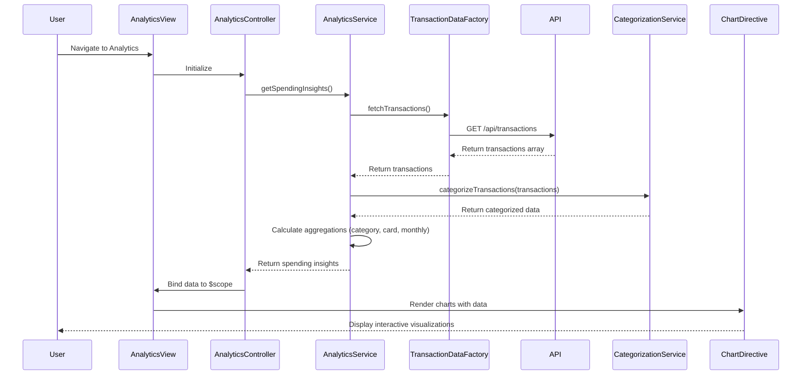

# Low-Level Design: Spending Analytics and Insights
**Epic ID:** QE-10736  
**Epic Label:** PERFTEST20261112133744

---

## a. Architecture Mapping

**HLD Component → AngularJS Artifact Mapping:**

- **User Interface - Analytics Dashboard** → Module: `creditCard.analytics`, Controller: `AnalyticsController`, View: `analytics.html`
- **API Gateway** → Service: `ApiGatewayService` (shared HTTP interceptor)
- **Analytics Service** → Service: `AnalyticsService` (orchestrates data aggregation and trend calculation)
- **Transaction Data Service** → Factory: `TransactionDataFactory` (REST API wrapper for transaction data)
- **Categorization Engine** → Service: `CategorizationService` (maps transactions to 9 predefined categories)
- **Visualization Renderer** → Directive: `spendingChart` (encapsulates chart rendering logic using Chart.js or D3.js)

**Recommended Folder Structure:**
```
app/
├── modules/
│   └── analytics/
│       ├── analytics.module.js
│       ├── analytics.controller.js
│       ├── analytics.html
│       └── analytics.css
├── services/
│   ├── analytics.service.js
│   ├── categorization.service.js
│   └── api-gateway.service.js
├── factories/
│   └── transaction-data.factory.js
├── directives/
│   └── spending-chart.directive.js
└── assets/
    └── libs/chart.min.js
```

---

## b. Component Specifications

| Component Name | Artifact Type | Responsibility | Key Dependencies |
|---|---|---|---|
| `creditCard.analytics` | Module | Root module for analytics feature, declares analytics components | `ngRoute`, `ngResource`, `chart.js` |
| `AnalyticsController` | Controller | Manages analytics view state, fetches spending data, triggers chart rendering | `AnalyticsService`, `$scope` |
| `AnalyticsService` | Service | Aggregates transaction data, calculates category-wise and card-wise spending, monthly trends | `TransactionDataFactory`, `CategorizationService`, `$q` |
| `CategorizationService` | Service | Categorizes transactions into 9 predefined categories (Food, Fuel, Shopping, Travel, Entertainment, Utilities, Healthcare, Education, Miscellaneous) | None (rule-based logic) |
| `TransactionDataFactory` | Factory | Fetches transaction data from REST API | `$resource` or `$http` |
| `spendingChart` | Directive | Renders interactive charts (bar, pie, line) for category-wise and monthly spend visualization | Chart.js or D3.js library |
| `ApiGatewayService` | Service | Shared HTTP interceptor for API request/response handling | `$httpProvider` |

---

## c. Data Model

**Transaction Model:**
```javascript
{
  transactionId: String,
  cardId: String,
  merchantName: String,
  amount: Number,
  transactionDate: String, // ISO 8601 format
  category: String, // One of 9 predefined categories
  description: String
}
```

**CategorySpend Model:**
```javascript
{
  category: String, // e.g., "Food & Dining"
  totalSpend: Number,
  transactionCount: Number
}
```

**MonthlyTrend Model:**
```javascript
{
  month: String, // e.g., "2026-11"
  totalSpend: Number,
  categoryBreakdown: Array<CategorySpend>
}
```

**CardWiseSpend Model:**
```javascript
{
  cardId: String,
  cardType: String,
  totalSpend: Number,
  categoryBreakdown: Array<CategorySpend>
}
```

---

## d. Data Flow

User navigates to analytics dashboard → `AnalyticsController` initializes and calls `AnalyticsService.getSpendingInsights()` → `AnalyticsService` invokes `TransactionDataFactory.fetchTransactions()` which makes REST API call (GET /api/transactions) → API returns transaction array → `CategorizationService` processes transactions and groups by category, card, and month → `AnalyticsService` calculates aggregated spending data (category-wise, card-wise, monthly trends) → Data is bound to `$scope` → View renders interactive charts using `spendingChart` directive with Chart.js → User interacts with charts (hover, click) to explore spending patterns.

---

## e. Primary Sequence Diagram



---

## f. Implementation Notes

- Use AngularJS custom directive (`spendingChart`) with isolated scope to encapsulate Chart.js rendering logic for reusability.
- Implement `CategorizationService` with rule-based mapping (merchant name patterns or transaction metadata) to assign categories.
- Use `$q.all()` for parallel API calls if fetching transactions and card data separately for performance optimization.
- Apply responsive chart options in Chart.js (maintainAspectRatio, responsive: true) to adapt to different screen sizes.
- Leverage AngularJS filters for date formatting and currency display in chart tooltips and legends.

---

## g. Error Handling

HTTP interceptor catches API failures; fallback displays "No data available" message with retry option in analytics view.

---

## h. Security Notes

Standard input validation and secure API calls assumed; transaction data access restricted by user authentication token.

---

**End of LLD Document**