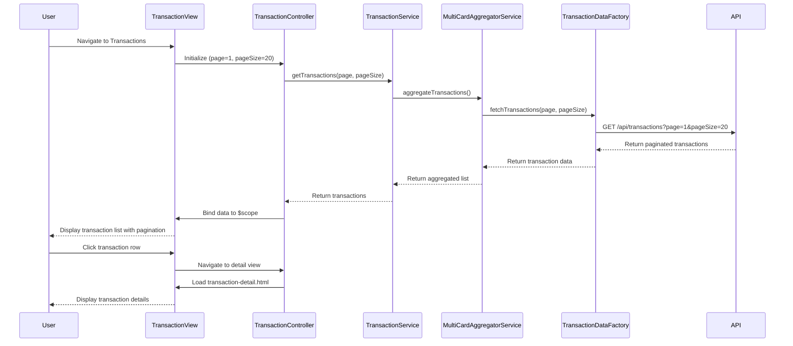

# Low-Level Design: Transaction Management and Viewing
**Epic ID:** QE-10737  
**Epic Label:** PERFTEST20261112133744

---

## a. Architecture Mapping

**HLD Component → AngularJS Artifact Mapping:**

- **User Interface - Transaction View** → Module: `creditCard.transactions`, Controller: `TransactionController`, View: `transactions.html`
- **API Gateway** → Service: `ApiGatewayService` (shared HTTP interceptor)
- **Transaction Service** → Service: `TransactionService` (orchestrates transaction fetching and filtering)
- **Transaction Data Repository** → Factory: `TransactionDataFactory` (REST API wrapper for transaction CRUD)
- **Multi-Card Aggregator** → Service: `MultiCardAggregatorService` (aggregates transactions from multiple cards)

**Recommended Folder Structure:**
```
app/
├── modules/
│   └── transactions/
│       ├── transactions.module.js
│       ├── transaction.controller.js
│       ├── transactions.html
│       ├── transaction-detail.html
│       └── transactions.css
├── services/
│   ├── transaction.service.js
│   ├── multi-card-aggregator.service.js
│   └── api-gateway.service.js
├── factories/
│   └── transaction-data.factory.js
└── filters/
    └── transaction-filter.js
```

---

## b. Component Specifications

| Component Name | Artifact Type | Responsibility | Key Dependencies |
|---|---|---|---|
| `creditCard.transactions` | Module | Root module for transaction management feature | `ngRoute`, `ngResource`, `ui.bootstrap` (for pagination) |
| `TransactionController` | Controller | Manages transaction list view, handles pagination, filtering, and detail navigation | `TransactionService`, `$scope`, `$routeParams` |
| `TransactionService` | Service | Fetches transaction data, applies filters, manages pagination state | `MultiCardAggregatorService`, `TransactionDataFactory`, `$q` |
| `MultiCardAggregatorService` | Service | Aggregates transactions from multiple credit cards into unified list | `TransactionDataFactory` |
| `TransactionDataFactory` | Factory | Wraps REST API calls for transaction retrieval (supports pagination, filtering) | `$resource` or `$http` |
| `ApiGatewayService` | Service | Shared HTTP interceptor for request/response handling | `$httpProvider` |
| `transactionFilter` | Filter | Custom AngularJS filter for client-side transaction filtering by date, amount, merchant | None |

---

## c. Data Model

**Transaction Model:**
```javascript
{
  transactionId: String,
  cardId: String,
  cardType: String, // e.g., "Visa", "MasterCard"
  merchantName: String,
  amount: Number,
  transactionDate: String, // ISO 8601 format
  category: String,
  status: String, // e.g., "Posted", "Pending"
  description: String
}
```

**TransactionListResponse Model:**
```javascript
{
  transactions: Array<Transaction>,
  totalCount: Number,
  page: Number,
  pageSize: Number
}
```

---

## d. Data Flow

User navigates to transaction view → `TransactionController` initializes and calls `TransactionService.getTransactions(page, pageSize)` → `TransactionService` invokes `MultiCardAggregatorService.aggregateTransactions()` → `MultiCardAggregatorService` calls `TransactionDataFactory.fetchTransactions()` for each card (or single API call with multi-card support) → REST API (GET /api/transactions?page=1&pageSize=20) returns paginated transaction data → Aggregated transaction list is returned to `TransactionController` → Data is bound to `$scope.transactions` → View (`transactions.html`) renders transaction list using `ng-repeat` with Bootstrap table and pagination controls → User clicks on transaction row → Controller navigates to detail view (`transaction-detail.html`) with transaction ID → Detail view displays full transaction information.

---

## e. Primary Sequence Diagram



---

## f. Implementation Notes

- Use AngularJS `$resource` with pagination parameters (page, pageSize) for efficient transaction data fetching.
- Implement infinite scroll or pagination using `ui.bootstrap.pagination` directive for large transaction datasets.
- Apply `ng-repeat` with `track by transactionId` for optimized list rendering and smooth scrolling.
- Use AngularJS routing (`$routeProvider`) to navigate between transaction list and detail views.
- Leverage Bootstrap responsive table classes (table-responsive) for mobile-friendly transaction display.

---

## g. Error Handling

HTTP interceptor in `ApiGatewayService` catches API errors and displays user-friendly error messages with retry option.

---

## h. Security Notes

Requires token-based auth via existing SSO; transaction data access restricted by user session and card ownership validation.

---

**End of LLD Document**