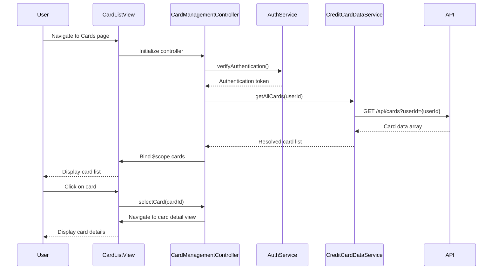

# Low-Level Design: QE-10738 - Multiple Credit Card Management

## a. Architecture Mapping

**HLD to AngularJS Artifact Mapping:**
- User Interface Card List → AngularJS View (HTML template with ng-repeat for card list)
- Card Management Controller → AngularJS Controller (cardManagementController)
- User Authentication Service → AngularJS Service/Factory (authService)
- Credit Card Data Service → AngularJS Service/Factory (creditCardDataService)
- Card Detail View → AngularJS View (HTML template with card detail display)

**Recommended Folder Structure:**
```
app/
├── modules/
│   └── cards/
│       ├── cards.module.js
│       ├── controllers/
│       │   └── cardManagementController.js
│       ├── services/
│       │   ├── creditCardDataService.js
│       │   └── authService.js
│       └── views/
│           ├── card-list.html
│           └── card-detail.html
├── shared/
│   └── directives/
│       └── cardTile.directive.js
└── assets/
    └── css/
        └── cards.css
```

## b. Component Specifications

| Component Name | Artifact Type | Responsibility | Key Dependencies |
|----------------|---------------|----------------|------------------|
| cardsModule | AngularJS Module | Root module for credit card management features | angular, ui.router |
| cardManagementController | Controller | Orchestrates card list/detail views, fetches card data, handles user interactions | creditCardDataService, authService, $scope |
| creditCardDataService | Factory | Retrieves and manages credit card data via REST API calls | $http, $q |
| authService | Service | Manages user authentication state and associates cards with user accounts | $http, $window |
| cardTileDirective | Directive | Reusable card display component for list view | None |
| cardListView | HTML Template | Displays list of all user credit cards with summary info | cardManagementController |
| cardDetailView | HTML Template | Displays detailed information for a selected credit card | cardManagementController |

## c. Data Model

**CreditCard Object:**
```javascript
{
  cardId: String,
  cardNumber: String (masked),
  cardHolderName: String,
  bankName: String,
  cardType: String,
  creditLimit: Number,
  availableCredit: Number,
  outstandingBalance: Number,
  monthlySpend: Number,
  expiryDate: String,
  isActive: Boolean
}
```

**User Object:**
```javascript
{
  userId: String,
  userName: String,
  email: String,
  cards: Array<CreditCard>
}
```

## d. Data Flow

User navigates to the card management page → cardListView loads and invokes cardManagementController → Controller calls authService to verify user authentication → Upon successful auth, controller invokes creditCardDataService.getAllCards() → Service makes REST API call (GET /api/cards) → API returns card data array → Service resolves promise with card data → Controller binds data to $scope.cards → View renders card list using ng-repeat and cardTile directive → User clicks on a card → Controller navigates to cardDetailView with selected card data → Detail view displays card-specific metrics.

## e. Primary Sequence Diagram



## f. Implementation Notes

- Use AngularJS 1.x module pattern with dependency injection for all controllers and services
- Implement ES6 classes for service definitions wrapped in angular.module().factory()
- Use $http service with promise-based API calls; handle responses with .then() and .catch()
- Apply ui-router for state management between card list and detail views
- Use Bootstrap grid system and card components for responsive card tile layout

## g. Error Handling

HTTP interceptor-based error handling with user-friendly toast notifications for API failures and authentication errors.

## h. Security Notes

Requires token-based authentication via existing SSO; card numbers displayed in masked format only.