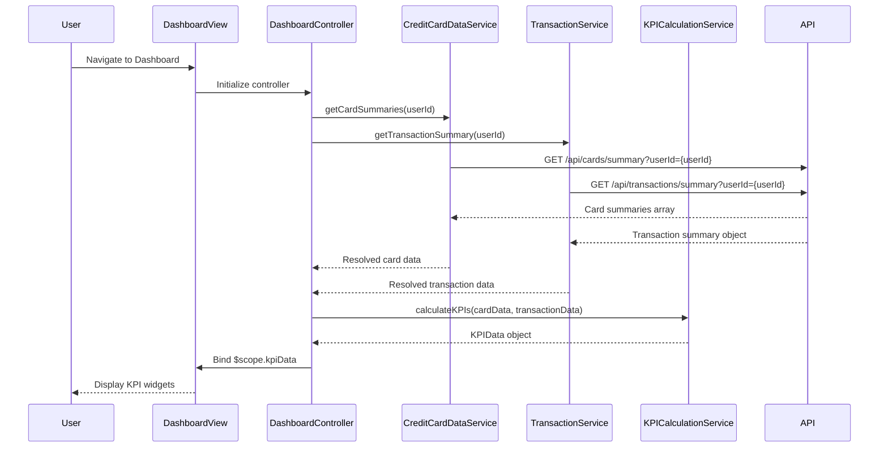

# Low-Level Design: QE-10739 - Dashboard KPIs and Financial Overview

## a. Architecture Mapping

**HLD to AngularJS Artifact Mapping:**
- User Interface Dashboard → AngularJS View (HTML template with KPI widgets)
- Dashboard Controller → AngularJS Controller (dashboardController)
- Credit Card Data Service → AngularJS Service/Factory (creditCardDataService)
- Transaction Service → AngularJS Service/Factory (transactionService)
- KPI Calculation Engine → AngularJS Service/Factory (kpiCalculationService)

**Recommended Folder Structure:**
```
app/
├── modules/
│   └── dashboard/
│       ├── dashboard.module.js
│       ├── controllers/
│       │   └── dashboardController.js
│       ├── services/
│       │   ├── creditCardDataService.js
│       │   ├── transactionService.js
│       │   └── kpiCalculationService.js
│       └── views/
│           └── dashboard.html
├── shared/
│   └── directives/
│       └── kpiWidget.directive.js
└── assets/
    └── css/
        └── dashboard.css
```

## b. Component Specifications

| Component Name | Artifact Type | Responsibility | Key Dependencies |
|----------------|---------------|----------------|------------------|
| dashboardModule | AngularJS Module | Root module for dashboard features | angular, ui.router |
| dashboardController | Controller | Orchestrates KPI data retrieval, aggregation, and display | creditCardDataService, transactionService, kpiCalculationService, $scope |
| creditCardDataService | Factory | Retrieves credit card balances and limits via REST API | $http, $q |
| transactionService | Factory | Retrieves transaction data for monthly spend and outstanding calculations | $http, $q |
| kpiCalculationService | Service | Aggregates multi-card data and computes KPIs (monthly spend, credit limit, available credit, outstanding) | None |
| kpiWidgetDirective | Directive | Reusable KPI display component with icon, label, and value | None |
| dashboardView | HTML Template | Displays KPI widgets in responsive grid layout | dashboardController |

## c. Data Model

**KPIData Object:**
```javascript
{
  monthlySpend: Number,
  totalCreditLimit: Number,
  availableCredit: Number,
  outstandingAmount: Number,
  lastUpdated: Date
}
```

**CardSummary Object:**
```javascript
{
  cardId: String,
  creditLimit: Number,
  availableCredit: Number,
  currentBalance: Number
}
```

**TransactionSummary Object:**
```javascript
{
  userId: String,
  monthlySpend: Number,
  totalOutstanding: Number,
  transactionCount: Number
}
```

## d. Data Flow

User navigates to dashboard → dashboardView loads and invokes dashboardController → Controller calls creditCardDataService.getCardSummaries() and transactionService.getTransactionSummary() in parallel → Both services make REST API calls (GET /api/cards/summary and GET /api/transactions/summary) → API responses return card and transaction data → Services resolve promises → Controller passes data to kpiCalculationService.calculateKPIs() → Calculation service aggregates data and computes all four KPIs → Controller binds KPIData object to $scope.kpiData → View renders KPI widgets using kpiWidget directive with data binding → UI updates in real-time.

## e. Primary Sequence Diagram



## f. Implementation Notes

- Use AngularJS 1.x with ES6 arrow functions and const/let for variable declarations
- Implement $q.all() for parallel API calls to optimize dashboard load time
- Use Bootstrap grid (col-md-3) for responsive KPI widget layout across devices
- Apply AngularJS filters for currency formatting (| currency) in KPI display
- Implement $scope.$watch for automatic UI updates when KPI data changes

## g. Error Handling

HTTP interceptor captures API errors; fallback displays cached KPI data with stale indicator and retry option.

## h. Security Notes

Requires token-based auth via existing SSO; all API calls include authorization header with JWT token.