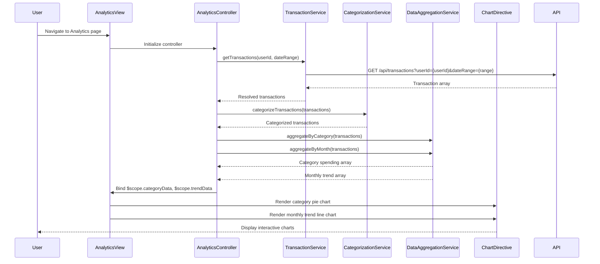

# Low-Level Design: QE-10740 - Spending Analytics and Category Insights

## a. Architecture Mapping

**HLD to AngularJS Artifact Mapping:**
- User Interface Analytics Dashboard → AngularJS View (HTML template with chart containers)
- Analytics Controller → AngularJS Controller (analyticsController)
- Transaction Service → AngularJS Service/Factory (transactionService)
- Categorization Service → AngularJS Service/Factory (categorizationService)
- Data Aggregation Service → AngularJS Service/Factory (dataAggregationService)
- Visualization Engine → AngularJS Directive (chartDirective using Chart.js or D3.js)

**Recommended Folder Structure:**
```
app/
├── modules/
│   └── analytics/
│       ├── analytics.module.js
│       ├── controllers/
│       │   └── analyticsController.js
│       ├── services/
│       │   ├── transactionService.js
│       │   ├── categorizationService.js
│       │   └── dataAggregationService.js
│       ├── directives/
│       │   └── chartDirective.js
│       └── views/
│           └── analytics.html
├── shared/
│   └── constants/
│       └── categories.constant.js
└── assets/
    ├── css/
    │   └── analytics.css
    └── libs/
        └── chart.min.js
```

## b. Component Specifications

| Component Name | Artifact Type | Responsibility | Key Dependencies |
|----------------|---------------|----------------|------------------|
| analyticsModule | AngularJS Module | Root module for spending analytics features | angular, ui.router, chart.js |
| analyticsController | Controller | Orchestrates data retrieval, aggregation, and chart rendering for spending insights | transactionService, categorizationService, dataAggregationService, $scope |
| transactionService | Factory | Retrieves transaction data via REST API for specified date range | $http, $q |
| categorizationService | Service | Classifies transactions into predefined categories (Food, Fuel, Shopping, etc.) | CATEGORIES_CONSTANT |
| dataAggregationService | Service | Aggregates transaction data by category and calculates monthly trends | None |
| chartDirective | Directive | Renders interactive charts (pie for category breakdown, line for monthly trends) using Chart.js | Chart.js library |
| analyticsView | HTML Template | Displays category breakdown chart, monthly trend chart, and category filter controls | analyticsController |

## c. Data Model

**Transaction Object:**
```javascript
{
  transactionId: String,
  cardId: String,
  amount: Number,
  category: String,
  merchantName: String,
  transactionDate: Date,
  description: String
}
```

**CategorySpending Object:**
```javascript
{
  category: String,
  totalAmount: Number,
  transactionCount: Number,
  percentage: Number
}
```

**MonthlyTrend Object:**
```javascript
{
  month: String,
  year: Number,
  totalSpend: Number,
  categoryBreakdown: Array<CategorySpending>
}
```

**CATEGORIES_CONSTANT:**
```javascript
['Food & Dining', 'Fuel', 'Shopping', 'Travel', 'Entertainment', 'Utilities', 'Healthcare', 'Education', 'Miscellaneous']
```

## d. Data Flow

User navigates to analytics page → analyticsView loads and invokes analyticsController → Controller calls transactionService.getTransactions(userId, dateRange) → Service makes REST API call (GET /api/transactions?userId={userId}&startDate={start}&endDate={end}) → API returns transaction array → Service resolves promise with transaction data → Controller passes transactions to categorizationService.categorizeTransactions() → Categorization service applies rules and assigns categories → Controller invokes dataAggregationService.aggregateByCategory() and aggregateByMonth() → Aggregation service computes category totals and monthly trends → Controller binds aggregated data to $scope → View renders charts using chartDirective with category breakdown (pie chart) and monthly trend (line chart) → User interacts with charts for drill-down insights.

## e. Primary Sequence Diagram



## f. Implementation Notes

- Use Chart.js library integrated via AngularJS directive for interactive and responsive chart rendering
- Implement ES6 array methods (map, filter, reduce) in dataAggregationService for efficient data processing
- Use AngularJS $filter service for date formatting and currency display in chart tooltips
- Apply lazy loading for Chart.js library to optimize initial page load performance
- Implement chart click events for drill-down from category chart to transaction list view

## g. Error Handling

Try/catch blocks in aggregation logic with HTTP interceptor for API errors; display user-friendly message with retry option on failure.

## h. Security Notes

Standard input validation and secure API calls assumed; transaction data filtered by authenticated user ID only.