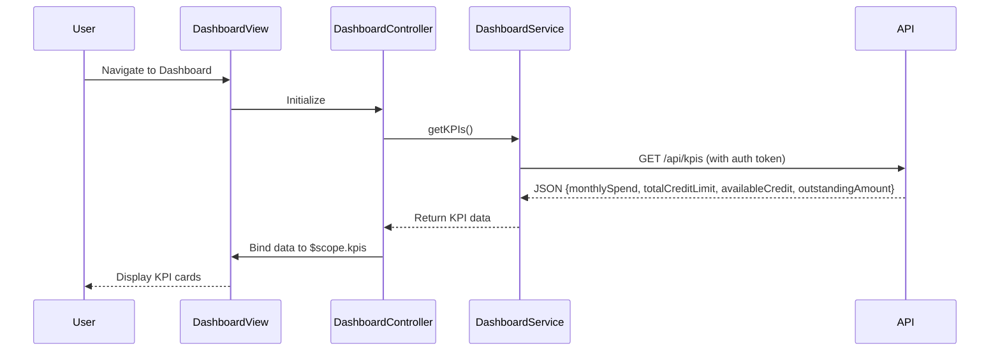

# Low-Level Design (LLD)
**Epic ID:** QE-10741  
**Epic Title:** Credit Card Dashboard and KPI Management  
**Application Stack:** AngularJS 1.x, JavaScript ES6, HTML5, CSS3, Bootstrap, REST APIs, MVC Architecture

---

## a. Architecture Mapping

- **Dashboard UI Layer** → AngularJS Module (`creditCardDashboard`) with Controller (`DashboardController`) and View (dashboard.html)
- **API Gateway** → AngularJS Service (`DashboardService`) using `$http` for REST API calls
- **Credit Card Data Service** → Backend REST API endpoints (GET `/api/cards`, GET `/api/kpis`)
- **User Authentication Service** → AngularJS Factory (`AuthFactory`) managing session tokens
- **Data Repository** → Backend data layer (out of scope for front-end LLD)

**Recommended Folder Structure:**
```
app/
├── modules/
│   └── dashboard/
│       ├── dashboard.module.js
│       ├── dashboard.controller.js
│       ├── dashboard.service.js
│       └── dashboard.html
├── shared/
│   ├── auth.factory.js
│   └── interceptor.service.js
└── assets/
    └── css/dashboard.css
```

---

## b. Component Specifications

| Component Name | Artifact Type | Responsibility | Key Dependencies |
|---|---|---|---|
| `creditCardDashboard` | Module | Root module for dashboard feature | `ngRoute`, `AuthFactory` |
| `DashboardController` | Controller | Manages dashboard state, fetches KPIs, binds data to view | `DashboardService`, `$scope` |
| `DashboardService` | Service | Handles REST API calls to fetch card data and KPIs | `$http`, `$q` |
| `AuthFactory` | Factory | Provides authentication token and session management | `$window.localStorage` |
| `HttpInterceptor` | Service | Attaches auth token to outgoing requests, handles 401 errors | `$httpProvider`, `AuthFactory` |
| `dashboard.html` | View | Displays KPI cards (monthly spend, credit limit, available credit, outstanding) with Bootstrap grid | Bootstrap CSS, AngularJS directives |

---

## c. Data Model

**KPI Model (JavaScript Object):**
```javascript
{
  monthlySpend: Number,       // Total spend in current month
  totalCreditLimit: Number,   // Sum of all card limits
  availableCredit: Number,    // Total available credit
  outstandingAmount: Number   // Total outstanding balance
}
```

**Card Model (JavaScript Object):**
```javascript
{
  cardId: String,             // Unique card identifier
  cardNumber: String,         // Masked card number (e.g., "**** 1234")
  cardType: String,           // e.g., "Visa", "MasterCard"
  creditLimit: Number,
  availableCredit: Number,
  outstandingBalance: Number
}
```

---

## d. Data Flow

User navigates to the dashboard view → `DashboardController` initializes and calls `DashboardService.getKPIs()` → Service sends GET request to `/api/kpis` with auth token via `HttpInterceptor` → Backend returns JSON with KPI data → Service resolves promise and returns data to Controller → Controller binds KPI object to `$scope.kpis` → View renders KPI cards using AngularJS expressions and Bootstrap grid, displaying monthly spend, total credit limit, available credit, and outstanding amount in real-time.

---

## e. Primary Sequence Diagram



---

## f. Implementation Notes

- Use AngularJS Dependency Injection to inject `DashboardService` and `$scope` into `DashboardController`.
- Implement `$http` service in `DashboardService` with promise-based pattern (`$q`) for async API calls.
- Use Bootstrap grid system (`.col-md-3`) for responsive KPI card layout across desktop, tablet, and mobile.
- Apply `ng-repeat` directive if displaying multiple cards; use `ng-if` for conditional rendering based on data availability.
- Leverage ES6 arrow functions and `const`/`let` for cleaner service and controller code.

---

## g. Error Handling

HTTP interceptor captures API errors (4xx/5xx), logs to console, and displays user-friendly notification via AngularJS `$rootScope.$broadcast` event.

---

## h. Security Notes

Requires token-based authentication via existing SSO; all API calls include Authorization header managed by `HttpInterceptor`.

---

**End of LLD for Epic QE-10741**