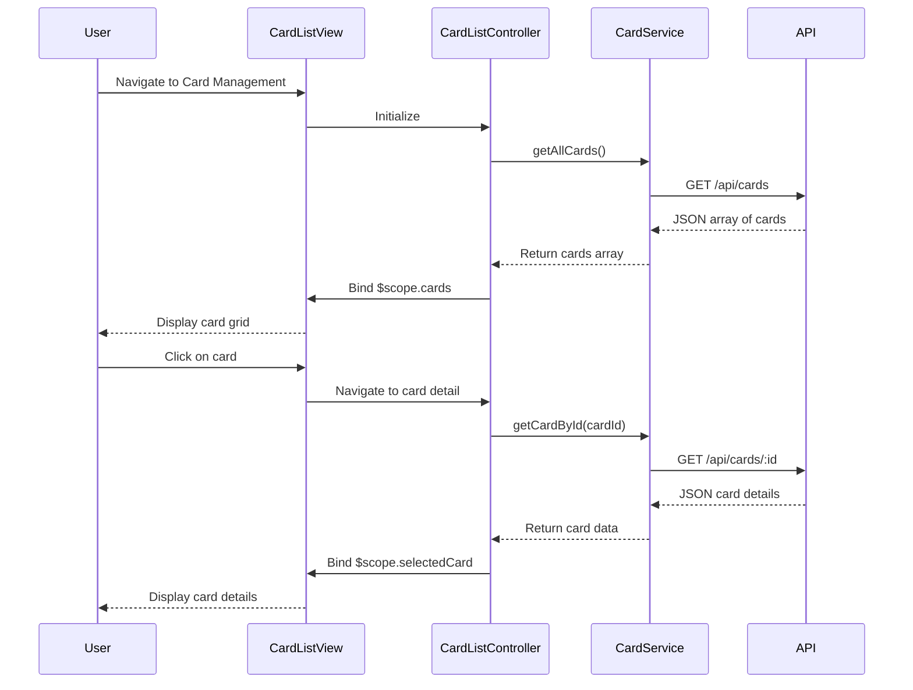

# Low-Level Design (LLD)
**Epic ID:** QE-10742  
**Epic Title:** Credit Card Management and Tracking  
**Application Stack:** AngularJS 1.x, JavaScript ES6, HTML5, CSS3, Bootstrap, REST APIs, MVC Architecture

---

## a. Architecture Mapping

- **User Interface** → AngularJS Module (`cardManagement`) with Controller (`CardListController`) and View (card-list.html)
- **Card Management Module** → AngularJS Service (`CardService`) for CRUD operations and card data management
- **Transaction Service** → AngularJS Service (`TransactionService`) for fetching card-wise spending data
- **Card Data Repository** → Backend REST API endpoints (GET `/api/cards`, GET `/api/cards/:id`, GET `/api/cards/:id/transactions`)
- **Card Comparison Engine** → AngularJS Filter (`cardComparison`) and Controller logic for sorting/comparing cards

**Recommended Folder Structure:**
```
app/
├── modules/
│   └── card-management/
│       ├── card-management.module.js
│       ├── card-list.controller.js
│       ├── card-detail.controller.js
│       ├── card.service.js
│       ├── transaction.service.js
│       ├── card-list.html
│       └── card-detail.html
├── shared/
│   └── filters/
│       └── card-comparison.filter.js
└── assets/
    └── css/card-management.css
```

---

## b. Component Specifications

| Component Name | Artifact Type | Responsibility | Key Dependencies |
|---|---|---|---|
| `cardManagement` | Module | Root module for card management feature | `ngRoute`, `CardService`, `TransactionService` |
| `CardListController` | Controller | Manages list of cards, handles card selection and comparison | `CardService`, `$scope` |
| `CardDetailController` | Controller | Displays detailed view of a single card with spending breakdown | `CardService`, `TransactionService`, `$routeParams` |
| `CardService` | Service | Fetches card data, manages card state, provides card CRUD operations | `$http`, `$q` |
| `TransactionService` | Service | Retrieves card-wise transaction data and calculates spending totals | `$http`, `$q` |
| `cardComparison` | Filter | Sorts and filters cards based on utilization, available credit, or spending | None |
| `card-list.html` | View | Displays multiple cards in grid layout with key metrics per card | Bootstrap, `ng-repeat` |
| `card-detail.html` | View | Shows individual card details including spending, limit, and outstanding balance | Bootstrap, AngularJS directives |

---

## c. Data Model

**Card Model (JavaScript Object):**
```javascript
{
  cardId: String,                // Unique card identifier
  cardNumber: String,            // Masked card number
  cardType: String,              // Visa, MasterCard, etc.
  cardHolderName: String,
  creditLimit: Number,
  availableCredit: Number,
  outstandingBalance: Number,
  utilizationRate: Number,       // Calculated: (creditLimit - availableCredit) / creditLimit * 100
  monthlySpend: Number           // Current month spending for this card
}
```

**Transaction Summary Model (JavaScript Object):**
```javascript
{
  cardId: String,
  totalSpend: Number,            // Total spending for the card
  transactionCount: Number,
  lastTransactionDate: String    // ISO date string
}
```

---

## d. Data Flow

User navigates to card management view → `CardListController` initializes and calls `CardService.getAllCards()` → Service sends GET request to `/api/cards` → Backend returns array of card objects → Controller binds cards to `$scope.cards` → View renders card grid using `ng-repeat` with Bootstrap cards → User clicks on a card → `CardDetailController` loads using `$routeParams.cardId` → Controller calls `CardService.getCardById(cardId)` and `TransactionService.getCardTransactions(cardId)` → Services fetch data from `/api/cards/:id` and `/api/cards/:id/transactions` → Controller binds detailed card data and transaction summary to scope → View displays card-specific spending, limit, outstanding balance, and transaction history.

---

## e. Primary Sequence Diagram



---

## f. Implementation Notes

- Use AngularJS `$routeProvider` to configure routes for card list (`/cards`) and card detail (`/cards/:cardId`) views.
- Implement `ng-repeat` with `track by cardId` for efficient rendering of card list.
- Calculate `utilizationRate` in `CardService` before returning card data to controller for display.
- Use Bootstrap card component (`.card`) for consistent card UI across list and detail views.
- Apply AngularJS filters (`orderBy`, custom `cardComparison`) for sorting cards by utilization, spending, or available credit.

---

## g. Error Handling

Interceptor-based error handling with try/catch in service methods; user notified via toast or alert directive on API failures.

---

## h. Security Notes

Standard input validation and secure API calls assumed; auth token attached via HTTP interceptor.

---

**End of LLD for Epic QE-10742**