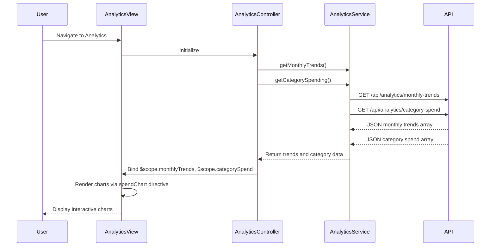

# Low-Level Design (LLD)
**Epic ID:** QE-10743  
**Epic Title:** Transaction Analytics and Spending Insights  
**Application Stack:** AngularJS 1.x, JavaScript ES6, HTML5, CSS3, Bootstrap, REST APIs, MVC Architecture

---

## a. Architecture Mapping

- **Analytics UI** → AngularJS Module (`transactionAnalytics`) with Controller (`AnalyticsController`) and View (analytics.html)
- **Visualization Engine** → AngularJS Directive (`spendChart`) wrapping Chart.js library for rendering interactive charts
- **Analytics Service** → AngularJS Service (`AnalyticsService`) for fetching aggregated spending data
- **Categorization Engine** → Backend service (API endpoint `/api/transactions/categorized`) returning pre-categorized transaction data
- **Transaction Data Service** → Backend REST API (GET `/api/transactions`, GET `/api/analytics/monthly-trends`, GET `/api/analytics/category-spend`)
- **Transaction Repository** → Backend data layer (out of scope for front-end LLD)

**Recommended Folder Structure:**
```
app/
├── modules/
│   └── analytics/
│       ├── analytics.module.js
│       ├── analytics.controller.js
│       ├── analytics.service.js
│       ├── spend-chart.directive.js
│       └── analytics.html
├── shared/
│   └── constants/
│       └── spending-categories.constant.js
└── assets/
    ├── css/analytics.css
    └── lib/chart.min.js
```

---

## b. Component Specifications

| Component Name | Artifact Type | Responsibility | Key Dependencies |
|---|---|---|---|
| `transactionAnalytics` | Module | Root module for analytics and insights feature | `ngRoute`, `AnalyticsService`, Chart.js |
| `AnalyticsController` | Controller | Manages analytics view state, fetches monthly trends and category spending data | `AnalyticsService`, `$scope` |
| `AnalyticsService` | Service | Retrieves aggregated transaction data and category-wise spending from REST API | `$http`, `$q` |
| `spendChart` | Directive | Renders interactive bar/pie charts using Chart.js for monthly trends and category breakdown | Chart.js library |
| `SPENDING_CATEGORIES` | Constant | Defines 9 spending categories (Food & Dining, Fuel, Shopping, Travel, Entertainment, Utilities, Healthcare, Education, Miscellaneous) | None |
| `analytics.html` | View | Displays monthly spend trend chart and category-wise spending breakdown with Bootstrap layout | Bootstrap, `spendChart` directive |

---

## c. Data Model

**Monthly Trend Model (JavaScript Object):**
```javascript
{
  month: String,              // e.g., "2024-01", "2024-02"
  totalSpend: Number          // Total spending for the month
}
```

**Category Spend Model (JavaScript Object):**
```javascript
{
  category: String,           // One of 9 predefined categories
  amount: Number,             // Total spending in this category
  percentage: Number          // Percentage of total spending
}
```

**Transaction Model (JavaScript Object):**
```javascript
{
  transactionId: String,
  cardId: String,
  amount: Number,
  category: String,           // Auto-categorized or manually tagged
  merchantName: String,
  transactionDate: String,    // ISO date string
  description: String
}
```

---

## d. Data Flow

User navigates to analytics view → `AnalyticsController` initializes and calls `AnalyticsService.getMonthlyTrends()` and `AnalyticsService.getCategorySpending()` → Service sends parallel GET requests to `/api/analytics/monthly-trends` and `/api/analytics/category-spend` → Backend returns aggregated JSON data (monthly spend array and category spend array) → Service resolves promises and returns data to Controller → Controller binds `$scope.monthlyTrends` and `$scope.categorySpend` → View invokes `spendChart` directive passing data attributes → Directive initializes Chart.js and renders interactive bar chart for monthly trends and pie chart for category breakdown → User interacts with charts (hover, click) to view detailed spending insights.

---

## e. Primary Sequence Diagram



---

## f. Implementation Notes

- Use AngularJS Directive (`spendChart`) to encapsulate Chart.js initialization and rendering logic for reusability.
- Implement `$q.all()` in `AnalyticsController` to fetch monthly trends and category spending data in parallel for faster load time.
- Define `SPENDING_CATEGORIES` as AngularJS constant for consistent category labels across app.
- Use Chart.js responsive configuration to ensure charts adapt to different screen sizes (desktop, tablet, mobile).
- Apply ES6 `map()` and `reduce()` functions in service layer for data transformation before passing to controller.

---

## g. Error Handling

Interceptor-based error handling with fallback to empty dataset; user notified via inline message if chart data unavailable.

---

## h. Security Notes

Standard input validation and secure API calls assumed; transaction data access restricted by user session.

---

**End of LLD for Epic QE-10743**