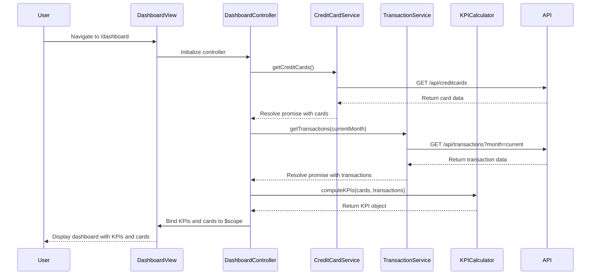

# Low-Level Design: Credit Card Dashboard and KPIs
**Epic ID:** QE-10744  
**Branch:** PERFTEST20261112133843

---

## a. Architecture Mapping

| HLD Component | AngularJS Artifact | Purpose |
|---------------|-------------------|----------|
| User Interface - Dashboard | Module: `creditCardDashboard` | Root module for dashboard feature |
| Dashboard Controller | Controller: `DashboardController` | Manages dashboard state and KPI display logic |
| Credit Card Data Service | Service: `CreditCardService` | Fetches credit card details, limits, and balances via REST API |
| Transaction Data Service | Service: `TransactionService` | Retrieves transaction data for monthly spend and outstanding calculations |
| KPI Calculation Engine | Factory: `KPICalculator` | Computes monthly spend, available credit, and outstanding amounts |
| Data Repository | Service integration (external) | Backend REST endpoints for card and transaction data |

**Recommended Folder Structure:**
```
app/
├── modules/
│   └── dashboard/
│       ├── dashboard.module.js
│       ├── dashboard.controller.js
│       ├── dashboard.html
│       └── dashboard.css
├── services/
│   ├── creditCard.service.js
│   ├── transaction.service.js
│   └── kpiCalculator.factory.js
└── models/
    ├── creditCard.model.js
    └── kpi.model.js
```

---

## b. Component Specifications

| Component Name | Artifact Type | Responsibility | Key Dependencies |
|----------------|---------------|----------------|------------------|
| `creditCardDashboard` | Module | Encapsulates dashboard feature and registers all components | `ngRoute`, `ui.bootstrap` |
| `DashboardController` | Controller | Orchestrates KPI display, handles user interactions, binds data to view | `CreditCardService`, `TransactionService`, `KPICalculator`, `$scope` |
| `CreditCardService` | Service | Fetches credit card data from REST API (`GET /api/creditcards`) | `$http`, `$q` |
| `TransactionService` | Service | Retrieves transaction data from REST API (`GET /api/transactions`) | `$http`, `$q` |
| `KPICalculator` | Factory | Aggregates data to compute monthly spend, total limit, available credit, outstanding | `_` (lodash/underscore) |
| `dashboardView` | HTML Template | Renders KPI cards, credit card list, responsive grid layout | Bootstrap grid, AngularJS directives |

---

## c. Data Model

**CreditCard Model:**
```javascript
{
  cardId: String,
  cardNumber: String,        // masked, e.g., "**** 1234"
  cardHolderName: String,
  creditLimit: Number,
  outstandingBalance: Number,
  availableCredit: Number,   // computed: creditLimit - outstandingBalance
  cardType: String,          // e.g., "Visa", "MasterCard"
  expiryDate: String         // ISO date format
}
```

**KPI Model:**
```javascript
{
  monthlySpend: Number,
  totalCreditLimit: Number,
  totalAvailableCredit: Number,
  totalOutstanding: Number
}
```

**Transaction Model (subset for KPI calculation):**
```javascript
{
  transactionId: String,
  cardId: String,
  amount: Number,
  transactionDate: String,   // ISO date format
  status: String             // e.g., "posted", "pending"
}
```

---

## d. Data Flow

User navigates to the dashboard route → AngularJS router loads `DashboardController` and `dashboardView` → Controller injects `CreditCardService` and `TransactionService` → Services make parallel REST API calls (`GET /api/creditcards`, `GET /api/transactions?month=current`) → On success, controller passes raw data to `KPICalculator` factory → Factory aggregates monthly spend (sum of current month transactions), total credit limit (sum across cards), available credit (sum of availableCredit per card), and outstanding (sum of outstandingBalance) → Controller binds computed KPIs and card list to `$scope` → View renders KPI cards and credit card grid using Bootstrap responsive layout → User sees real-time dashboard with all KPIs and cards displayed.

---

## e. Primary Sequence Diagram



---

## f. Implementation Notes

- Use AngularJS 1.x module pattern with dependency injection for all services and controllers.
- Leverage `$http` service with promise-based API calls; handle errors via `.catch()` and display user-friendly messages.
- Use Bootstrap grid system (col-md-*, col-sm-*) for responsive KPI cards and credit card tiles.
- Implement `KPICalculator` as a stateless factory with pure functions for testability.
- Cache credit card data in service using `$cacheFactory` to reduce redundant API calls on dashboard revisits.

---

## g. Error Handling

Use `$http` interceptor to catch API errors globally; display toast notifications via `angular-toastr` or similar for user feedback on failures.

---

## h. Security Notes

Requires token-based authentication via existing SSO; all API calls include Authorization header with JWT token.