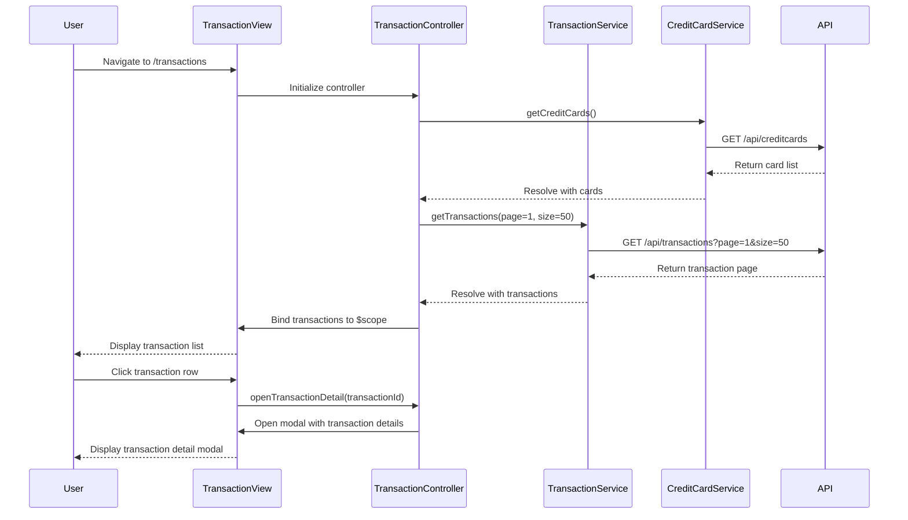

# Low-Level Design: Transaction Management and Viewing
**Epic ID:** QE-10745  
**Branch:** PERFTEST20261112133843

---

## a. Architecture Mapping

| HLD Component | AngularJS Artifact | Purpose |
|---------------|-------------------|----------|
| User Interface - Transaction View | Module: `transactionManagement` | Root module for transaction viewing feature |
| Transaction Controller | Controller: `TransactionController` | Manages transaction list state, filtering, and detail view |
| Transaction Data Service | Service: `TransactionService` | Fetches transaction records from REST API |
| Credit Card Data Service | Service: `CreditCardService` | Retrieves card details for associating transactions with cards |
| Transaction Repository | Service integration (external) | Backend REST endpoints for transaction data |

**Recommended Folder Structure:**
```
app/
├── modules/
│   └── transactions/
│       ├── transactions.module.js
│       ├── transactions.controller.js
│       ├── transactions.html
│       ├── transaction-detail.html
│       └── transactions.css
├── services/
│   ├── transaction.service.js
│   └── creditCard.service.js
└── models/
    └── transaction.model.js
```

---

## b. Component Specifications

| Component Name | Artifact Type | Responsibility | Key Dependencies |
|----------------|---------------|----------------|------------------|
| `transactionManagement` | Module | Encapsulates transaction viewing feature and registers components | `ngRoute`, `ui.bootstrap`, `infinite-scroll` |
| `TransactionController` | Controller | Manages transaction list, filtering by card, pagination, and detail modal | `TransactionService`, `CreditCardService`, `$scope`, `$uibModal` |
| `TransactionService` | Service | Fetches transaction data via REST API (`GET /api/transactions`) with pagination and filtering | `$http`, `$q` |
| `CreditCardService` | Service | Retrieves credit card list for filter dropdown (`GET /api/creditcards`) | `$http`, `$q` |
| `transactionListView` | HTML Template | Renders scrollable transaction list with card filter and detail links | Bootstrap table, AngularJS filters |
| `transactionDetailModal` | Directive/Template | Displays detailed transaction information in modal overlay | `ui.bootstrap.modal` |

---

## c. Data Model

**Transaction Model:**
```javascript
{
  transactionId: String,
  cardId: String,
  cardNumber: String,        // masked, e.g., "**** 1234"
  merchantName: String,
  category: String,          // e.g., "Food & Dining", "Fuel"
  amount: Number,
  transactionDate: String,   // ISO date format
  status: String,            // "posted", "pending", "declined"
  description: String
}
```

**TransactionFilter Model:**
```javascript
{
  cardId: String,            // null for "All Cards"
  startDate: String,         // ISO date format
  endDate: String,           // ISO date format
  pageNumber: Number,
  pageSize: Number
}
```

---

## d. Data Flow

User navigates to transactions route → AngularJS router loads `TransactionController` and `transactionListView` → Controller injects `TransactionService` and `CreditCardService` → `CreditCardService` fetches card list for filter dropdown → `TransactionService` makes REST API call (`GET /api/transactions?page=1&size=50`) → On success, controller binds transaction array to `$scope` → View renders transaction list with infinite scroll → User selects card filter or scrolls down → Controller updates filter parameters and calls `TransactionService` again → Service fetches filtered/paginated data → Controller appends new transactions to list → User clicks transaction row → Controller opens `$uibModal` with transaction details → Modal displays full transaction information → User closes modal and continues browsing.

---

## e. Primary Sequence Diagram



---

## f. Implementation Notes

- Use AngularJS 1.x with `ui-router` for nested views if transaction detail is a separate route; otherwise use `ui.bootstrap.modal` for detail overlay.
- Implement infinite scroll using `ngInfiniteScroll` directive to load transactions as user scrolls down.
- Use `$http` with pagination parameters (page, size) and cache initial page in `TransactionService` for performance.
- Apply AngularJS filters (e.g., `currency`, `date`) in view for formatting transaction amounts and dates.
- Store filter state in controller and pass to service on each API call; reset pagination when filter changes.

---

## g. Error Handling

Use try/catch in controller methods combined with `$http` error callbacks; display error messages via toast notifications or inline alerts.

---

## h. Security Notes

Standard input validation and secure API calls assumed; all API requests include Authorization header with JWT token from SSO.