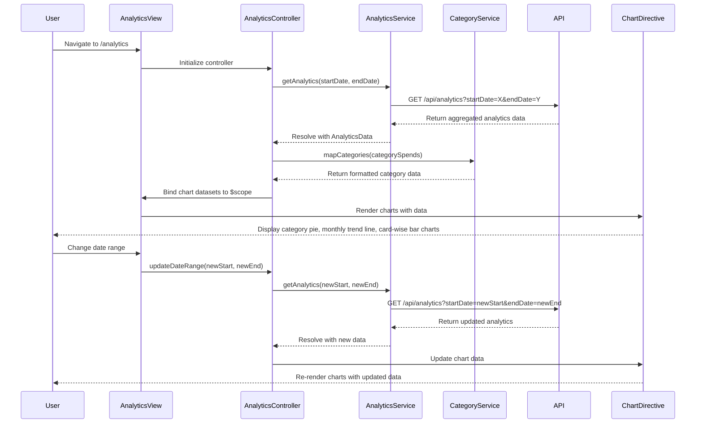

# Low-Level Design: Spending Analytics and Insights
**Epic ID:** QE-10746  
**Branch:** PERFTEST20261112133843

---

## a. Architecture Mapping

| HLD Component | AngularJS Artifact | Purpose |
|---------------|-------------------|----------|
| User Interface - Analytics Dashboard | Module: `spendingAnalytics` | Root module for analytics feature |
| Analytics Controller | Controller: `AnalyticsController` | Manages analytics state, chart data binding, and user interactions |
| Transaction Categorization Service | Service: `CategoryService` | Provides category-wise transaction aggregation logic |
| Data Aggregation Service | Service: `AnalyticsService` | Computes monthly trends and card-wise spend analysis |
| Transaction Repository | Service integration (external) | Backend REST endpoints for transaction data |
| Visualization Engine | Directive: `chartDirective` (wraps Chart.js or D3.js) | Renders interactive charts and graphs |

**Recommended Folder Structure:**
```
app/
├── modules/
│   └── analytics/
│       ├── analytics.module.js
│       ├── analytics.controller.js
│       ├── analytics.html
│       └── analytics.css
├── services/
│   ├── analytics.service.js
│   ├── category.service.js
│   └── transaction.service.js
├── directives/
│   └── chart.directive.js
└── models/
    ├── categorySpend.model.js
    └── trendData.model.js
```

---

## b. Component Specifications

| Component Name | Artifact Type | Responsibility | Key Dependencies |
|----------------|---------------|----------------|------------------|
| `spendingAnalytics` | Module | Encapsulates analytics feature and registers all components | `ngRoute`, `chart.js`, `ui.bootstrap` |
| `AnalyticsController` | Controller | Orchestrates chart data preparation, handles date range selection, binds analytics to view | `AnalyticsService`, `CategoryService`, `$scope`, `$filter` |
| `AnalyticsService` | Service | Fetches aggregated analytics data from REST API (`GET /api/analytics`) | `$http`, `$q` |
| `CategoryService` | Service | Provides category mapping and aggregation logic for nine predefined categories | `TransactionService` |
| `chartDirective` | Directive | Wraps Chart.js library to render pie, bar, and line charts with AngularJS data binding | `Chart.js`, `$timeout` |
| `analyticsView` | HTML Template | Renders category-wise pie chart, monthly trend line chart, and card-wise bar chart | Bootstrap grid, custom chart directive |

---

## c. Data Model

**CategorySpend Model:**
```javascript
{
  category: String,          // "Food & Dining", "Fuel", "Shopping", "Travel", "Entertainment", "Utilities", "Healthcare", "Education", "Miscellaneous"
  totalSpend: Number,
  transactionCount: Number,
  percentage: Number         // computed: (totalSpend / overallSpend) * 100
}
```

**MonthlyTrend Model:**
```javascript
{
  month: String,             // "2024-01", "2024-02", etc.
  totalSpend: Number
}
```

**CardWiseSpend Model:**
```javascript
{
  cardId: String,
  cardNumber: String,        // masked
  totalSpend: Number
}
```

**AnalyticsData Model (aggregated):**
```javascript
{
  categorySpends: Array<CategorySpend>,
  monthlyTrends: Array<MonthlyTrend>,
  cardWiseSpends: Array<CardWiseSpend>
}
```

---

## d. Data Flow

User navigates to analytics route → AngularJS router loads `AnalyticsController` and `analyticsView` → Controller injects `AnalyticsService` and `CategoryService` → `AnalyticsService` makes REST API call (`GET /api/analytics?startDate=X&endDate=Y`) → Backend aggregates transaction data by category, month, and card → API returns `AnalyticsData` object → Controller processes data and prepares chart datasets (labels, values, colors) → Controller binds chart data to `$scope` → `chartDirective` watches scope changes and renders three charts (category pie chart, monthly trend line chart, card-wise bar chart) using Chart.js → User interacts with date range picker → Controller updates date parameters and re-fetches analytics → Charts update reactively with new data.

---

## e. Primary Sequence Diagram



---

## f. Implementation Notes

- Use AngularJS 1.x with Chart.js wrapped in a custom directive for reactive chart rendering; watch `$scope` changes to update charts.
- Implement `AnalyticsService` to call backend aggregation API; cache results for selected date range to avoid redundant calls.
- Use ES6 array methods (map, reduce, filter) in `CategoryService` for client-side data transformation if backend returns raw transactions.
- Apply AngularJS `$filter('currency')` and `$filter('date')` for consistent formatting in charts and tooltips.
- Ensure chart directive uses `$timeout` to defer rendering until DOM is ready and data is bound.

---

## g. Error Handling

Interceptor-based error handling for API failures; display user-friendly error messages via toast notifications and fallback to empty chart states.

---

## h. Security Notes

Requires token-based auth via existing SSO; all analytics API calls include Authorization header with JWT token.