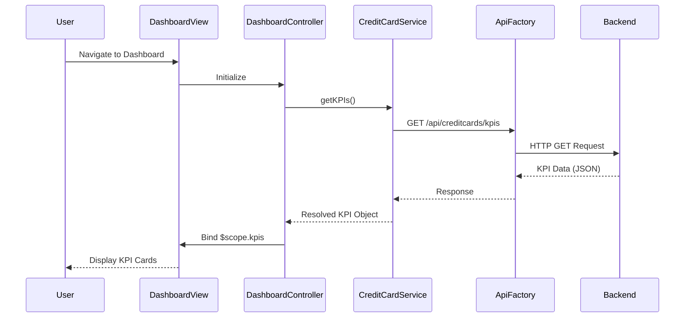

# Low-Level Design: Credit Card Dashboard and KPI Overview
**Epic ID:** QE-10747  
**Label:** PERFTEST20261112134117

---

## a. Architecture Mapping

- **Dashboard UI Component** → AngularJS Module: `ccDashboard.module` + Controller: `DashboardController`
- **KPI Display** → AngularJS Directive: `kpiCard` for reusable KPI widgets
- **Data Retrieval** → AngularJS Service: `CreditCardService` for API calls
- **API Communication** → AngularJS Factory: `ApiFactory` for REST endpoint management
- **Responsive Layout** → Bootstrap grid system integrated with HTML5 templates

**Recommended Folder Structure:**
```
/app
  /modules
    /dashboard
      dashboard.module.js
      dashboard.controller.js
      dashboard.html
  /services
    creditcard.service.js
  /directives
    kpi-card.directive.js
  /factories
    api.factory.js
  /assets
    /css
    /js
```

---

## b. Component Specifications

| Component Name | Artifact Type | Responsibility | Key Dependencies |
|----------------|---------------|----------------|------------------|
| `ccDashboard.module` | Module | Root module for dashboard feature | `ngRoute`, `ApiFactory` |
| `DashboardController` | Controller | Manages dashboard state and KPI data binding | `CreditCardService`, `$scope` |
| `CreditCardService` | Service | Fetches credit card data and KPIs from REST API | `ApiFactory`, `$http`, `$q` |
| `kpiCard` | Directive | Renders individual KPI cards with icon, label, and value | None |
| `ApiFactory` | Factory | Centralizes API endpoint configuration and HTTP methods | `$http` |

---

## c. Data Model

**CreditCardKPI Object:**
```javascript
{
  monthlySpend: Number,        // Total spend for current month
  totalCreditLimit: Number,    // Sum of all card limits
  availableCredit: Number,     // Total available credit across cards
  outstandingAmount: Number    // Total outstanding balance
}
```

**CreditCard Object:**
```javascript
{
  cardId: String,
  cardNumber: String,          // Masked format (e.g., "**** 1234")
  cardType: String,            // e.g., "Visa", "MasterCard"
  creditLimit: Number,
  availableCredit: Number,
  outstandingBalance: Number
}
```

---

## d. Data Flow

User navigates to the dashboard → `DashboardController` initializes and calls `CreditCardService.getKPIs()` → Service invokes `ApiFactory` to make GET request to `/api/creditcards/kpis` → Backend returns aggregated KPI data → Service resolves promise with KPI object → Controller binds data to `$scope.kpis` → View renders KPI cards using `kpiCard` directive with Bootstrap responsive grid → User sees monthly spend, total credit limit, available credit, and outstanding amount displayed in real-time.

---

## e. Primary Sequence Diagram



---

## f. Implementation Notes

- Use AngularJS Dependency Injection to inject `CreditCardService` into `DashboardController` for testability.
- Leverage ES6 arrow functions and `const`/`let` for cleaner service and controller code.
- Implement Bootstrap responsive grid (col-xs, col-sm, col-md, col-lg) in dashboard.html for multi-device support.
- Use `$http` service with promise-based `.then()` and `.catch()` for async API calls.
- Apply AngularJS one-time binding (`::`) for static KPI labels to optimize digest cycle performance.

---

## g. Error Handling

HTTP interceptor captures API errors; user-friendly notifications displayed via toast/alert service on failure.

---

## h. Security Notes

Standard input validation and secure API calls assumed; token-based authentication via existing SSO mechanism.