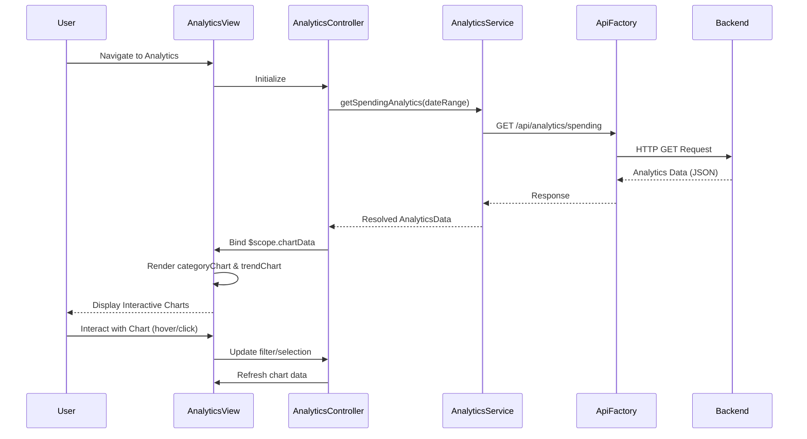

# Low-Level Design: Spending Analytics and Category Insights
**Epic ID:** QE-10748  
**Label:** PERFTEST20261112134117

---

## a. Architecture Mapping

- **Analytics Dashboard UI** → AngularJS Module: `ccAnalytics.module` + Controller: `AnalyticsController`
- **Category Chart Visualization** → AngularJS Directive: `categoryChart` wrapping Chart.js or D3.js
- **Trend Analysis** → AngularJS Directive: `trendChart` for monthly spend line/bar charts
- **Data Retrieval** → AngularJS Service: `AnalyticsService` for fetching categorized transaction data
- **API Communication** → AngularJS Factory: `ApiFactory` for REST endpoint management

**Recommended Folder Structure:**
```
/app
  /modules
    /analytics
      analytics.module.js
      analytics.controller.js
      analytics.html
  /services
    analytics.service.js
  /directives
    category-chart.directive.js
    trend-chart.directive.js
  /factories
    api.factory.js
```

---

## b. Component Specifications

| Component Name | Artifact Type | Responsibility | Key Dependencies |
|----------------|---------------|----------------|------------------|
| `ccAnalytics.module` | Module | Root module for analytics feature | `ngRoute`, `ApiFactory`, Chart.js |
| `AnalyticsController` | Controller | Manages analytics state, filters, and chart data binding | `AnalyticsService`, `$scope`, `$filter` |
| `AnalyticsService` | Service | Fetches categorized transactions and aggregated spend data from API | `ApiFactory`, `$http`, `$q` |
| `categoryChart` | Directive | Renders pie/donut chart for category-wise spending breakdown | Chart.js library |
| `trendChart` | Directive | Renders line/bar chart for monthly spend trends over time | Chart.js library |
| `ApiFactory` | Factory | Centralizes API endpoint configuration and HTTP methods | `$http` |

---

## c. Data Model

**CategorySpend Object:**
```javascript
{
  category: String,            // e.g., "Food & Dining", "Fuel"
  amount: Number,              // Total spend in category
  transactionCount: Number     // Number of transactions
}
```

**MonthlyTrend Object:**
```javascript
{
  month: String,               // e.g., "2024-01", "2024-02"
  totalSpend: Number           // Total spend for the month
}
```

**AnalyticsData Object:**
```javascript
{
  categoryBreakdown: Array<CategorySpend>,
  monthlyTrends: Array<MonthlyTrend>,
  dateRange: { startDate: String, endDate: String }
}
```

---

## d. Data Flow

User navigates to analytics dashboard → `AnalyticsController` initializes and calls `AnalyticsService.getSpendingAnalytics()` → Service invokes `ApiFactory` to make GET request to `/api/analytics/spending` with optional date range filters → Backend returns categorized spend data and monthly trends → Service resolves promise with `AnalyticsData` object → Controller processes data and binds to `$scope.chartData` → View renders `categoryChart` directive for category breakdown and `trendChart` directive for monthly trends → User interacts with charts (hover, click) to explore spending patterns → UI updates dynamically based on user selections.

---

## e. Primary Sequence Diagram



---

## f. Implementation Notes

- Use AngularJS `$filter` service to enable client-side filtering by category or date range for quick interactions.
- Integrate Chart.js via directive link function to bind chart rendering lifecycle with AngularJS digest cycle.
- Leverage ES6 `Array.map()` and `Array.reduce()` for efficient data transformation before chart rendering.
- Implement lazy loading for chart libraries to optimize initial page load time.
- Use AngularJS `$watch` on filter models to trigger chart re-rendering when user changes date range or category selection.

---

## g. Error Handling

HTTP interceptor captures API errors; fallback to empty state UI with retry option on analytics data fetch failure.

---

## h. Security Notes

Standard input validation and secure API calls assumed; ensure date range inputs are sanitized to prevent injection attacks.