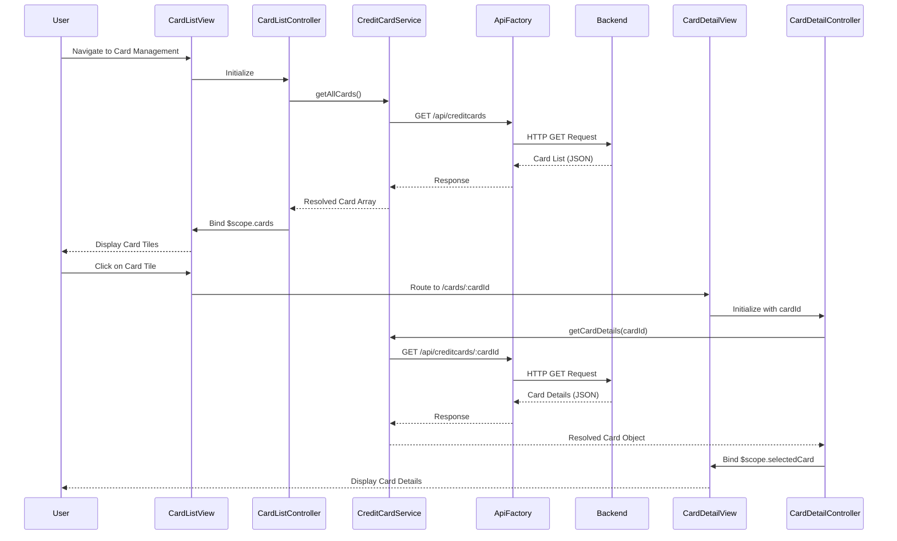

# Low-Level Design: Multiple Credit Card Management and Visualization
**Epic ID:** QE-10749  
**Label:** PERFTEST20261112134117

---

## a. Architecture Mapping

- **Card List View UI** → AngularJS Module: `ccCardManagement.module` + Controller: `CardListController`
- **Card Detail View UI** → AngularJS Controller: `CardDetailController` (same module)
- **Card Display** → AngularJS Directive: `cardTile` for rendering individual card summary tiles
- **Card Switching** → AngularJS Service: `CardNavigationService` for managing selected card state
- **Data Retrieval** → AngularJS Service: `CreditCardService` for fetching card list and details
- **API Communication** → AngularJS Factory: `ApiFactory` for REST endpoint management

**Recommended Folder Structure:**
```
/app
  /modules
    /card-management
      card-management.module.js
      card-list.controller.js
      card-detail.controller.js
      card-list.html
      card-detail.html
  /services
    creditcard.service.js
    card-navigation.service.js
  /directives
    card-tile.directive.js
  /factories
    api.factory.js
```

---

## b. Component Specifications

| Component Name | Artifact Type | Responsibility | Key Dependencies |
|----------------|---------------|----------------|------------------|
| `ccCardManagement.module` | Module | Root module for card management feature | `ngRoute`, `ApiFactory` |
| `CardListController` | Controller | Manages list of all credit cards and user selection | `CreditCardService`, `CardNavigationService`, `$scope` |
| `CardDetailController` | Controller | Manages detailed view of a single selected card | `CreditCardService`, `CardNavigationService`, `$scope`, `$routeParams` |
| `CreditCardService` | Service | Fetches all cards and individual card details from API | `ApiFactory`, `$http`, `$q` |
| `CardNavigationService` | Service | Maintains selected card state across views | None |
| `cardTile` | Directive | Renders card summary tile with card number, type, balance, and limit | None |
| `ApiFactory` | Factory | Centralizes API endpoint configuration and HTTP methods | `$http` |

---

## c. Data Model

**CreditCard Object:**
```javascript
{
  cardId: String,
  cardNumber: String,          // Masked format (e.g., "**** 1234")
  cardType: String,            // e.g., "Visa", "MasterCard", "Amex"
  cardHolderName: String,
  creditLimit: Number,
  availableCredit: Number,
  outstandingBalance: Number,
  lastTransactionDate: String  // ISO date format
}
```

**CardSpendSummary Object:**
```javascript
{
  cardId: String,
  currentMonthSpend: Number,
  previousMonthSpend: Number,
  categoryBreakdown: Array<{ category: String, amount: Number }>
}
```

---

## d. Data Flow

User navigates to card management view → `CardListController` initializes and calls `CreditCardService.getAllCards()` → Service invokes `ApiFactory` to make GET request to `/api/creditcards` → Backend returns array of credit card objects → Service resolves promise with card list → Controller binds data to `$scope.cards` → View renders card tiles using `cardTile` directive in Bootstrap grid → User clicks on a card tile → `CardNavigationService` stores selected cardId → User is routed to card detail view → `CardDetailController` retrieves cardId from `$routeParams` and calls `CreditCardService.getCardDetails(cardId)` → Service fetches detailed card info and spend summary → Controller binds data to `$scope.selectedCard` → View displays card-specific balance, limit, and spend analysis.

---

## e. Primary Sequence Diagram



---

## f. Implementation Notes

- Use AngularJS `ngRoute` or `ui-router` for navigation between card list and detail views with parameterized routes.
- Implement `CardNavigationService` as a singleton service to share selected card state without re-fetching data.
- Leverage ES6 template literals for dynamic API endpoint construction (e.g., `/api/creditcards/${cardId}`).
- Apply AngularJS `ng-repeat` with `track by cardId` for efficient rendering of card tiles in list view.
- Use Bootstrap card component classes for consistent card tile styling and responsive layout.

---

## g. Error Handling

HTTP interceptor captures API errors; display user-friendly message if card list or details fail to load, with retry option.

---

## h. Security Notes

Standard input validation and secure API calls assumed; ensure card numbers are always masked on client-side display.