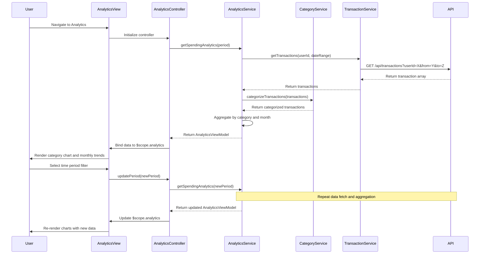

# Low-Level Design: Spending Analytics and Insights
**Epic ID:** QE-10750  
**Application Stack:** AngularJS 1.x, JavaScript ES6, HTML5, CSS3, Bootstrap, REST APIs, MVC Architecture

---

## a. Architecture Mapping

| HLD Component | AngularJS Artifact | Purpose |
|---------------|-------------------|----------|
| Analytics UI | Module: `analyticsModule` | Root module for analytics feature |
| Analytics UI | Controller: `AnalyticsController` | Manages analytics view state and user interactions |
| Visualization Engine | Directive: `spendingChart` | Renders interactive category and trend charts |
| Data Analytics Engine | Service: `AnalyticsService` | Processes and aggregates spending data |
| Categorization Service | Service: `CategoryService` | Classifies transactions into 9 predefined categories |
| Transaction Data Service | Service: `TransactionService` | Fetches raw transaction data from REST API |
| Dashboard Service Integration | Service: `DashboardIntegrationService` | Pushes insights to main dashboard |

**Recommended Folder Structure:**
```
app/
├── modules/
│   └── analytics/
│       ├── controllers/
│       │   └── analyticsController.js
│       ├── services/
│       │   ├── analyticsService.js
│       │   ├── categoryService.js
│       │   └── transactionService.js
│       ├── directives/
│       │   └── spendingChart.js
│       ├── views/
│       │   └── analytics.html
│       └── analyticsModule.js
```

---

## b. Component Specifications

| Component Name | Artifact Type | Responsibility | Key Dependencies |
|----------------|---------------|----------------|------------------|
| `analyticsModule` | Module | Encapsulates all analytics-related components and routing | `ngRoute`, `chart.js` |
| `AnalyticsController` | Controller | Manages analytics view state, fetches data, handles user filters | `AnalyticsService`, `$scope`, `$filter` |
| `AnalyticsService` | Service | Aggregates transaction data, calculates category totals and monthly trends | `TransactionService`, `CategoryService`, `$q`, `$http` |
| `CategoryService` | Service | Classifies transactions into 9 categories using merchant/MCC rules | `$http` (for category rules API) |
| `TransactionService` | Service | Retrieves raw transaction data from REST API endpoint `/api/transactions` | `$http`, `$q` |
| `spendingChart` | Directive | Renders interactive pie/bar/line charts using Chart.js or D3.js | `AnalyticsService`, Chart.js library |
| `DashboardIntegrationService` | Service | Sends aggregated insights to main dashboard via event broadcast | `$rootScope` |

---

## c. Data Model

**Transaction Model:**
```javascript
class Transaction {
  transactionId: String
  cardId: String
  amount: Number
  merchantName: String
  mccCode: String
  category: String  // One of 9 predefined categories
  transactionDate: Date
  description: String
}
```

**Category Model:**
```javascript
class Category {
  categoryName: String  // Food & Dining, Fuel, Shopping, Travel, Entertainment, Utilities, Healthcare, Education, Miscellaneous
  totalSpend: Number
  transactionCount: Number
  percentage: Number
}
```

**MonthlyTrend Model:**
```javascript
class MonthlyTrend {
  month: String  // YYYY-MM format
  totalSpend: Number
  categoryBreakdown: Array<Category>
}
```

**AnalyticsViewModel:**
```javascript
class AnalyticsViewModel {
  categories: Array<Category>
  monthlyTrends: Array<MonthlyTrend>
  selectedPeriod: String  // e.g., 'last3months', 'last6months', 'last12months'
  totalTransactions: Number
}
```

---

## d. Data Flow

User navigates to Analytics view → `AnalyticsController` initializes and calls `AnalyticsService.getSpendingAnalytics(period)` → `AnalyticsService` fetches raw transactions via `TransactionService.getTransactions(userId, dateRange)` from REST API `/api/transactions` → `CategoryService.categorizeTransactions(transactions)` classifies each transaction into one of 9 categories → `AnalyticsService` aggregates data into category totals and monthly trends → Aggregated data returned to controller and bound to `$scope.analytics` → `spendingChart` directive watches scope data and renders interactive Chart.js visualizations → User interacts with filters (time period, category) → Controller updates filters, re-fetches data, and updates view → `DashboardIntegrationService` broadcasts key insights to main dashboard via `$rootScope.$broadcast('analyticsUpdated', insights)`.

---

## e. Primary Sequence Diagram



---

## f. Implementation Notes

- Use AngularJS Dependency Injection to inject services into controllers and other services for testability and modularity.
- Implement `AnalyticsService` with caching using `$cacheFactory` to store pre-aggregated results for common queries (current month, last 3 months) to meet 3-second rendering NFR.
- Use ES6 classes and arrow functions for service and controller logic; transpile with Babel if needed for browser compatibility.
- Integrate Chart.js via custom directive `spendingChart` that watches `$scope.analytics` and re-renders on data change; ensure responsive chart options for mobile.
- REST API calls via `$http` service with promise-based error handling; use `$q.all()` for parallel data fetching if multiple endpoints are involved.

---

## g. Error Handling

Use HTTP interceptor to catch API errors globally; display user-friendly error messages via Bootstrap modal or toast notification; log errors to console for debugging.

---

## h. Security Notes

Standard input validation and secure API calls assumed; ensure userId is validated server-side and transaction data is scoped to authenticated user via existing SSO token.

---

**End of LLD for QE-10750**