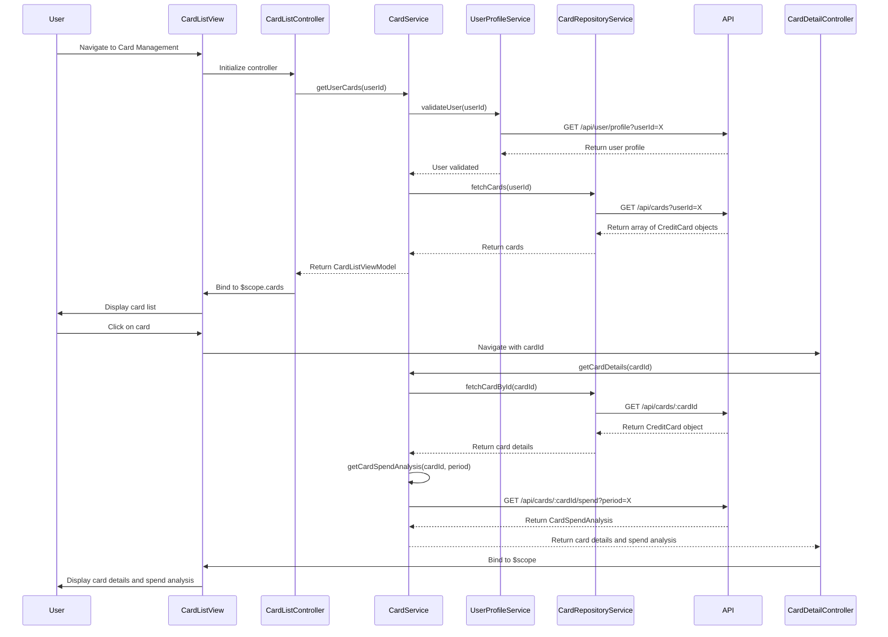

# Low-Level Design: Multiple Credit Card Management
**Epic ID:** QE-10751  
**Application Stack:** AngularJS 1.x, JavaScript ES6, HTML5, CSS3, Bootstrap, REST APIs, MVC Architecture

---

## a. Architecture Mapping

| HLD Component | AngularJS Artifact | Purpose |
|---------------|-------------------|----------|
| User Interface | Module: `cardManagementModule` | Root module for card management feature |
| User Interface | Controller: `CardListController` | Manages card list view and user interactions |
| User Interface | Controller: `CardDetailController` | Manages individual card detail view |
| Card Management Module | Service: `CardService` | Handles CRUD operations and card data retrieval |
| User Profile Service | Service: `UserProfileService` | Validates card ownership and user account |
| Credit Card Data Repository | Service: `CardRepositoryService` | Interfaces with REST API for card data persistence |
| Dashboard KPI Service | Service: `KPIService` | Provides aggregated metrics for dashboard display |

**Recommended Folder Structure:**
```
app/
├── modules/
│   └── cardManagement/
│       ├── controllers/
│       │   ├── cardListController.js
│       │   └── cardDetailController.js
│       ├── services/
│       │   ├── cardService.js
│       │   ├── userProfileService.js
│       │   └── cardRepositoryService.js
│       ├── views/
│       │   ├── cardList.html
│       │   └── cardDetail.html
│       └── cardManagementModule.js
```

---

## b. Component Specifications

| Component Name | Artifact Type | Responsibility | Key Dependencies |
|----------------|---------------|----------------|------------------|
| `cardManagementModule` | Module | Encapsulates card management components and routing | `ngRoute`, `ui.bootstrap` |
| `CardListController` | Controller | Displays list of user's credit cards, handles card selection and filtering | `CardService`, `$scope`, `$location` |
| `CardDetailController` | Controller | Displays detailed view of a single card including spend analysis and transactions | `CardService`, `$routeParams`, `$scope` |
| `CardService` | Service | Orchestrates card data operations, card-wise spend analysis, and validation | `CardRepositoryService`, `UserProfileService`, `$q` |
| `UserProfileService` | Service | Validates card ownership against user profile via API `/api/user/profile` | `$http`, `$q` |
| `CardRepositoryService` | Service | Fetches and persists card data via REST API `/api/cards` | `$http`, `$q` |
| `KPIService` | Service | Calculates aggregated KPIs (total credit, available credit, outstanding) across all cards | `CardService` |

---

## c. Data Model

**CreditCard Model:**
```javascript
class CreditCard {
  cardId: String
  userId: String
  cardNumber: String  // Masked, e.g., "**** **** **** 1234"
  cardType: String  // Visa, MasterCard, Amex, etc.
  cardName: String  // User-defined name, e.g., "Personal Card"
  creditLimit: Number
  availableCredit: Number
  outstandingBalance: Number
  currentMonthSpend: Number
  expiryDate: String  // MM/YY format
  status: String  // Active, Inactive, Blocked
}
```

**CardSpendAnalysis Model:**
```javascript
class CardSpendAnalysis {
  cardId: String
  period: String  // e.g., "2023-11" for November 2023
  totalSpend: Number
  transactionCount: Number
  categoryBreakdown: Array<{category: String, amount: Number}>
}
```

**CardListViewModel:**
```javascript
class CardListViewModel {
  cards: Array<CreditCard>
  totalCards: Number
  totalCreditLimit: Number
  totalAvailableCredit: Number
  totalOutstanding: Number
}
```

---

## d. Data Flow

User navigates to Card Management view → `CardListController` initializes and calls `CardService.getUserCards(userId)` → `CardService` validates user via `UserProfileService.validateUser(userId)` → `CardRepositoryService.fetchCards(userId)` sends GET request to `/api/cards?userId=X` → API returns array of CreditCard objects → `CardService` processes and returns cards to controller → Controller binds data to `$scope.cards` → View renders card list with Bootstrap grid → User clicks on a card → `CardDetailController` initializes with `cardId` from route params → `CardService.getCardDetails(cardId)` and `CardService.getCardSpendAnalysis(cardId, period)` fetch detailed data → Data bound to `$scope.cardDetail` and `$scope.spendAnalysis` → View displays card details, spend analysis, and recent transactions → `KPIService` aggregates data across all cards and broadcasts to dashboard.

---

## e. Primary Sequence Diagram



---

## f. Implementation Notes

- Use AngularJS Dependency Injection for all services and controllers to ensure modularity and testability.
- Implement `CardRepositoryService` with `$http` service; use promise chaining with `$q` for sequential API calls and error propagation.
- Cache card list data in `CardService` using `$cacheFactory` with TTL to meet 1-second retrieval NFR; invalidate cache on card updates.
- Use `ng-repeat` with `track by cardId` in card list view for optimal rendering performance with up to 10+ cards.
- Implement card-wise spend analysis by aggregating transactions filtered by `cardId` and `period`; pre-aggregate on server-side for performance.

---

## g. Error Handling

HTTP interceptor captures API failures; display user-friendly error messages via Bootstrap alert component; retry logic for transient network errors with exponential backoff.

---

## h. Security Notes

Requires token-based auth via existing SSO; validate card ownership server-side to prevent unauthorized access; mask sensitive card data (full card number) in API responses and UI.

---

**End of LLD for QE-10751**