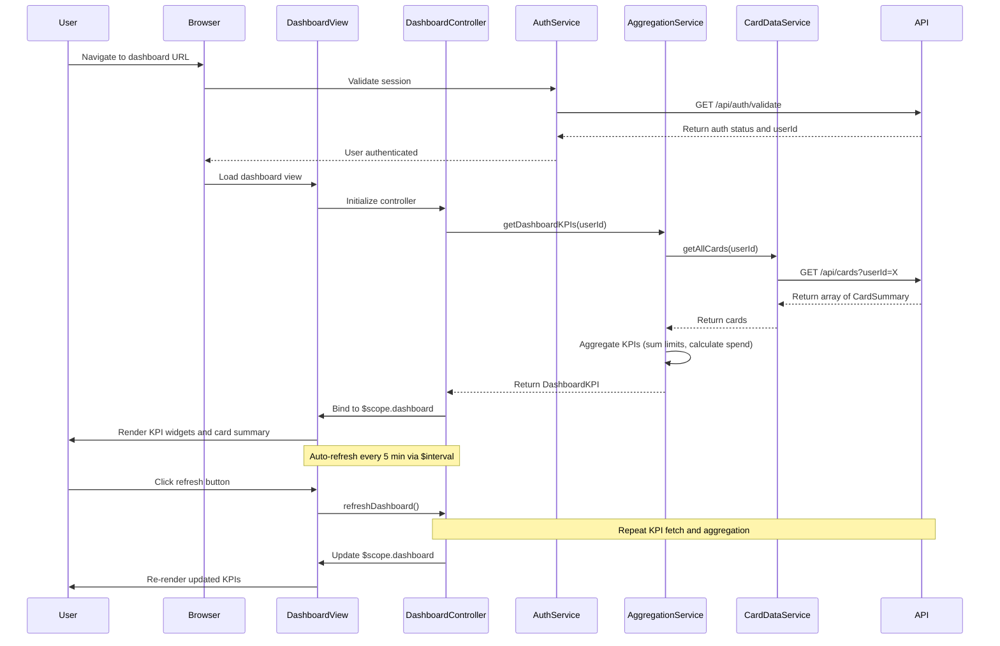

# Low-Level Design: Credit Card Dashboard and KPI Management
**Epic ID:** QE-10752  
**Application Stack:** AngularJS 1.x, JavaScript ES6, HTML5, CSS3, Bootstrap, REST APIs, MVC Architecture

---

## a. Architecture Mapping

| HLD Component | AngularJS Artifact | Purpose |
|---------------|-------------------|----------|
| Dashboard UI Layer | Module: `dashboardModule` | Root module for dashboard feature |
| Dashboard UI Layer | Controller: `DashboardController` | Manages dashboard view state and KPI display |
| User Authentication Service | Service: `AuthService` | Validates user identity and manages session |
| Data Aggregation Service | Service: `AggregationService` | Calculates consolidated KPIs across multiple cards |
| Credit Card Data Storage | Service: `CardDataService` | Retrieves card data from REST API |
| Dashboard UI Components | Directive: `kpiWidget` | Reusable widget for displaying individual KPIs |

**Recommended Folder Structure:**
```
app/
├── modules/
│   └── dashboard/
│       ├── controllers/
│       │   └── dashboardController.js
│       ├── services/
│       │   ├── authService.js
│       │   ├── aggregationService.js
│       │   └── cardDataService.js
│       ├── directives/
│       │   └── kpiWidget.js
│       ├── views/
│       │   └── dashboard.html
│       └── dashboardModule.js
```

---

## b. Component Specifications

| Component Name | Artifact Type | Responsibility | Key Dependencies |
|----------------|---------------|----------------|------------------|
| `dashboardModule` | Module | Encapsulates dashboard components, routing, and initialization | `ngRoute`, `ui.bootstrap` |
| `DashboardController` | Controller | Manages dashboard view state, fetches KPI data, handles refresh actions | `AggregationService`, `AuthService`, `$scope`, `$interval` |
| `AuthService` | Service | Validates user identity, manages authentication token, handles login/logout | `$http`, `$window`, `$q` |
| `AggregationService` | Service | Aggregates data from multiple cards to calculate consolidated KPIs | `CardDataService`, `$q` |
| `CardDataService` | Service | Fetches credit card data from REST API endpoint `/api/cards` | `$http`, `$q` |
| `kpiWidget` | Directive | Reusable component to display individual KPI with icon, label, and value | None (isolated scope) |

---

## c. Data Model

**DashboardKPI Model:**
```javascript
class DashboardKPI {
  monthlySpend: Number
  totalCreditLimit: Number
  availableCredit: Number
  outstandingAmount: Number
  lastUpdated: Date
}
```

**CardSummary Model:**
```javascript
class CardSummary {
  cardId: String
  cardName: String
  creditLimit: Number
  availableCredit: Number
  outstandingBalance: Number
  currentMonthSpend: Number
}
```

**DashboardViewModel:**
```javascript
class DashboardViewModel {
  kpis: DashboardKPI
  cards: Array<CardSummary>
  userName: String
  isLoading: Boolean
}
```

---

## d. Data Flow

User accesses dashboard URL → `AuthService` validates user session and token → `DashboardController` initializes and calls `AggregationService.getDashboardKPIs(userId)` → `AggregationService` calls `CardDataService.getAllCards(userId)` which sends GET request to `/api/cards?userId=X` → API returns array of CardSummary objects → `AggregationService` aggregates data (sums credit limits, available credit, outstanding amounts, calculates monthly spend from transactions) → Aggregated KPIs returned to controller as DashboardKPI object → Controller binds data to `$scope.dashboard` → View renders KPI widgets using `kpiWidget` directive with Bootstrap responsive grid → Dashboard auto-refreshes every 5 minutes via `$interval` service → User can manually refresh by clicking refresh button which triggers same data flow.

---

## e. Primary Sequence Diagram



---

## f. Implementation Notes

- Use AngularJS Dependency Injection to inject services into `DashboardController` for testability and separation of concerns.
- Implement `AggregationService` with caching using `$cacheFactory` to store aggregated KPIs for 5 minutes to meet 2-second load time NFR and reduce API calls.
- Use ES6 classes for service logic and arrow functions for callbacks; transpile with Babel if targeting older browsers.
- Implement `kpiWidget` directive with isolated scope `{label: '@', value: '=', icon: '@'}` for reusability across different KPIs.
- Use Bootstrap grid system (`col-xs-12 col-sm-6 col-md-3`) for responsive layout ensuring mobile, tablet, and desktop compatibility.

---

## g. Error Handling

HTTP interceptor handles API errors globally; display user-friendly error messages using Bootstrap alert component; implement try/catch in controllers for synchronous errors.

---

## h. Security Notes

Requires token-based auth via existing SSO; `AuthService` manages JWT token in `$window.sessionStorage`; all API calls include Authorization header; validate userId server-side to ensure data scoping.

---

**End of LLD for QE-10752**