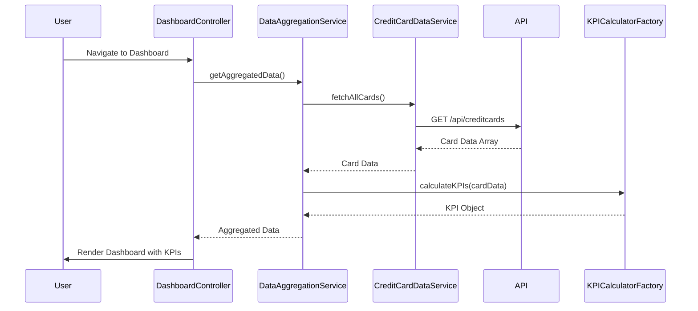

# Low-Level Design (LLD)
## Epic: QE-10753 - Credit Card Dashboard and KPI Monitoring

### a. Architecture Mapping

- **Dashboard UI Layer** → AngularJS Module (`creditCardDashboardModule`) + Controller (`DashboardController`)
- **Authentication Service** → AngularJS Service (`AuthService`) for token management and session validation
- **Credit Card Data Service** → AngularJS Service (`CreditCardDataService`) for REST API calls
- **KPI Calculation Engine** → AngularJS Factory (`KPICalculatorFactory`) for aggregating card data
- **Data Aggregation Layer** → AngularJS Service (`DataAggregationService`) orchestrating data flow

**Recommended Folder Structure:**
```
/app
  /modules
    /dashboard
      dashboard.module.js
      dashboard.controller.js
      dashboard.html
  /services
    auth.service.js
    creditCardData.service.js
    dataAggregation.service.js
  /factories
    kpiCalculator.factory.js
  /assets
    /css
    /images
```

### b. Component Specifications

| Component Name | Artifact Type | Responsibility | Key Dependencies |
|----------------|---------------|----------------|------------------|
| creditCardDashboardModule | Module | Root module for dashboard feature, registers all components | angular, ui.router |
| DashboardController | Controller | Manages dashboard view state, binds KPI data to UI | DataAggregationService, $scope |
| AuthService | Service | Handles user authentication and token validation | $http, $window |
| CreditCardDataService | Service | Fetches credit card data from REST API | $http, $q, API_CONFIG |
| DataAggregationService | Service | Orchestrates data retrieval and aggregation logic | CreditCardDataService, KPICalculatorFactory |
| KPICalculatorFactory | Factory | Calculates monthly spend, total limit, available credit, outstanding amount | None |
| dashboardDirective | Directive | Renders KPI cards with responsive layout | None |

### c. Data Model

**CreditCard Object:**
```javascript
{
  cardId: String,
  cardNumber: String (masked),
  cardType: String,
  creditLimit: Number,
  availableCredit: Number,
  outstandingAmount: Number,
  status: String
}
```

**KPI Object:**
```javascript
{
  monthlySpend: Number,
  totalCreditLimit: Number,
  totalAvailableCredit: Number,
  totalOutstanding: Number,
  lastUpdated: Date
}
```

### d. Data Flow

User navigates to dashboard → DashboardController initializes and calls DataAggregationService → DataAggregationService invokes CreditCardDataService to fetch all user credit cards via REST API → KPICalculatorFactory aggregates card data to compute KPIs (monthly spend, total credit limit, available credit, outstanding amount) → Aggregated KPI object is returned to DashboardController → Controller binds data to $scope → View renders KPI cards and card list using Angular data binding with responsive Bootstrap grid layout.

### e. Primary Sequence Diagram



### f. Implementation Notes

- Use AngularJS 1.x dependency injection for all services and factories; register components via module.controller(), module.service(), module.factory()
- Implement $http interceptors in AuthService for automatic token attachment to API requests
- Use $q promises for async API calls; chain .then() for data transformation in services
- Apply Bootstrap responsive grid (col-xs, col-sm, col-md) for KPI card layout to meet multi-device NFR
- Implement $interval or manual refresh mechanism for real-time KPI updates; cache API responses for 30 seconds to optimize performance

### g. Error Handling

HTTP interceptor-based error handling with user notification via toast/modal for API failures; try/catch in KPI calculation logic.

### h. Security Notes

Requires token-based auth via existing SSO; AuthService manages secure token storage and validation.