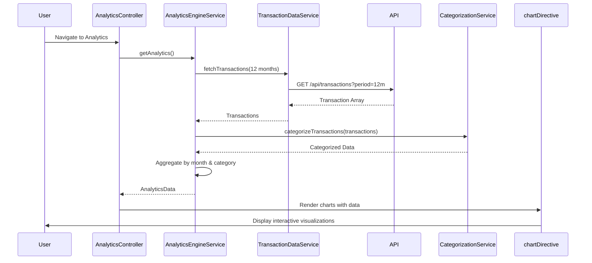

# Low-Level Design (LLD)
## Epic: QE-10754 - Spending Analytics and Insights

### a. Architecture Mapping

- **User Interface** → AngularJS Module (`spendingAnalyticsModule`) + Controller (`AnalyticsController`)
- **Visualization Layer** → AngularJS Directive (`chartDirective`) for rendering charts
- **Transaction Data Service** → AngularJS Service (`TransactionDataService`) for REST API integration
- **Analytics Engine** → AngularJS Service (`AnalyticsEngineService`) for data processing and aggregation
- **Categorization Service** → AngularJS Service (`CategorizationService`) for category mapping
- **Chart Rendering Library** → Integration with Chart.js or D3.js via Angular wrapper directive

**Recommended Folder Structure:**
```
/app
  /modules
    /analytics
      analytics.module.js
      analytics.controller.js
      analytics.html
  /services
    transactionData.service.js
    analyticsEngine.service.js
    categorization.service.js
  /directives
    chart.directive.js
  /assets
    /css
    /js/libs (Chart.js/D3.js)
```

### b. Component Specifications

| Component Name | Artifact Type | Responsibility | Key Dependencies |
|----------------|---------------|----------------|------------------|
| spendingAnalyticsModule | Module | Root module for analytics feature | angular, ui.router, chart.js |
| AnalyticsController | Controller | Manages analytics view, binds chart data and category filters | AnalyticsEngineService, $scope |
| TransactionDataService | Service | Fetches transaction history from REST API (12 months) | $http, $q, API_CONFIG |
| AnalyticsEngineService | Service | Aggregates transactions by month and category, computes trends | TransactionDataService, CategorizationService |
| CategorizationService | Service | Maps transactions to 9 predefined categories | None |
| chartDirective | Directive | Renders interactive charts (line for trends, pie/bar for categories) using Chart.js | Chart.js library |

### c. Data Model

**Transaction Object:**
```javascript
{
  transactionId: String,
  cardId: String,
  amount: Number,
  category: String,
  date: Date,
  description: String
}
```

**AnalyticsData Object:**
```javascript
{
  monthlyTrends: Array<{month: String, totalSpend: Number}>,
  categoryBreakdown: Array<{category: String, amount: Number, percentage: Number}>,
  categories: ['Food & Dining', 'Fuel', 'Shopping', 'Travel', 'Entertainment', 'Utilities', 'Healthcare', 'Education', 'Miscellaneous']
}
```

### d. Data Flow

User navigates to analytics page → AnalyticsController calls AnalyticsEngineService.getAnalytics() → AnalyticsEngineService invokes TransactionDataService to fetch 12 months of transaction data via REST API → CategorizationService maps each transaction to one of 9 categories → AnalyticsEngineService aggregates data by month and category, computes totals and percentages → Processed AnalyticsData object returned to AnalyticsController → Controller binds data to $scope → chartDirective renders interactive line chart (monthly trends) and pie/bar chart (category breakdown) using Chart.js with touch-enabled responsive configuration.

### e. Primary Sequence Diagram



### f. Implementation Notes

- Use Chart.js Angular directive wrapper for declarative chart rendering; configure responsive: true and maintainAspectRatio: false for mobile compatibility
- Implement AnalyticsEngineService with ES6 Array methods (map, filter, reduce) for efficient data aggregation
- Cache processed analytics data in AnalyticsEngineService for 5 minutes to meet 1.5s rendering NFR on subsequent views
- Use AngularJS $watch on category filter to dynamically update charts without full data reload
- Enable touch events in Chart.js configuration for mobile gesture support

### g. Error Handling

HTTP interceptor handles API errors; AnalyticsEngineService uses try/catch for aggregation logic with fallback empty state display.

### h. Security Notes

Standard input validation and secure API calls assumed; transaction data access controlled via user authentication token.