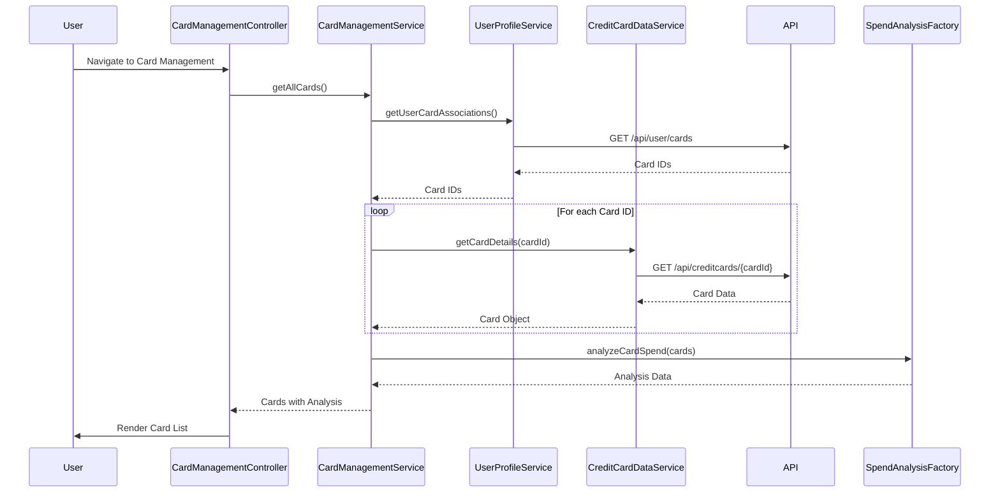

# Low-Level Design (LLD)
## Epic: QE-10755 - Credit Card Management and Tracking

### a. Architecture Mapping

- **User Interface** → AngularJS Module (`cardManagementModule`) + Controller (`CardManagementController`)
- **Card Management Module** → AngularJS Controller (`CardManagementController`) + Service (`CardManagementService`)
- **Credit Card Data Service** → AngularJS Service (`CreditCardDataService`) for REST API calls
- **User Profile Service** → AngularJS Service (`UserProfileService`) for user-card associations
- **Spend Analysis Engine** → AngularJS Factory (`SpendAnalysisFactory`) for card-wise comparisons

**Recommended Folder Structure:**
```
/app
  /modules
    /cardManagement
      cardManagement.module.js
      cardManagement.controller.js
      cardManagement.html
      cardDetail.html
  /services
    cardManagement.service.js
    creditCardData.service.js
    userProfile.service.js
  /factories
    spendAnalysis.factory.js
  /assets
    /css
```

### b. Component Specifications

| Component Name | Artifact Type | Responsibility | Key Dependencies |
|----------------|---------------|----------------|------------------|
| cardManagementModule | Module | Root module for card management feature | angular, ui.router |
| CardManagementController | Controller | Manages card list view, card selection, and comparison UI | CardManagementService, $scope, $state |
| CardManagementService | Service | Orchestrates card data retrieval and spend analysis | CreditCardDataService, UserProfileService, SpendAnalysisFactory |
| CreditCardDataService | Service | Fetches individual card details and status via REST API | $http, $q, API_CONFIG |
| UserProfileService | Service | Retrieves user-card associations and user profile data | $http, $q |
| SpendAnalysisFactory | Factory | Computes card-wise spend totals and comparison metrics | None |
| cardDetailDirective | Directive | Renders individual card detail view with limits and balances | None |

### c. Data Model

**CreditCard Object:**
```javascript
{
  cardId: String,
  userId: String,
  cardNumber: String (masked),
  cardType: String,
  issuer: String,
  creditLimit: Number,
  availableCredit: Number,
  outstandingBalance: Number,
  status: String (Active/Inactive/Blocked),
  lastTransactionDate: Date
}
```

**CardSpendAnalysis Object:**
```javascript
{
  cardId: String,
  monthlySpend: Number,
  utilizationPercentage: Number,
  transactionCount: Number
}
```

### d. Data Flow

User navigates to card management page → CardManagementController calls CardManagementService.getAllCards() → CardManagementService invokes UserProfileService to get user-card associations → For each associated card, CreditCardDataService fetches detailed card info via REST API (sub-300ms per call) → SpendAnalysisFactory computes card-wise spend and utilization metrics → CardManagementService returns array of cards with spend analysis → Controller binds data to $scope → View renders card list with detail cards; user clicks card for detailed view → $state navigates to card detail view with selected card data.

### e. Primary Sequence Diagram



### f. Implementation Notes

- Use AngularJS $q.all() to parallelize multiple card detail API calls for improved performance while respecting 300ms latency NFR
- Implement card data caching in CreditCardDataService using $cacheFactory to reduce redundant API calls
- Use ui.router for card detail view navigation with cardId as route parameter
- Apply ES6 template literals for masked card number display formatting
- Implement card comparison feature using ng-repeat with orderBy filter for sorting by spend or utilization

### g. Error Handling

HTTP interceptor-based error handling; CardManagementService wraps API calls in try/catch with user-friendly error messages via notification service.

### h. Security Notes

Requires token-based auth via existing SSO; card numbers are masked on client-side; sensitive card data transmitted over HTTPS only.