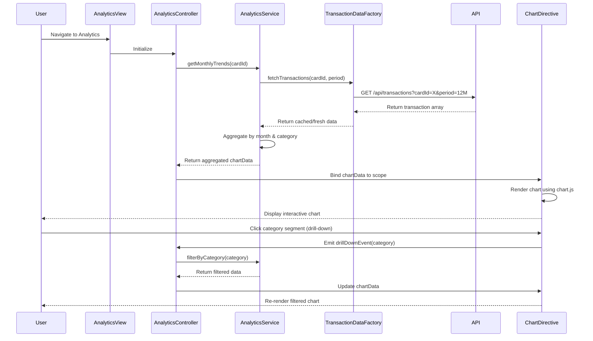

# Low-Level Design: QE-10756 - Spending Analytics and Transaction Insights

## a. Architecture Mapping

**HLD Component → AngularJS Artifact:**
- User Interface → AngularJS Module: `analytics.module` + Controller: `AnalyticsController`
- Analytics Presentation Layer → Directive: `spendingChart` + Directive: `categoryBreakdown`
- Analytics Engine → Service: `AnalyticsService` (aggregation, filtering, drill-down logic)
- Transaction Data Service → Factory: `TransactionDataFactory` (REST API client for transaction retrieval)
- Category Classification Service → Service: `CategoryService` (category mapping and filtering)

**Recommended Folder Structure:**
```
app/
├── modules/
│   └── analytics/
│       ├── analytics.module.js
│       ├── controllers/
│       │   └── analytics.controller.js
│       ├── services/
│       │   ├── analytics.service.js
│       │   └── category.service.js
│       ├── factories/
│       │   └── transaction-data.factory.js
│       ├── directives/
│       │   ├── spending-chart.directive.js
│       │   └── category-breakdown.directive.js
│       └── views/
│           └── analytics.html
```

## b. Component Specifications

| Component Name | Artifact Type | Responsibility | Key Dependencies |
|----------------|---------------|----------------|------------------|
| analytics.module | Module | Registers all analytics components and configures routing | ngRoute, chart.js |
| AnalyticsController | Controller | Manages analytics view state, user interactions, and chart data binding | AnalyticsService, CategoryService, $scope |
| AnalyticsService | Service | Aggregates transaction data, computes trends, handles drill-down logic | TransactionDataFactory, $q |
| CategoryService | Service | Maps transactions to 9 predefined categories, filters by category | None |
| TransactionDataFactory | Factory | Fetches transaction history via REST API, caches responses | $http, $cacheFactory |
| spendingChart | Directive | Renders interactive monthly spend trend chart with drill-down | chart.js, AnalyticsService |
| categoryBreakdown | Directive | Renders category-wise spending pie/bar chart | chart.js, CategoryService |

## c. Data Model

**Transaction Model:**
```javascript
{
  transactionId: String,
  cardId: String,
  amount: Number,
  category: String, // One of: Food & Dining, Fuel, Shopping, Travel, Entertainment, Utilities, Healthcare, Education, Miscellaneous
  date: Date,
  description: String,
  merchantName: String
}
```

**Analytics Summary Model:**
```javascript
{
  cardId: String,
  month: String, // YYYY-MM format
  totalSpend: Number,
  categorySpend: Object, // { "Food & Dining": 1500, "Fuel": 800, ... }
  transactionCount: Number
}
```

**Chart Data Model:**
```javascript
{
  labels: Array<String>, // e.g., ["Jan", "Feb", "Mar", ...]
  datasets: Array<Object>, // chart.js dataset format
  options: Object // chart configuration
}
```

## d. Data Flow

User navigates to Analytics view → AnalyticsController initializes and calls AnalyticsService.getMonthlyTrends() → AnalyticsService invokes TransactionDataFactory.fetchTransactions() which makes REST API call to /api/transactions?cardId=X&period=12M → Factory returns transaction array → AnalyticsService aggregates data by month and category using CategoryService.categorize() → Aggregated data is bound to $scope.chartData → spendingChart and categoryBreakdown directives render interactive charts using chart.js → User clicks chart segment to drill down → Directive emits event → Controller calls AnalyticsService.filterByCategory() → Updated data re-renders chart.

## e. Primary Sequence Diagram



## f. Implementation Notes

- Use AngularJS dependency injection to inject AnalyticsService, CategoryService, and TransactionDataFactory into AnalyticsController.
- Leverage $cacheFactory in TransactionDataFactory to cache transaction data for 5 minutes to meet 3-second render NFR.
- Integrate chart.js library via directive link function; bind chart update logic to $scope.$watch for reactive updates.
- Use ES6 arrow functions and const/let in services; structure services as ES6 classes wrapped in AngularJS service registration.
- Implement REST API calls using $http with promise chaining ($q); handle 1000+ transactions per card by implementing pagination or server-side aggregation.

## g. Error Handling

HTTP interceptor captures API errors; display user-friendly toast notifications using angular-toastr; retry failed requests once with exponential backoff.

## h. Security Notes

Requires token-based authentication via existing SSO; include JWT token in Authorization header for all API calls; validate user access to card data server-side.