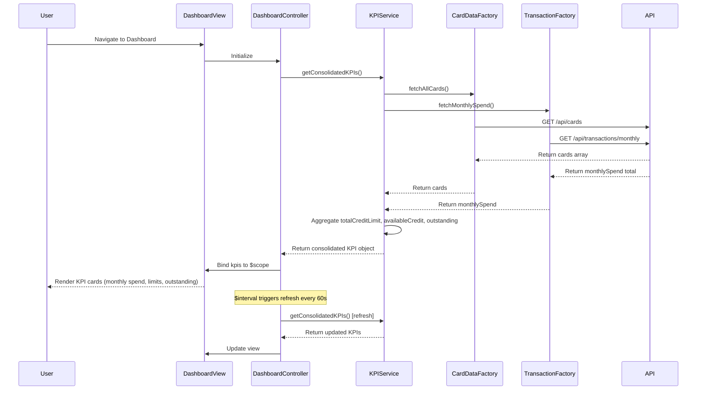

# Low-Level Design: QE-10757 - Dashboard KPIs and Financial Overview

## a. Architecture Mapping

**HLD Component → AngularJS Artifact:**
- User Device / Dashboard UI Layer → AngularJS Module: `dashboard.module` + Controller: `DashboardController`
- KPI Aggregation Service → Service: `KPIService` (aggregates monthly spend, credit limits, outstanding amounts)
- Credit Card Data Service → Factory: `CardDataFactory` (REST API client for card details and balances)
- Transaction Processing System → Factory: `TransactionFactory` (REST API client for spending calculations)

**Recommended Folder Structure:**
```
app/
├── modules/
│   └── dashboard/
│       ├── dashboard.module.js
│       ├── controllers/
│       │   └── dashboard.controller.js
│       ├── services/
│       │   └── kpi.service.js
│       ├── factories/
│       │   ├── card-data.factory.js
│       │   └── transaction.factory.js
│       └── views/
│           └── dashboard.html
```

## b. Component Specifications

| Component Name | Artifact Type | Responsibility | Key Dependencies |
|----------------|---------------|----------------|------------------|
| dashboard.module | Module | Registers dashboard components, configures routing and responsive breakpoints | ngRoute, angular-responsive |
| DashboardController | Controller | Manages dashboard state, fetches KPI data, binds to view | KPIService, $scope, $interval |
| KPIService | Service | Aggregates KPIs across all cards (monthly spend, total limit, available credit, outstanding) | CardDataFactory, TransactionFactory, $q |
| CardDataFactory | Factory | Fetches card details, balances, limits via REST API | $http, $cacheFactory |
| TransactionFactory | Factory | Fetches monthly spending data via REST API | $http |

## c. Data Model

**Card Model:**
```javascript
{
  cardId: String,
  cardNumber: String, // Masked, e.g., "**** **** **** 1234"
  cardType: String, // e.g., "Visa", "MasterCard"
  creditLimit: Number,
  availableCredit: Number,
  outstandingAmount: Number
}
```

**KPI Model:**
```javascript
{
  monthlySpend: Number,
  totalCreditLimit: Number,
  totalAvailableCredit: Number,
  totalOutstanding: Number,
  lastUpdated: Date
}
```

**Dashboard ViewModel:**
```javascript
{
  kpis: KPI,
  cards: Array<Card>,
  isLoading: Boolean,
  errorMessage: String
}
```

## d. Data Flow

User navigates to Dashboard → DashboardController initializes and calls KPIService.getConsolidatedKPIs() → KPIService concurrently invokes CardDataFactory.fetchAllCards() and TransactionFactory.fetchMonthlySpend() using $q.all() → Both factories make REST API calls to /api/cards and /api/transactions/monthly → API responses return card array and monthly spend total → KPIService aggregates totalCreditLimit, totalAvailableCredit, totalOutstanding by summing across cards → Aggregated KPI object is returned to DashboardController → Controller binds KPI data to $scope.kpis → View renders KPI cards with Bootstrap grid layout → Real-time refresh triggered by $interval every 60 seconds, repeating the flow.

## e. Primary Sequence Diagram



## f. Implementation Notes

- Use AngularJS $q.all() in KPIService to parallelize API calls to CardDataFactory and TransactionFactory for faster load times (<2s NFR).
- Implement responsive layout using Bootstrap grid classes (col-xs-*, col-sm-*, col-md-*, col-lg-*) in dashboard.html for mobile/tablet/desktop support.
- Cache card data in CardDataFactory using $cacheFactory with 5-minute TTL to reduce redundant API calls.
- Use $interval service in DashboardController to implement real-time refresh; ensure interval is cancelled on $scope.$destroy to prevent memory leaks.
- Structure services as ES6 classes; use const/let and arrow functions for cleaner code.

## g. Error Handling

HTTP interceptor-based error handling; display user-friendly error messages via angular-toastr on API failures; retry logic with exponential backoff for transient errors.

## h. Security Notes

Requires token-based auth via existing SSO; include JWT in Authorization header for all API requests; mask sensitive card numbers in UI.