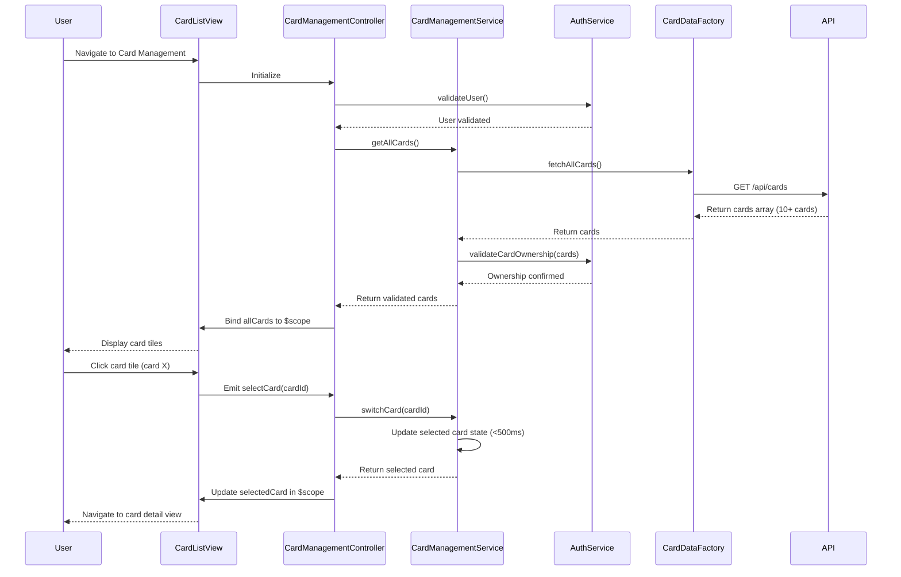

# Low-Level Design: QE-10758 - Multiple Credit Card Management

## a. Architecture Mapping

**HLD Component → AngularJS Artifact:**
- User Interface → AngularJS Module: `cardManagement.module` + Controller: `CardManagementController`
- Card Management Service → Service: `CardManagementService` (orchestrates card operations, switching, comparison)
- Credit Card Data Service → Factory: `CardDataFactory` (REST API client for card information)
- User Authentication Service → Service: `AuthService` (validates card ownership and user identity)

**Recommended Folder Structure:**
```
app/
├── modules/
│   └── card-management/
│       ├── card-management.module.js
│       ├── controllers/
│       │   └── card-management.controller.js
│       ├── services/
│       │   ├── card-management.service.js
│       │   └── auth.service.js
│       ├── factories/
│       │   └── card-data.factory.js
│       ├── directives/
│       │   └── card-tile.directive.js
│       └── views/
│           ├── card-list.html
│           └── card-detail.html
```

## b. Component Specifications

| Component Name | Artifact Type | Responsibility | Key Dependencies |
|----------------|---------------|----------------|------------------|
| cardManagement.module | Module | Registers card management components, configures routing | ngRoute |
| CardManagementController | Controller | Manages card list, card switching, selected card state, comparison view | CardManagementService, AuthService, $scope |
| CardManagementService | Service | Orchestrates card retrieval, switching logic, card comparison calculations | CardDataFactory, $q |
| AuthService | Service | Validates user identity and card ownership before displaying card data | $http, $window (for token storage) |
| CardDataFactory | Factory | Fetches card details (limits, balances, availability) via REST API | $http, $cacheFactory |
| cardTile | Directive | Renders individual card tile with card-specific metrics, handles click events | None |

## c. Data Model

**Card Model:**
```javascript
{
  cardId: String,
  cardNumber: String, // Masked, e.g., "**** **** **** 5678"
  cardType: String, // e.g., "Visa", "MasterCard", "Amex"
  cardHolderName: String,
  creditLimit: Number,
  availableCredit: Number,
  outstandingBalance: Number,
  expiryDate: String, // MM/YY format
  isActive: Boolean
}
```

**Card Comparison Model:**
```javascript
{
  cards: Array<Card>,
  comparisonMetrics: {
    highestLimit: Card,
    lowestOutstanding: Card,
    highestUtilization: Card
  }
}
```

**View State Model:**
```javascript
{
  allCards: Array<Card>,
  selectedCard: Card,
  isLoading: Boolean,
  errorMessage: String
}
```

## d. Data Flow

User navigates to Card Management view → CardManagementController initializes and calls AuthService.validateUser() to verify user identity → Upon successful validation, controller calls CardManagementService.getAllCards() → Service invokes CardDataFactory.fetchAllCards() which makes REST API call to /api/cards → Factory returns array of up to 10+ cards → Service validates card ownership via AuthService → CardManagementService returns validated card array to controller → Controller binds cards to $scope.allCards and sets $scope.selectedCard to first card → View renders card list using ng-repeat and cardTile directive → User clicks a card tile → cardTile emits selectCard event → Controller calls CardManagementService.switchCard(cardId) → Service updates selected card state within 500ms → Controller updates $scope.selectedCard → View transitions to card detail view displaying card-specific metrics.

## e. Primary Sequence Diagram



## f. Implementation Notes

- Use AngularJS dependency injection to inject CardManagementService, AuthService, and CardDataFactory into CardManagementController.
- Implement card switching with $scope.$apply() to ensure state updates occur within 500ms NFR; use $timeout with 0ms delay if needed to batch digest cycles.
- Cache card data in CardDataFactory using $cacheFactory to ensure data consistency across all card views and reduce redundant API calls.
- Structure cardTile directive with isolate scope and two-way binding for selectedCard; use ng-click to emit selectCard event to parent controller.
- Use ES6 classes for services; implement CardManagementService.switchCard() as synchronous method operating on cached data to meet 500ms switching requirement.

## g. Error Handling

Interceptor-based error handling for API failures; display error toasts using angular-toastr; implement try/catch in AuthService for token validation errors.

## h. Security Notes

Requires token-based auth via existing SSO; validate card ownership server-side before returning card data; mask sensitive card numbers in UI and API responses.