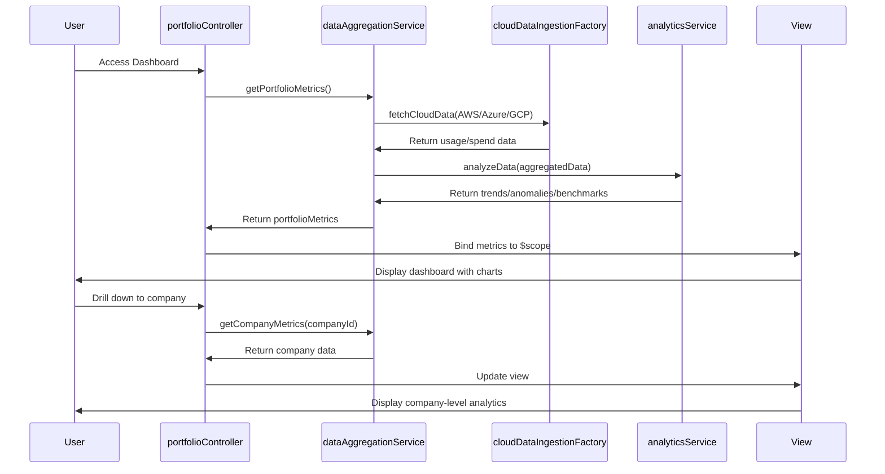

# Low-Level Design: AI Usage and Spend Dashboard
**Epic ID:** QE-5773

---

## a. Architecture Mapping

- **Data Ingestion Service** → AngularJS Factory (`cloudDataIngestionFactory`) - handles API polling from AWS/Azure/GCP
- **Data Aggregation Engine** → AngularJS Service (`dataAggregationService`) - consolidates multi-cloud data
- **Analytics & Benchmarking Service** → AngularJS Service (`analyticsService`) - processes trends, anomalies, benchmarks
- **Dashboard Web Application** → AngularJS Module (`aiDashboardModule`) with Controllers (`portfolioController`, `companyController`, `drillDownController`)
- **Report Generation Service** → AngularJS Factory (`reportFactory`) - generates PDF/Excel exports
- **SSO Provider** → AngularJS Service (`authService`) - handles authentication/authorization

**Folder Structure:**
```
app/
├── modules/
│   └── ai-dashboard/
│       ├── controllers/
│       ├── services/
│       ├── factories/
│       ├── directives/
│       └── views/
├── shared/
│   ├── auth/
│   └── components/
└── assets/
```

---

## b. Component Specifications

| Name | Artifact Type | Responsibility | Key Dependencies |
|------|---------------|----------------|------------------|
| aiDashboardModule | Module | Root module for AI dashboard application | ngRoute, ngResource, chart.js |
| portfolioController | Controller | Manages portfolio-wide view and aggregated metrics | dataAggregationService, analyticsService |
| companyController | Controller | Manages company-level drill-down views | dataAggregationService, $routeParams |
| drillDownController | Controller | Handles department/project level analytics | analyticsService, $scope |
| dataAggregationService | Service | Consolidates data from multiple cloud providers | cloudDataIngestionFactory, $http |
| analyticsService | Service | Performs trend analysis, anomaly detection, benchmarking | dataAggregationService, $q |
| cloudDataIngestionFactory | Factory | Fetches usage/spend data from AWS/Azure/GCP APIs | $http, $interval |
| reportFactory | Factory | Generates PDF/Excel reports from dashboard data | dataAggregationService, $window |
| authService | Service | Handles SSO authentication and role-based access | $http, $location, $cookies |
| dashboardChartDirective | Directive | Renders interactive charts for spend/usage visualization | chart.js, $timeout |
| freshnessIndicatorDirective | Directive | Displays data freshness timestamp and status | $interval |
| anomalyAlertDirective | Directive | Shows anomaly notifications with drill-down links | analyticsService |

---

## c. Data Model

**CloudUsageData**
- `companyId`: String
- `companyName`: String
- `provider`: String (AWS/Azure/GCP)
- `service`: String
- `usageMetrics`: Object { calls: Number, tokens: Number, computeHours: Number }
- `spendData`: Object { amount: Number, currency: String, billingPeriod: String }
- `timestamp`: Date

**PortfolioMetrics**
- `totalSpend`: Number
- `totalUsage`: Number
- `companyCount`: Number
- `topSpenders`: Array[Object]
- `anomalies`: Array[Object]
- `benchmarkComparison`: Object { industryAvg: Number, portfolioAvg: Number }

**Report**
- `reportId`: String
- `reportType`: String (PDF/Excel)
- `generatedDate`: Date
- `dataRange`: Object { startDate: Date, endDate: Date }
- `content`: Blob

---

## d. Data Flow

User authenticates via SSO and accesses dashboard → portfolioController initializes and requests aggregated data → dataAggregationService calls cloudDataIngestionFactory to fetch latest usage/spend from AWS/Azure/GCP APIs → aggregated data processed by analyticsService for trends, anomalies, and benchmarks → portfolioController receives processed data and binds to view → dashboardChartDirective renders interactive visualizations → user drills down to company level → companyController fetches company-specific data and updates view → user requests report → reportFactory generates PDF/Excel and triggers download → freshnessIndicatorDirective continuously displays last update timestamp.

---

## e. Primary Sequence Diagram



---

## f. Implementation Notes

- Use AngularJS dependency injection for all services, factories, and controllers to enable testability and modularity
- Leverage ES6 arrow functions and promises ($q) for asynchronous API calls and data processing
- Implement HTTP interceptor for centralized error handling and authentication token injection
- Use chart.js with Angular directives for responsive, interactive data visualizations
- Apply MVC pattern: Controllers manage business logic, Services handle data operations, Views bind via two-way data binding

---

## g. Error Handling

HTTP interceptor-based approach with global error handler; failed API calls trigger user-friendly notifications via toastr and retry logic for transient failures.

---

## h. Security Notes

Requires token-based authentication via existing SSO provider; all API calls secured with bearer tokens and TLS 1.2+; role-based access control enforced at service layer.