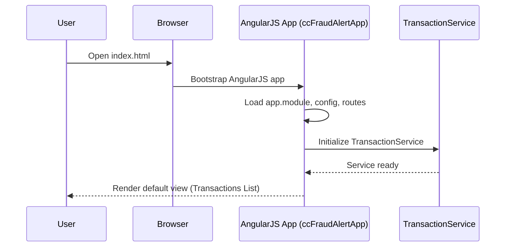
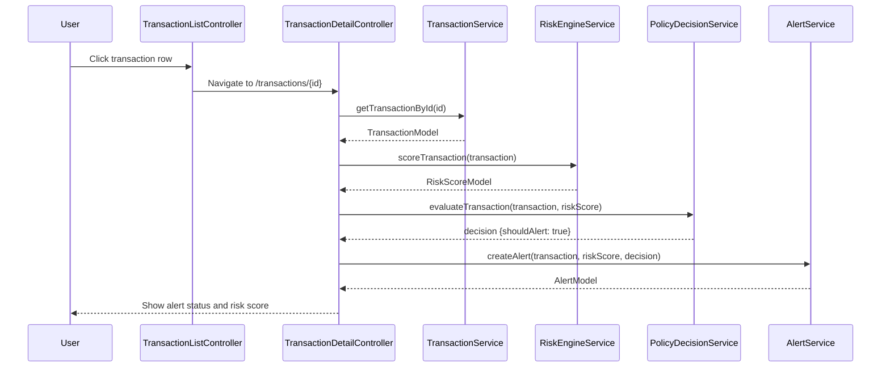
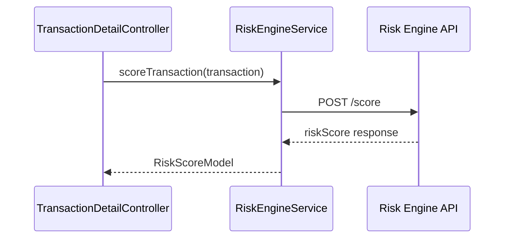
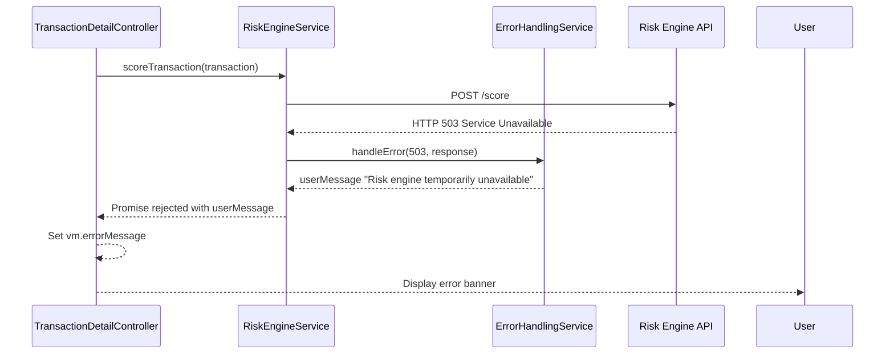

# QE-7334 – Credit Card Fraud Alert Foundational Capabilities – Low‑Level Design (LLD)

---

## 1. Application Architecture

### 1.1 Architectural Overview

This LLD defines the implementation of the **credit card transaction ingestion and fraud alert foundation** epic as an enterprise-grade web application built with:

- AngularJS (1.x) for the client-side MVC
- JavaScript ES6 for business logic
- HTML5, CSS3, Bootstrap for UI
- REST APIs for server communication
- MVC architecture on the backend (conceptual; REST endpoints assumed to exist)

The web application provides:

- Real-time visualization of transaction ingestion status
- Risk-score display per transaction
- Alert generation view/list when scores cross thresholds
- Configuration UI for risk thresholds and related policies (UI hooks, even if backend might be separate)

The application integrates with:

- Upstream card authorization/transaction platform (via backend REST APIs that expose ingested transactions)
- Fraud-risk engine/model (via backend REST APIs that calculate risk scores)
- Policy/decision engine (via backend REST APIs that determine whether alerts should be raised)


### 1.2 AngularJS MVC Mapping

**AngularJS Application Name (Application_Name):** `ccFraudAlertApp`

- **Modules**
  - `ccFraudAlertApp` – root module
  - `ccfa.transactions` – transaction ingestion and listing
  - `ccfa.risk` – risk score visualization
  - `ccfa.alerts` – alert generation, listing, and detail view
  - `ccfa.config` – configuration management (thresholds, policies)
  - `ccfa.common` – shared services, models, filters, and directives

- **Controllers**
  - `TransactionListController` – manages transaction list and ingestion status
  - `TransactionDetailController` – displays detailed information and risk scores for a single transaction
  - `RiskScoreController` – handles risk-related UI components (e.g., score charts)
  - `AlertListController` – manages list of raised alerts
  - `AlertDetailController` – displays full alert details and decision information
  - `ConfigThresholdController` – manages threshold configuration UI

- **Services / Factories**
  - `TransactionService` – communication with transaction ingestion REST APIs
  - `RiskEngineService` – communication with fraud-risk engine REST APIs
  - `PolicyDecisionService` – communication with policy/decision engine REST APIs
  - `AlertService` – communication with alert generation REST APIs
  - `ConfigService` – communication with configuration REST APIs
  - `LoggingService` – client-side logging abstraction
  - `ErrorHandlingService` – standardized error handling

- **Directives**
  - `transactionCard` – directive for rendering transaction summary cards
  - `riskScoreBadge` – directive for visualizing risk scores
  - `alertStatusLabel` – directive for displaying alert status

- **Models (Plain JS Objects)**
  - `TransactionModel` – in-memory representation of a transaction
  - `RiskScoreModel` – risk score and related metadata
  - `AlertModel` – alert record and state
  - `ThresholdConfigModel` – configuration object for thresholds

- **Filters**
  - `riskLevelFilter` – converts numeric risk score to textual risk level (Low/Medium/High/Critical)
  - `transactionStatusFilter` – formats transaction status codes
  - `alertStatusFilter` – formats alert state

- **Configuration**
  - `app.routes.js` – defines AngularJS routes and views
  - `app.config.js` – defines AngularJS configuration (interceptors, constants)
  - `app.constants.js` – defines API base URLs, feature flags, environment settings


### 1.3 Recommended Project Folder Structure

```text
/webapp
  /app
    app.module.js
    app.config.js
    app.routes.js
    app.constants.js

    /common
      services/
        logging.service.js
        error-handling.service.js
      models/
        transaction.model.js
        risk-score.model.js
        alert.model.js
        threshold-config.model.js
      filters/
        risk-level.filter.js
        transaction-status.filter.js
        alert-status.filter.js
      directives/
        transaction-card.directive.js
        risk-score-badge.directive.js
        alert-status-label.directive.js

    /transactions
      transactions.module.js
      controllers/
        transaction-list.controller.js
        transaction-detail.controller.js
      services/
        transaction.service.js
      views/
        transactions-list.html
        transaction-detail.html

    /risk
      risk.module.js
      controllers/
        risk-score.controller.js
      services/
        risk-engine.service.js
      views/
        risk-score-panel.html

    /alerts
      alerts.module.js
      controllers/
        alert-list.controller.js
        alert-detail.controller.js
      services/
        alert.service.js
      views/
        alerts-list.html
        alert-detail.html

    /config
      config.module.js
      controllers/
        config-threshold.controller.js
      services/
        config.service.js
      views/
        config-threshold.html

  /assets
    css/
      main.css
      alerts.css
      transactions.css
    js/
      lib/ (AngularJS, Bootstrap, etc.)
    img/
      icons/

  index.html
```

Each HLD component is mapped to one or more AngularJS artifacts as described in the next sections.


---

## 2. Component Specifications

### 2.1 `ccFraudAlertApp` Root Module

- **Type:** AngularJS Module
- **File:** `app/app.module.js`
- **Responsibility:**
  - Declare dependency on feature modules (`ccfa.transactions`, `ccfa.risk`, `ccfa.alerts`, `ccfa.config`, `ccfa.common`).
  - Initialize the overall AngularJS application.
- **Public API:**
  - Angular module declaration `angular.module('ccFraudAlertApp', [...])`.
- **Dependencies:**
  - `ngRoute`, `ngAnimate`, `ngSanitize`, `ui.bootstrap`, `ccfa.transactions`, `ccfa.risk`, `ccfa.alerts`, `ccfa.config`, `ccfa.common`.
- **Inputs/Outputs:**
  - Inputs: No direct inputs; Angular bootstrap.
  - Outputs: Provides DI container for controllers/services.


### 2.2 `TransactionService`

- **Type:** AngularJS Service (factory)
- **File:** `app/transactions/services/transaction.service.js`
- **Responsibility:**
  - Communicate with backend transaction ingestion APIs.
  - Fetch current transactions, streaming or polling new ones as they arrive.
  - Provide methods for filtering/searching transactions in the frontend.
- **Public Methods:**
  - `getTransactions(params)` – returns a promise with transaction list.
  - `getTransactionById(transactionId)` – returns a promise with transaction detail.
  - `subscribeToNewTransactions(callback)` – optional; registers a callback for new transactions via polling or web-socket wrapper.
- **Inputs:**
  - `params` (object): pagination, date range, card number mask, status filters.
  - `transactionId` (string): unique transaction identifier.
  - `callback` (function): handler for newly ingested transactions.
- **Outputs:**
  - Promise resolving to arrays or single `TransactionModel` objects.
- **Dependencies/Injected Services:**
  - `$http`, `$q`, `LoggingService`, `ErrorHandlingService`, `API_ENDPOINTS` constant.


### 2.3 `RiskEngineService`

- **Type:** AngularJS Service
- **File:** `app/risk/services/risk-engine.service.js`
- **Responsibility:**
  - Interact with fraud-risk engine REST API.
  - Request risk scores for transactions.
  - Normalize risk-score responses into `RiskScoreModel`.
- **Public Methods:**
  - `scoreTransaction(transaction)` – scores a transaction, returns a promise resolving to `RiskScoreModel`.
  - `getBatchScores(transactionIds)` – optional batch scoring.
- **Inputs:**
  - `transaction` (`TransactionModel` or plain JS object).
  - `transactionIds` (array of strings).
- **Outputs:**
  - Promise resolving to `RiskScoreModel` or array of `RiskScoreModel`.
- **Dependencies:**
  - `$http`, `$q`, `LoggingService`, `ErrorHandlingService`, `API_ENDPOINTS`.


### 2.4 `PolicyDecisionService`

- **Type:** AngularJS Service
- **File:** `app/alerts/services/policy-decision.service.js`
- **Responsibility:**
  - Communicate with policy/decision engine REST API.
  - Determine whether a transaction should trigger an alert based on risk score and configured thresholds.
- **Public Methods:**
  - `evaluateTransaction(transaction, riskScore)` – returns decision result (e.g., `shouldAlert`, `reasonCodes`).
- **Inputs:**
  - `transaction` (`TransactionModel`).
  - `riskScore` (`RiskScoreModel`).
- **Outputs:**
  - Promise resolving to a decision object: `{ shouldAlert: boolean, decisionCode: string, reasons: [] }`.
- **Dependencies:**
  - `$http`, `$q`, `ConfigService`, `LoggingService`, `ErrorHandlingService`, `API_ENDPOINTS`.


### 2.5 `AlertService`

- **Type:** AngularJS Service
- **File:** `app/alerts/services/alert.service.js`
- **Responsibility:**
  - Creation, retrieval, and listing of alerts.
  - Persist alert records via backend API when `PolicyDecisionService` indicates `shouldAlert = true`.
- **Public Methods:**
  - `createAlert(transaction, riskScore, decision)` – creates new alert.
  - `getAlerts(params)` – retrieves alerts list with filter and pagination.
  - `getAlertById(alertId)` – retrieves single alert detail.
- **Inputs:**
  - `transaction` (`TransactionModel`).
  - `riskScore` (`RiskScoreModel`).
  - `decision` (decision object).
  - `params` (filter object).
  - `alertId` (string).
- **Outputs:**
  - Promise resolving to `AlertModel` or array of `AlertModel`.
- **Dependencies:**
  - `$http`, `$q`, `LoggingService`, `ErrorHandlingService`, `API_ENDPOINTS`.


### 2.6 `ConfigService`

- **Type:** AngularJS Service
- **File:** `app/config/services/config.service.js`
- **Responsibility:**
  - Manage configuration retrieval and updates for risk thresholds and policy parameters.
- **Public Methods:**
  - `getThresholdConfig()` – returns current threshold configurations.
  - `updateThresholdConfig(thresholdConfig)` – updates threshold settings.
- **Inputs:**
  - `thresholdConfig` (`ThresholdConfigModel`).
- **Outputs:**
  - Promise resolving to updated configuration object or status.
- **Dependencies:**
  - `$http`, `$q`, `LoggingService`, `ErrorHandlingService`, `API_ENDPOINTS`.


### 2.7 `TransactionListController`

- **Type:** AngularJS Controller
- **File:** `app/transactions/controllers/transaction-list.controller.js`
- **Responsibility:**
  - Control the transaction list view.
  - Initiate loading of transactions and refresh operations.
  - Handle user interactions such as filter changes and selection of a transaction.
- **Public Methods (on `$scope` or `controllerAs`):**
  - `loadTransactions()` – load initial transactions.
  - `refresh()` – re-fetch transactions (polling or manual refresh).
  - `applyFilters()` – apply user-selected filters.
  - `viewTransaction(transactionId)` – navigate to detail view.
- **Inputs:**
  - User actions via UI.
  - Route parameters (if applicable).
- **Outputs:**
  - Populates view model with list of `TransactionModel` items.
  - Navigates to transaction detail route.
- **Dependencies:**
  - `TransactionService`, `$scope` or `this`, `$location`/`$state`, `LoggingService`, `ErrorHandlingService`.


### 2.8 `TransactionDetailController`

- **Type:** AngularJS Controller
- **File:** `app/transactions/controllers/transaction-detail.controller.js`
- **Responsibility:**
  - Display transaction details and associated risk score and alert state.
  - Coordinate scoring and policy evaluation if not already done.
- **Public Methods:**
  - `loadTransaction()` – load transaction by ID.
  - `calculateRisk()` – invoke `RiskEngineService`.
  - `evaluatePolicy()` – call `PolicyDecisionService`.
  - `createAlertIfNeeded()` – call `AlertService` when policy indicates an alert.
- **Inputs:**
  - Route parameter `transactionId`.
- **Outputs:**
  - View model containing `TransactionModel`, `RiskScoreModel`, and `AlertModel` if exists.
- **Dependencies:**
  - `TransactionService`, `RiskEngineService`, `PolicyDecisionService`, `AlertService`, `$routeParams`, `LoggingService`, `ErrorHandlingService`.


### 2.9 `AlertListController`

- **Type:** AngularJS Controller
- **File:** `app/alerts/controllers/alert-list.controller.js`
- **Responsibility:**
  - Display list of generated fraud alerts.
  - Provide filtering by risk level, status, date range.
- **Public Methods:**
  - `loadAlerts()` – load alerts.
  - `applyAlertFilters()` – filter list.
  - `viewAlert(alertId)` – navigate to alert detail.
- **Dependencies:**
  - `AlertService`, `$location`/`$state`, `LoggingService`, `ErrorHandlingService`.


### 2.10 `AlertDetailController`

- **Type:** AngularJS Controller
- **File:** `app/alerts/controllers/alert-detail.controller.js`
- **Responsibility:**
  - Show detailed alert information (transaction, risk score, decision reasoning).
- **Public Methods:**
  - `loadAlert()` – retrieve alert by ID.
- **Inputs:**
  - `alertId` route parameter.
- **Outputs:**
  - `AlertModel` populated on the view.
- **Dependencies:**
  - `AlertService`, `TransactionService`, `RiskEngineService`, `$routeParams`.


### 2.11 `ConfigThresholdController`

- **Type:** AngularJS Controller
- **File:** `app/config/controllers/config-threshold.controller.js`
- **Responsibility:**
  - Render UI for viewing and modifying threshold configurations used by the policy engine.
- **Public Methods:**
  - `loadConfig()` – fetch current settings.
  - `saveConfig()` – persist updated settings.
  - `resetConfig()` – revert to defaults.
- **Dependencies:**
  - `ConfigService`, `LoggingService`, `ErrorHandlingService`.


### 2.12 Common Services & Directives

- **`LoggingService`**
  - File: `app/common/services/logging.service.js`
  - Responsibility: Abstract logging to console, remote logging APIs.

- **`ErrorHandlingService`**
  - File: `app/common/services/error-handling.service.js`
  - Responsibility: Standardize error transformation and user-visible messages.

- **`transactionCard` Directive**
  - File: `app/common/directives/transaction-card.directive.js`
  - Responsibility: Present transaction summary cards.

- **`riskScoreBadge` Directive**
  - File: `app/common/directives/risk-score-badge.directive.js`
  - Responsibility: Visual representation of risk score using colors and badges.

- **`alertStatusLabel` Directive**
  - File: `app/common/directives/alert-status-label.directive.js`
  - Responsibility: Display alert status (Open, Investigating, Closed).


---

## 3. Component Responsibilities (Detailed)

### 3.1 Business Logic Ownership

- **Transaction ingestion and listing**
  - Owned by `TransactionService` (data retrieval and normalization) and `TransactionListController` (UI, user interaction, state).
- **Risk evaluation**
  - Owned by `RiskEngineService` (API calls, response normalization) and `TransactionDetailController`/`RiskScoreController` (UI orchestration).
- **Policy evaluation and alert triggering**
  - Owned by `PolicyDecisionService` (policy invocation and evaluation) and `AlertService` (alert creation).
- **Configuration management**
  - Owned by `ConfigService` and `ConfigThresholdController`.

### 3.2 UI Handling

- Controllers interact with views via `$scope` (or `controllerAs`) to:
  - Maintain lists and selected items.
  - Track loading and error states.
  - Bind to filters and search inputs.
  - Display badges, labels, and alert statuses.

- Directives encapsulate reusable UI pieces, promoting separation of concerns.

### 3.3 State Management

- Transient UI state:
  - Maintained in controllers (e.g., `vm.transactions`, `vm.selectedTransaction`, `vm.alerts`).
- Entity state:
  - Represented by JS models (`TransactionModel`, `RiskScoreModel`, `AlertModel`, `ThresholdConfigModel`).
- Persistent state:
  - Managed via backend APIs using services.

### 3.4 API Communication

- All API communication flows through dedicated services (`TransactionService`, `RiskEngineService`, `PolicyDecisionService`, `AlertService`, `ConfigService`) using `$http` with ES6 promises (`.then`, `.catch`).
- HTTP interceptors (configured in `app.config.js`) handle authentication headers, correlation IDs, logging, and global error processing.

### 3.5 Validation

- Input validation:
  - Controllers validate user inputs (e.g., filter date ranges, numeric thresholds) using AngularJS built-in validation and custom directives.
  - Services validate critical parameters (e.g., non-null transaction IDs) before calling APIs.


---

## 4. Interface Specifications

### 4.1 REST API Interfaces

The following endpoints are defined for communication with backend systems. Actual host and base paths are driven by environment-specific constants.

#### 4.1.1 Transaction Ingestion Service API

- **Endpoint:** `GET {{API_BASE_URL}}/transactions`
- **Method:** `GET`
- **Request Parameters (query):**
  - `page` (number, optional)
  - `pageSize` (number, optional)
  - `fromDate` (ISO-8601 string, optional)
  - `toDate` (ISO-8601 string, optional)
  - `cardLast4` (string, optional, masked card number)
  - `status` (string, optional – e.g., `AUTHORIZED`, `DECLINED`)
- **Response (JSON):**
  ```json
  {
    "items": [
      {
        "id": "TXN12345",
        "timestamp": "2024-10-28T10:15:00Z",
        "amount": 123.45,
        "currency": "USD",
        "merchantId": "M123",
        "cardLast4": "1234",
        "status": "AUTHORIZED"
      }
    ],
    "page": 1,
    "pageSize": 50,
    "totalItems": 1000
  }
  ```
- **Error Responses:**
  - `400 Bad Request` – invalid query params.
  - `500 Internal Server Error` – ingestion system error.

- **Endpoint:** `GET {{API_BASE_URL}}/transactions/{transactionId}`
- **Method:** `GET`
- **Response:**
  ```json
  {
    "id": "TXN12345",
    "timestamp": "2024-10-28T10:15:00Z",
    "amount": 123.45,
    "currency": "USD",
    "merchantId": "M123",
    "merchantName": "ABC Store",
    "cardLast4": "1234",
    "status": "AUTHORIZED",
    "channel": "ECOMMERCE",
    "location": "US-CA",
    "rawPayload": { /* original authorization data */ }
  }
  ```


#### 4.1.2 Fraud-Risk Engine API

- **Endpoint:** `POST {{RISK_ENGINE_BASE_URL}}/score`
- **Method:** `POST`
- **Request Payload:**
  ```json
  {
    "transactionId": "TXN12345",
    "features": {
      "amount": 123.45,
      "merchantId": "M123",
      "channel": "ECOMMERCE",
      "location": "US-CA",
      "cardLast4": "1234",
      "timestamp": "2024-10-28T10:15:00Z"
    }
  }
  ```
- **Response:**
  ```json
  {
    "transactionId": "TXN12345",
    "score": 0.87,
    "scoreBand": "HIGH",
    "modelVersion": "2024.09.01",
    "reasonCodes": ["UNUSUAL_LOCATION", "HIGH_AMOUNT"]
  }
  ```
- **Error Responses:**
  - `400 Bad Request` – missing features.
  - `503 Service Unavailable` – risk engine not reachable.


#### 4.1.3 Policy/Decision Engine API

- **Endpoint:** `POST {{POLICY_ENGINE_BASE_URL}}/evaluate`
- **Method:** `POST`
- **Request Payload:**
  ```json
  {
    "transactionId": "TXN12345",
    "riskScore": 0.87,
    "scoreBand": "HIGH",
    "thresholds": {
      "alertScoreThreshold": 0.8
    }
  }
  ```
- **Response:**
  ```json
  {
    "transactionId": "TXN12345",
    "shouldAlert": true,
    "decisionCode": "ALERT_HIGH_RISK",
    "reasons": ["SCORE_ABOVE_THRESHOLD"]
  }
  ```
- **Error Responses:**
  - `500 Internal Server Error` – evaluation error.


#### 4.1.4 Alert Generation Service API

- **Endpoint:** `POST {{API_BASE_URL}}/alerts`
- **Method:** `POST`
- **Request Payload:**
  ```json
  {
    "transactionId": "TXN12345",
    "score": 0.87,
    "scoreBand": "HIGH",
    "decisionCode": "ALERT_HIGH_RISK",
    "reasons": ["SCORE_ABOVE_THRESHOLD"],
    "createdAt": "2024-10-28T10:15:30Z"
  }
  ```
- **Response:**
  ```json
  {
    "alertId": "ALT98765",
    "status": "OPEN"
  }
  ```

- **Endpoint:** `GET {{API_BASE_URL}}/alerts`
- **Method:** `GET`
- **Request Params:**
  - `status`, `scoreBand`, `fromDate`, `toDate`, pagination.

- **Response:**
  ```json
  {
    "items": [
      {
        "alertId": "ALT98765",
        "transactionId": "TXN12345",
        "score": 0.87,
        "scoreBand": "HIGH",
        "status": "OPEN",
        "createdAt": "2024-10-28T10:15:30Z"
      }
    ],
    "page": 1,
    "pageSize": 50,
    "totalItems": 200
  }
  ```

- **Endpoint:** `GET {{API_BASE_URL}}/alerts/{alertId}`
- **Method:** `GET`
- **Response:**
  ```json
  {
    "alertId": "ALT98765",
    "transactionId": "TXN12345",
    "score": 0.87,
    "scoreBand": "HIGH",
    "decisionCode": "ALERT_HIGH_RISK",
    "reasons": ["SCORE_ABOVE_THRESHOLD"],
    "status": "OPEN",
    "createdAt": "2024-10-28T10:15:30Z"
  }
  ```


#### 4.1.5 Configuration Service API

- **Endpoint:** `GET {{API_BASE_URL}}/config/risk-thresholds`
- **Method:** `GET`
- **Response:**
  ```json
  {
    "alertScoreThreshold": 0.8,
    "criticalScoreThreshold": 0.95,
    "updatedAt": "2024-10-20T12:00:00Z",
    "updatedBy": "risk_admin"
  }
  ```

- **Endpoint:** `PUT {{API_BASE_URL}}/config/risk-thresholds`
- **Method:** `PUT`
- **Request Payload:**
  ```json
  {
    "alertScoreThreshold": 0.85,
    "criticalScoreThreshold": 0.95
  }
  ```


### 4.2 Internal Interface Interactions

- `TransactionListController` → `TransactionService`
  - Calls `getTransactions(params)` to display list.

- `TransactionDetailController` → `TransactionService`, `RiskEngineService`, `PolicyDecisionService`, `AlertService`
  - Retrieves transaction, computes risk, evaluates policy, creates alerts.

- `AlertListController` → `AlertService`
  - Loads alerts via `getAlerts(params)`.

- `ConfigThresholdController` → `ConfigService`
  - Fetches and saves threshold configurations.


---

## 5. Data Model Design

### 5.1 `TransactionModel`

- **Object Name:** `TransactionModel`
- **Attributes:**
  - `id` (string)
  - `timestamp` (Date | string ISO-8601)
  - `amount` (number)
  - `currency` (string)
  - `merchantId` (string)
  - `merchantName` (string)
  - `cardLast4` (string)
  - `status` (string)
  - `channel` (string)
  - `location` (string)
  - `rawPayload` (object)
- **Default Values:**
  - `currency` default `'USD'`
  - `status` default `'AUTHORIZED'`
- **Validation Rules:**
  - `id` required, non-empty.
  - `amount` required, >= 0.
  - `currency` must be a known ISO currency code.
  - `timestamp` must be valid date.
  - `cardLast4` must be 4 digits.
- **State Transitions:**
  - `status`: `PENDING` → `AUTHORIZED | DECLINED | FAILED`.


### 5.2 `RiskScoreModel`

- **Object Name:** `RiskScoreModel`
- **Attributes:**
  - `transactionId` (string)
  - `score` (number; 0.0–1.0)
  - `scoreBand` (string; `LOW|MEDIUM|HIGH|CRITICAL`)
  - `modelVersion` (string)
  - `reasonCodes` (array of strings)
- **Default Values:**
  - `score` default 0.
  - `scoreBand` default `LOW`.
- **Validation Rules:**
  - `score` between 0 and 1.
  - `scoreBand` matches allowed values.
- **State Transitions:**
  - `scoreBand` can change based on recalculation using new model version.


### 5.3 `AlertModel`

- **Object Name:** `AlertModel`
- **Attributes:**
  - `alertId` (string)
  - `transactionId` (string)
  - `score` (number)
  - `scoreBand` (string)
  - `decisionCode` (string)
  - `reasons` (array of strings)
  - `status` (string; `OPEN|INVESTIGATING|CLOSED`)
  - `createdAt` (Date | string)
  - `updatedAt` (Date | string, optional)
- **Default Values:**
  - `status` default `OPEN`.
- **Validation Rules:**
  - `alertId` required.
  - `transactionId` required.
  - `status` must be one of allowed values.
- **State Transitions:**
  - `status`: `OPEN` → `INVESTIGATING` → `CLOSED`.


### 5.4 `ThresholdConfigModel`

- **Object Name:** `ThresholdConfigModel`
- **Attributes:**
  - `alertScoreThreshold` (number; 0–1)
  - `criticalScoreThreshold` (number; 0–1)
  - `updatedAt` (Date | string)
  - `updatedBy` (string)
- **Default Values:**
  - `alertScoreThreshold` default `0.8`.
  - `criticalScoreThreshold` default `0.95`.
- **Validation Rules:**
  - `alertScoreThreshold` and `criticalScoreThreshold` between 0 and 1.
  - `criticalScoreThreshold` >= `alertScoreThreshold`.


---

## 6. Data Flow

### 6.1 End-to-End Fraud Evaluation Flow

**User Action → View → Controller → Service → Model/API → Response → UI Update**

1. **User Action**
   - User opens the Transactions list page.

2. **View** (`transactions-list.html`)
   - AngularJS route loads `TransactionListController` and binds UI elements for filters and transaction table.

3. **Controller** (`TransactionListController`)
   - Executes `loadTransactions()` on initialization.

4. **Service** (`TransactionService`)
   - Builds query parameters.
   - Calls `GET /transactions`.

5. **Model/API**
   - Backend ingestion service returns transaction objects.
   - `TransactionService` maps them to `TransactionModel` instances.

6. **Response**
   - Promise resolved with `TransactionModel[]`.

7. **UI Update**
   - Controller updates `vm.transactions`.
   - View renders table with `transactionCard` directives.


### 6.2 Transaction Detail and Alert Creation Flow

1. **User Action**
   - User clicks a transaction row.

2. **View** (`transaction-detail.html`)
   - Route `/transactions/:transactionId` is activated.

3. **Controller** (`TransactionDetailController`)
   - Reads `transactionId` from `$routeParams`.
   - Calls `TransactionService.getTransactionById(transactionId)` → populates `vm.transaction`.
   - Calls `RiskEngineService.scoreTransaction(vm.transaction)` → populates `vm.riskScore`.
   - Calls `PolicyDecisionService.evaluateTransaction(vm.transaction, vm.riskScore)` → obtains decision.
   - If `decision.shouldAlert`, calls `AlertService.createAlert(...)`.

4. **API Calls**
   - `GET /transactions/{id}`
   - `POST /score`
   - `POST /evaluate`
   - `POST /alerts`

5. **Response & Models**
   - Each service maps API responses to respective models.

6. **UI Update**
   - Risk score displayed with `riskScoreBadge` directive.
   - Alert status displayed with `alertStatusLabel`.


### 6.3 Alerts Listing Flow

1. **User Action**
   - User navigates to Alerts page.

2. **Controller** (`AlertListController`)
   - Calls `AlertService.getAlerts(params)`.

3. **Service** & **API**
   - `GET /alerts` with filters.

4. **Models**
   - Map to `AlertModel[]`.

5. **UI Update**
   - Display alerts list with filterable table.


---

## 7. Sequence Diagrams (Mermaid)

### 7.1 Application Initialization



### 7.2 Primary User Workflow: Transaction Detail to Alert Creation



### 7.3 Service/API Interaction – Risk Scoring



### 7.4 Error Handling Scenario – Risk Engine Unavailable




---

## 8. Implementation Details

### 8.1 AngularJS Implementation Approach

- Use **module-per-feature** structure.
- Use `controllerAs` syntax to avoid `$scope` overuse.
- Register services as `factory` or `service` where they hold state.
- Define route configurations in `app.routes.js` using `ngRoute`.

### 8.2 JavaScript ES6 Coding Patterns

- Use `const` and `let` for variable declarations.
- Define models using ES6 classes (transpiled or supported):

  ```js
  class TransactionModel {
    constructor(data) {
      this.id = data.id;
      this.amount = data.amount || 0;
      this.currency = data.currency || 'USD';
      // ... other fields
    }
  }
  ```

- Use arrow functions for callbacks, especially in promises (`.then(result => { ... })`).

### 8.3 Dependency Injection Details

- AngularJS DI is used extensively:

  ```js
  angular
    .module('ccfa.transactions')
    .controller('TransactionListController', [
      'TransactionService', 'LoggingService', 'ErrorHandlingService',
      function(TransactionService, LoggingService, ErrorHandlingService) {
        const vm = this;
        // ...
      }
    ]);
  ```

- Keep injection arrays aligned with function signatures to avoid minification issues.

### 8.4 Business Logic Flow

- Services encapsulate all backend interaction and business rules that don't belong in the UI.
- Controllers delegate business logic to services, focusing on orchestrating calls and managing view models.

### 8.5 Validation Logic

- Use AngularJS form validation with `ng-model`, `ng-required`, `ng-pattern` for filters and thresholds.
- Implement custom directive `valid-threshold` if needed to enforce threshold constraints.

### 8.6 State Management Approach

- Stateless services for API calls; controllers hold view state.
- If cross-view state is required (e.g., filters remembered), use a shared service.

### 8.7 DOM Interaction Approach

- Prefer AngularJS bindings and directives instead of direct DOM manipulation.
- Use Bootstrap components (modals, alerts) integrated via `ui.bootstrap`.

### 8.8 API Integration Approach

- Use centralized `$http` configuration in `app.config.js`:
  - Base URL constants.
  - Global headers (e.g., auth tokens).
  - Interceptors for logging and error handling.


---

## 9. Configuration

### 9.1 AngularJS Configuration Files

- **`app.config.js`**
  - Configure `$httpProvider` interceptors.
  - Configure `$logProvider`.

- **`app.routes.js`**
  - Routes:
    - `/transactions` → `TransactionListController`, `transactions-list.html`
    - `/transactions/:transactionId` → `TransactionDetailController`, `transaction-detail.html`
    - `/alerts` → `AlertListController`, `alerts-list.html`
    - `/alerts/:alertId` → `AlertDetailController`, `alert-detail.html`
    - `/config/thresholds` → `ConfigThresholdController`, `config-threshold.html`

- **`app.constants.js`**
  - Define environment-specific constants:

  ```js
  angular.module('ccFraudAlertApp')
    .constant('API_ENDPOINTS', {
      BASE_URL: 'https://api.ccfraud-alert.local',
      TRANSACTIONS: '/transactions',
      ALERTS: '/alerts',
      CONFIG_THRESHOLDS: '/config/risk-thresholds'
    })
    .constant('RISK_ENGINE_ENDPOINTS', {
      BASE_URL: 'https://risk-engine.local',
      SCORE: '/score'
    })
    .constant('POLICY_ENGINE_ENDPOINTS', {
      BASE_URL: 'https://policy-engine.local',
      EVALUATE: '/evaluate'
    });
  ```

### 9.2 Environment-Specific Properties

- Use `config.<env>.json` files loaded at bootstrap to override:
  - `API_BASE_URL`
  - `RISK_ENGINE_BASE_URL`
  - `POLICY_ENGINE_BASE_URL`

### 9.3 Feature Flags

- Example flags:
  - `enableBatchScoring` – toggles batch risk scoring.
  - `enableLiveStreaming` – toggles real-time transaction streaming.

### 9.4 Logging and Telemetry Configuration

- Log levels (`DEBUG`, `INFO`, `WARN`, `ERROR`) controlled via configuration.
- Telemetry integration with e.g., Azure App Insights or internal telemetry via `LoggingService`.


---

## 10. Error Handling and Resiliency

### 10.1 Client-Side Exception Handling

- Use `$exceptionHandler` override to capture unhandled exceptions and forward to `LoggingService`.
- Show user-friendly error banners for unexpected errors.

### 10.2 REST API Error Handling

- Standardize error format in `ErrorHandlingService`:
  - Map HTTP errors to user messages.
  - Provide remediation hints where possible.

### 10.3 Retry Mechanisms

- Implement automatic retries for transient errors (e.g., `503`) in Risk Engine and Policy Engine calls using exponential backoff.

### 10.4 Logging Strategy

- Log key events:
  - Transaction list loaded.
  - Risk scoring requests and responses.
  - Policy evaluation outcomes.
  - Alert creation events.

### 10.5 Recovery and Fallback Behavior

- If Risk Engine unavailable:
  - Show message, mark transaction as "Not Scored".
- If Policy Engine unavailable:
  - Allow manual alert creation or fallback to simple threshold-based rule on frontend (configurable feature flag).


---

## 11. Security Considerations

### 11.1 Input Validation and Sanitization

- Validate all user inputs in forms (filters, thresholds) on client side.
- Use AngularJS built-in sanitization (`ngSanitize`) for any dynamic HTML.

### 11.2 XSS Prevention

- Avoid `ng-bind-html` unless necessary; when used, ensure content is sanitized.
- Do not display raw `rawPayload` without sanitization.

### 11.3 CSRF Protection

- Use server-issued CSRF tokens included in all state-changing requests (`POST`, `PUT`).
- Configure `$http` to send CSRF token header automatically.

### 11.4 Secure API Communication

- Enforce HTTPS for all API calls.
- Use secure cookies or headers for auth tokens.

### 11.5 Authentication and Authorization Integration Points

- Require authentication to access the application.
- Use route guards to restrict access to configuration screens to admin roles.

### 11.6 Sensitive Data Handling

- Mask card numbers (`cardLast4`) only; never load full PAN into the browser.
- Avoid logging any sensitive transaction identifiers beyond what is required for troubleshooting.

### 11.7 Audit Logging Approach

- Ensure backend implements audit logging for:
  - Configuration changes.
  - Alert creation and status changes.

- Frontend can send correlation IDs with each request; `LoggingService` includes them in logs for traceability.
