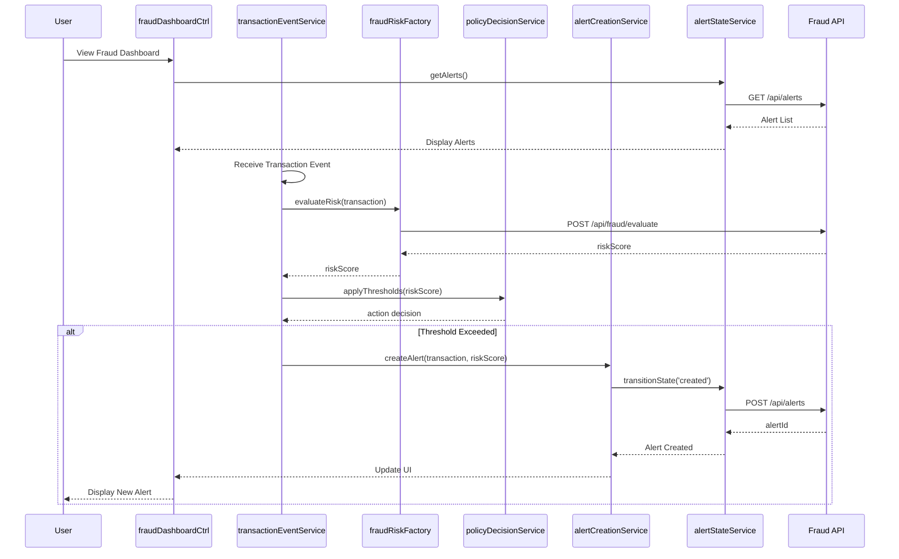

# Low-Level Design: Credit Card Fraud Alert System - Transaction Evaluation
**Epic ID:** QE-7356

## a. Architecture Mapping

- **Transaction Event Ingestion** → AngularJS Service (`transactionEventService`)
- **Fraud Risk Engine** → AngularJS Factory (`fraudRiskFactory`)
- **Policy Decision Engine** → AngularJS Service (`policyDecisionService`)
- **Alert Creation Service** → AngularJS Service (`alertCreationService`)
- **Transaction Context Assembler** → AngularJS Factory (`transactionContextFactory`)
- **Alert State Manager** → AngularJS Service (`alertStateService`)
- **Audit Service** → AngularJS Service (`auditService`)
- **Analytics Service** → AngularJS Service (`analyticsService`)
- **Fraud Dashboard Controller** → AngularJS Controller (`fraudDashboardCtrl`)
- **Alert Management Controller** → AngularJS Controller (`alertManagementCtrl`)

**Recommended Folder Structure:**
```
/app
  /modules
    /fraud-detection
      /controllers
      /services
      /factories
      /directives
      /views
  /shared
    /services
    /models
```

## b. Component Specifications

| Name | Artifact Type | Responsibility | Key Dependencies |
|------|---------------|----------------|------------------|
| fraudDashboardCtrl | Controller | Displays fraud alerts dashboard and real-time transaction monitoring | alertStateService, analyticsService, $scope |
| alertManagementCtrl | Controller | Manages alert lifecycle transitions and review actions | alertStateService, auditService, $scope |
| transactionEventService | Service | Receives and validates transaction events from authorization platform | $http, $q, transactionContextFactory |
| fraudRiskFactory | Factory | Communicates with fraud risk engine API to obtain risk scores | $http, $q |
| policyDecisionService | Service | Applies configurable thresholds and determines action based on risk score | fraudRiskFactory, $q |
| alertCreationService | Service | Generates canonical alert records when thresholds are exceeded | transactionContextFactory, alertStateService, $http |
| transactionContextFactory | Factory | Assembles merchant, amount, time, location, and card details | $http |
| alertStateService | Service | Manages alert lifecycle states (created, queued, delivered, viewed, etc.) | $http, auditService, analyticsService |
| auditService | Service | Records decision and lifecycle transitions for compliance | $http, $q |
| analyticsService | Service | Captures fraud_alert_created events and risk decision metrics | $http |
| alertListDirective | Directive | Renders paginated alert list with filtering and sorting | alertStateService |

## c. Data Model

**TransactionEvent:**
```javascript
{
  transactionId: String,
  cardId: String,
  amount: Number,
  currency: String,
  merchantName: String,
  merchantCategory: String,
  timestamp: Date,
  location: Object { lat: Number, lng: Number, country: String },
  authorizationStatus: String
}
```

**FraudAlert:**
```javascript
{
  alertId: String,
  transactionId: String,
  riskScore: Number,
  riskLevel: String, // 'low', 'medium', 'high', 'critical'
  state: String, // 'created', 'queued', 'delivered', 'viewed', 'confirmed', 'reported', 'protected', 'resolved', 'expired'
  transactionContext: TransactionEvent,
  policyAction: String, // 'approve', 'alert', 'step-up', 'hold', 'decline'
  createdAt: Date,
  updatedAt: Date
}
```

**PolicyThreshold:**
```javascript
{
  thresholdId: String,
  riskScoreMin: Number,
  riskScoreMax: Number,
  action: String,
  isActive: Boolean
}
```

## d. Data Flow

User views fraud dashboard → fraudDashboardCtrl initializes and calls alertStateService.getAlerts() → alertStateService makes REST API call to fetch alerts → transactionEventService receives new transaction event via WebSocket/polling → transactionEventService calls fraudRiskFactory.evaluateRisk(transaction) → fraudRiskFactory sends transaction to fraud risk engine API and receives risk score → policyDecisionService.applyThresholds(riskScore) determines action → if threshold exceeded, alertCreationService.createAlert() generates canonical alert record → alertStateService transitions alert to 'created' then 'queued' state → auditService.logDecision() records lifecycle event → analyticsService.trackEvent('fraud_alert_created') captures metrics → UI updates via $scope.$apply() to display new alert in dashboard.

## e. Primary Sequence Diagram



## f. Implementation Notes

- Use AngularJS 1.x dependency injection for all services, factories, and controllers
- Implement ES6 classes for service definitions with constructor-based DI
- Use $http interceptors for authentication token injection and global error handling
- Leverage $q promises for asynchronous API calls with chaining for sequential operations
- Implement WebSocket or long-polling via $interval for real-time transaction event ingestion

## g. Error Handling

Global $http interceptor captures API errors, logs to auditService, displays user-friendly notifications via toastr, and implements retry logic for transient failures.

## h. Security Notes

Requires token-based authentication via existing SSO with JWT tokens; all API calls include Authorization header; role-based access control enforced server-side.