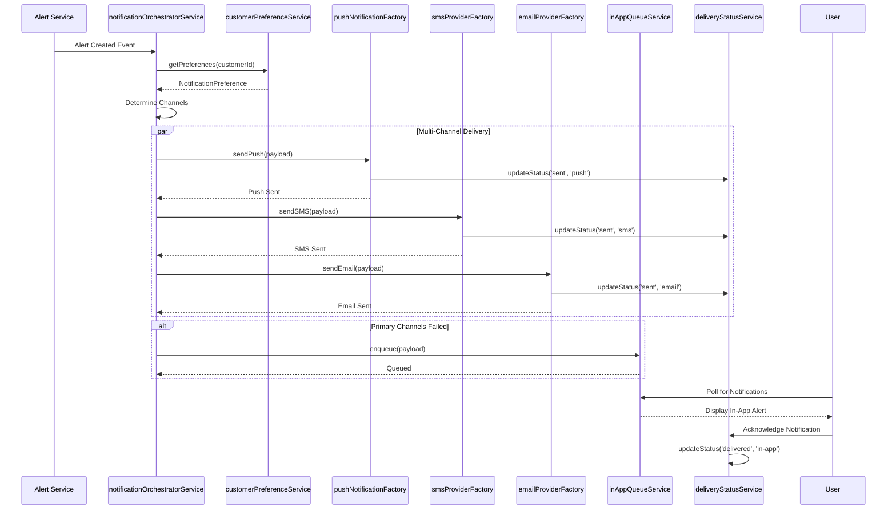

# Low-Level Design: Credit Card Fraud Alert System - Multi-Channel Notification
**Epic ID:** QE-7357

## a. Architecture Mapping

- **Notification Orchestrator** → AngularJS Service (`notificationOrchestratorService`)
- **Push Provider** → AngularJS Factory (`pushNotificationFactory`)
- **SMS Provider** → AngularJS Factory (`smsProviderFactory`)
- **Email Provider** → AngularJS Factory (`emailProviderFactory`)
- **In-App Queue** → AngularJS Service (`inAppQueueService`)
- **Customer Preference Service** → AngularJS Service (`customerPreferenceService`)
- **Delivery Status Tracker** → AngularJS Service (`deliveryStatusService`)
- **Analytics Service** → AngularJS Service (`analyticsService`)
- **Notification Settings Controller** → AngularJS Controller (`notificationSettingsCtrl`)
- **Alert Notification Controller** → AngularJS Controller (`alertNotificationCtrl`)

**Recommended Folder Structure:**
```
/app
  /modules
    /notifications
      /controllers
      /services
      /factories
      /directives
      /views
  /shared
    /services
    /models
```

## b. Component Specifications

| Name | Artifact Type | Responsibility | Key Dependencies |
|------|---------------|----------------|------------------|
| notificationSettingsCtrl | Controller | Manages customer notification preferences UI and updates | customerPreferenceService, $scope |
| alertNotificationCtrl | Controller | Displays in-app notifications and handles user acknowledgment | inAppQueueService, deliveryStatusService, $scope |
| notificationOrchestratorService | Service | Coordinates multi-channel notification delivery with fallback logic | customerPreferenceService, pushNotificationFactory, smsProviderFactory, emailProviderFactory, inAppQueueService |
| pushNotificationFactory | Factory | Sends push notifications via provider API with retry mechanism | $http, $q, deliveryStatusService |
| smsProviderFactory | Factory | Sends SMS alerts via provider API with delivery confirmation | $http, $q, deliveryStatusService |
| emailProviderFactory | Factory | Sends email alerts with transaction context and secure links | $http, $q, deliveryStatusService |
| inAppQueueService | Service | Manages in-app notification queue for offline/fallback scenarios | $http, $q, localStorageService |
| customerPreferenceService | Service | Retrieves and updates customer notification channel preferences | $http, $q |
| deliveryStatusService | Service | Tracks notification delivery status (sent, delivered, failed) across channels | $http, analyticsService |
| analyticsService | Service | Captures fraud_alert_sent, fraud_alert_delivered, fraud_alert_failed events | $http |
| notificationBadgeDirective | Directive | Displays unread in-app notification count badge | inAppQueueService |

## c. Data Model

**NotificationPreference:**
```javascript
{
  customerId: String,
  pushEnabled: Boolean,
  smsEnabled: Boolean,
  emailEnabled: Boolean,
  inAppEnabled: Boolean,
  preferredChannel: String, // 'push', 'sms', 'email', 'in-app'
  securityOverride: Boolean, // forces all channels for critical alerts
  updatedAt: Date
}
```

**NotificationPayload:**
```javascript
{
  notificationId: String,
  alertId: String,
  customerId: String,
  channels: Array, // ['push', 'sms', 'email', 'in-app']
  title: String,
  message: String,
  transactionContext: Object,
  deepLink: String,
  priority: String, // 'low', 'medium', 'high', 'critical'
  createdAt: Date
}
```

**DeliveryStatus:**
```javascript
{
  deliveryId: String,
  notificationId: String,
  channel: String,
  status: String, // 'sent', 'delivered', 'failed', 'pending'
  attemptCount: Number,
  lastAttemptAt: Date,
  errorMessage: String,
  deliveredAt: Date
}
```

## d. Data Flow

Alert Service creates canonical alert → notificationOrchestratorService receives alert event → customerPreferenceService.getPreferences(customerId) retrieves notification settings → orchestrator determines channels based on preferences and security overrides → for each channel, orchestrator calls respective factory (pushNotificationFactory, smsProviderFactory, emailProviderFactory) → each factory attempts delivery with retry logic → deliveryStatusService.updateStatus() records outcome (sent, delivered, failed) → if all channels fail, inAppQueueService.enqueue() stores notification for offline customer → analyticsService.trackEvent() captures fraud_alert_sent, fraud_alert_delivered, fraud_alert_failed events → alertNotificationCtrl polls inAppQueueService and displays in-app notifications → user acknowledges notification, deliveryStatusService updates status to 'delivered'.

## e. Primary Sequence Diagram



## f. Implementation Notes

- Use AngularJS 1.x $http service with promise chaining for sequential fallback attempts across channels
- Implement retry logic using $timeout with exponential backoff for failed provider calls
- Store in-app queue in localStorage via localStorageService for offline persistence
- Use $interval for polling inAppQueueService to check for new notifications every 30 seconds
- Leverage ES6 template literals for dynamic notification message composition with transaction context

## g. Error Handling

$http interceptor captures provider API failures, logs to deliveryStatusService, triggers fallback channel attempts, and displays user notification for critical delivery failures.

## h. Security Notes

Secure deep links use JWT tokens with expiration; all notification payloads sanitized to prevent XSS; customer preference updates require authentication and authorization.