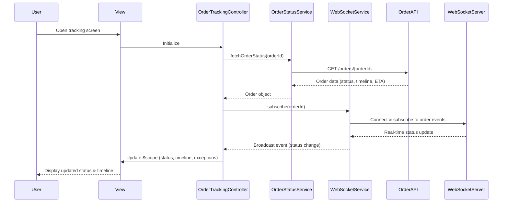

# Low-Level Design: QE-7359 - Real-Time Order Status, Timeline, and Exceptions

## a. Architecture Mapping

- **Tracking UI Screen** → `OrderTrackingController` + `order-tracking.html` view
- **Order Status Display** → `OrderStatusService` (API integration) + `statusTimeline` directive
- **Exception/Delay Handling** → `ExceptionHandlerService` + `exceptionBanner` directive
- **Support Entry Point** → `SupportService` + `contactSupport` directive
- **Real-Time Updates** → `WebSocketService` (Factory for persistent connection)
- **Order Persistence** → `OrderCacheFactory` (singleton state management)

**Folder Structure:**
```
app/
  order-tracking/
    order-tracking.module.js
    order-tracking.controller.js
    order-tracking.service.js
    order-tracking.routes.js
    views/order-tracking.html
  shared/
    services/websocket.service.js
    services/exception-handler.service.js
    services/support.service.js
    directives/status-timeline.directive.js
    directives/exception-banner.directive.js
    interceptors/auth.interceptor.js
```

## b. Component Specifications

| Name | Artifact Type | Responsibility | Key Dependencies |
|------|---------------|----------------|------------------|
| OrderTrackingController | Controller | Manages tracking screen state, binds order data to view, handles user actions | OrderStatusService, WebSocketService, OrderCacheFactory, $scope |
| OrderStatusService | Service | Fetches order state/timeline from Order Service API, processes status events | $http, $q, AuthService |
| WebSocketService | Factory | Maintains WebSocket connection for real-time order updates, handles reconnection | $rootScope, $window |
| ExceptionHandlerService | Service | Processes delay/cancellation/failure events, triggers notifications | NotificationService, $http |
| SupportService | Service | Routes contextual help requests to Customer Support Platform API | $http, OrderCacheFactory |
| OrderCacheFactory | Factory | Persists active orders in memory/localStorage, recovers state on reopen | $window.localStorage |
| statusTimeline | Directive | Renders order stage progression (completed/current/upcoming) | - |
| exceptionBanner | Directive | Displays exception messages (delays, cancellations) with actions | - |
| contactSupport | Directive | Provides contextual support entry button with order context | SupportService |
| authInterceptor | Interceptor | Attaches auth tokens to API requests, ensures account-scoped access | $q, AuthService |

## c. Data Model

```js
Order = {
  orderId: String,
  customerId: String,
  status: String, // 'pending', 'accepted', 'preparing', 'ready', 'picked_up', 'in_transit', 'delivered', 'cancelled'
  timeline: Array<Stage>, // [{stage: String, status: String, timestamp: Number}]
  eta: Number, // Unix timestamp
  restaurant: Object, // {id: String, name: String, status: String}
  deliveryPartner: Object, // {id: String, name: String, status: String}
  exceptions: Array<Exception>, // [{type: String, message: String, timestamp: Number}]
  lastUpdated: Number // Unix timestamp for event sequencing
}

Stage = {
  stage: String, // 'confirmed', 'accepted', 'preparing', 'ready', 'picked_up', 'in_transit', 'delivered'
  status: String, // 'completed', 'current', 'upcoming'
  timestamp: Number // Unix timestamp
}

Exception = {
  type: String, // 'delay', 'cancellation', 'eta_change', 'missing_partner'
  message: String,
  timestamp: Number,
  severity: String // 'info', 'warning', 'critical'
}
```

## d. Data Flow

User opens tracking screen → View loads → OrderTrackingController initializes → OrderStatusService fetches current order state via REST API → OrderCacheFactory persists order locally → WebSocketService establishes connection and subscribes to order updates → Real-time events (status changes, exceptions) arrive via WebSocket → Controller updates $scope with new status/timeline/exceptions → View re-renders timeline and exception banner → User clicks support button → SupportService sends contextual help request to Customer Support Platform API → UI shows confirmation.

## e. Primary Sequence Diagram



## f. Implementation Notes

- Use constructor injection with `$inject` array for minification safety across all controllers/services
- WebSocketService implements reconnection logic with exponential backoff; falls back to polling if WebSocket unavailable
- Event sequencing via `lastUpdated` timestamp to handle duplicate/out-of-order events safely
- OrderCacheFactory uses localStorage for persistence; clears stale orders older than 24 hours on init
- All API calls centralized in services; controllers never call $http directly

## g. Error Handling

HTTP interceptor captures API errors and WebSocket failures; user sees last known status with retry prompt and contextual support link.

## h. Security Notes

Requires token-based auth via existing SSO; authInterceptor attaches JWT to all API requests; account-scoped access enforced server-side.