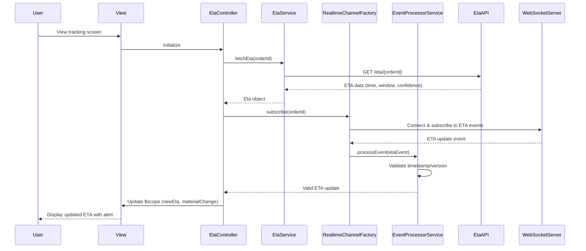

# Low-Level Design: QE-7360 - ETA Calculation, Real-Time Updates, and Reliability

## a. Architecture Mapping

- **ETA Display & Updates** → `EtaController` + `eta-display.html` view
- **ETA Calculation** → `EtaService` (API integration with ETA Service)
- **Real-Time Channel** → `RealtimeChannelFactory` (WebSocket/SSE wrapper)
- **Event Processing** → `EventProcessorService` (state machine for duplicate/out-of-order events)
- **Material ETA Change Notifications** → `NotificationService` + `etaChangeAlert` directive
- **Graceful Degradation** → `FallbackPollingService` (periodic refresh when real-time unavailable)

**Folder Structure:**
```
app/
  eta/
    eta.module.js
    eta.controller.js
    eta.service.js
    eta.routes.js
    views/eta-display.html
  shared/
    services/realtime-channel.factory.js
    services/event-processor.service.js
    services/notification.service.js
    services/fallback-polling.service.js
    directives/eta-change-alert.directive.js
    interceptors/auth.interceptor.js
```

## b. Component Specifications

| Name | Artifact Type | Responsibility | Key Dependencies |
|------|---------------|----------------|------------------|
| EtaController | Controller | Manages ETA display, binds ETA data to view, handles material changes | EtaService, RealtimeChannelFactory, EventProcessorService, $scope |
| EtaService | Service | Fetches ETA from ETA Service API, processes ETA updates | $http, $q, AuthService |
| RealtimeChannelFactory | Factory | Establishes WebSocket/SSE connection for real-time ETA updates, handles reconnection | $rootScope, $window |
| EventProcessorService | Service | Processes incoming events with timestamp/version-based state machine, filters duplicates | - |
| NotificationService | Service | Sends push/SMS/email for material ETA changes via Notification Service API | $http |
| FallbackPollingService | Service | Implements periodic polling when real-time channel unavailable | $interval, EtaService |
| etaChangeAlert | Directive | Displays in-app alert for material ETA changes with explanation | - |
| authInterceptor | Interceptor | Attaches auth tokens, ensures secure API access | $q, AuthService |

## c. Data Model

```js
Eta = {
  orderId: String,
  estimatedDeliveryTime: Number, // Unix timestamp
  deliveryWindow: Object, // {start: Number, end: Number}
  confidence: String, // 'high', 'medium', 'low'
  lastUpdated: Number, // Unix timestamp for event sequencing
  version: Number, // Event version for ordering
  materialChange: Boolean, // True if ETA changed by >15 min
  changeReason: String // 'traffic', 'restaurant_delay', 'partner_delay', etc.
}

EtaEvent = {
  orderId: String,
  newEta: Number,
  version: Number,
  timestamp: Number,
  changeType: String // 'minor', 'material'
}
```

## d. Data Flow

User views tracking screen → View loads → EtaController initializes → EtaService fetches current ETA via REST API → RealtimeChannelFactory establishes WebSocket connection → ETA update event arrives → EventProcessorService validates event timestamp/version against current state → If material change detected, NotificationService triggers push notification → EtaController updates $scope with new ETA → View re-renders ETA display and shows etaChangeAlert directive → If WebSocket fails, FallbackPollingService activates periodic polling → User sees updated ETA with clear "estimate" label.

## e. Primary Sequence Diagram



## f. Implementation Notes

- EventProcessorService uses timestamp and version fields to maintain correct state; ignores events with older timestamps/versions
- RealtimeChannelFactory detects connection loss and triggers FallbackPollingService (30-second interval) until reconnection
- Material ETA change threshold: >15 minutes difference triggers NotificationService call
- ETA displayed with explicit "Estimated delivery:" label to communicate uncertainty
- All services use constructor injection with `$inject` array for minification safety

## g. Error Handling

HTTP interceptor captures API/WebSocket failures; UI shows last known ETA with "Updating..." indicator and automatic retry via FallbackPollingService.

## h. Security Notes

Token-based auth via existing SSO; authInterceptor attaches JWT; ETA API enforces account-scoped access to prevent unauthorized ETA queries.