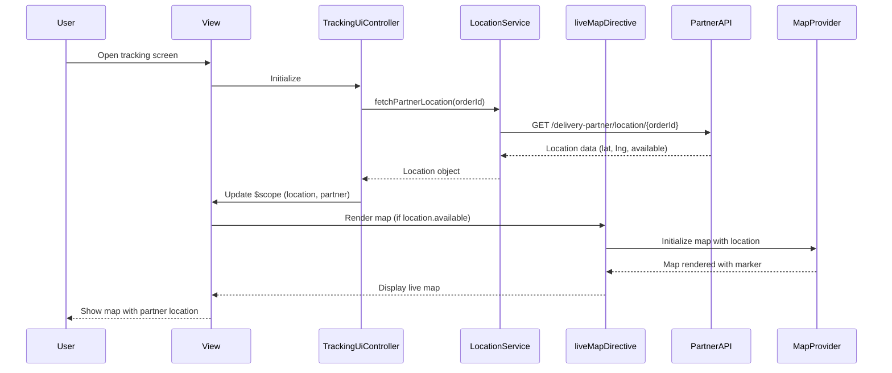

# Low-Level Design: QE-7361 - Live Delivery Map, Partner Visibility, and Tracking UI

## a. Architecture Mapping

- **Tracking Screen Layout** → `TrackingUiController` + `tracking-ui.html` view
- **Progress Timeline** → `progressTimeline` directive
- **Restaurant & Order Summary** → `orderSummary` directive
- **Delivery Partner Info** → `partnerInfo` directive
- **Live Map** → `liveMap` directive (integrates Map Provider SDK)
- **Map Location Updates** → `LocationService` (API integration with Delivery-Partner Service)
- **Arrival Indication** → `arrivalIndicator` directive
- **Exception Banner** → `exceptionBanner` directive (shared from QE-7359)

**Folder Structure:**
```
app/
  tracking-ui/
    tracking-ui.module.js
    tracking-ui.controller.js
    tracking-ui.service.js
    tracking-ui.routes.js
    views/tracking-ui.html
  shared/
    services/location.service.js
    directives/progress-timeline.directive.js
    directives/order-summary.directive.js
    directives/partner-info.directive.js
    directives/live-map.directive.js
    directives/arrival-indicator.directive.js
    directives/exception-banner.directive.js
    interceptors/auth.interceptor.js
```

## b. Component Specifications

| Name | Artifact Type | Responsibility | Key Dependencies |
|------|---------------|----------------|------------------|
| TrackingUiController | Controller | Manages tracking UI state, binds order/partner/location data to view | LocationService, OrderStatusService, $scope |
| LocationService | Service | Fetches partner location from Delivery-Partner Service API, handles location availability | $http, $q, AuthService |
| progressTimeline | Directive | Renders order stage timeline (confirmed → delivered) with completed/current/upcoming states | - |
| orderSummary | Directive | Displays restaurant info and order details (items, totals) | - |
| partnerInfo | Directive | Shows delivery partner name, photo, approved contact options (call/message) | - |
| liveMap | Directive | Renders map with partner location marker and route after pickup; hides when location unavailable | MapProvider SDK, LocationService |
| arrivalIndicator | Directive | Shows "Driver arriving soon" state when partner near destination | - |
| exceptionBanner | Directive | Displays delay/cancellation alerts with actions | - |
| authInterceptor | Interceptor | Attaches auth tokens, ensures secure access to order/location data | $q, AuthService |

## c. Data Model

```js
TrackingUi = {
  orderId: String,
  status: String,
  eta: Number,
  timeline: Array<Stage>, // From QE-7359
  restaurant: Restaurant,
  order: OrderDetails,
  deliveryPartner: DeliveryPartner,
  location: Location,
  exceptions: Array<Exception>
}

Restaurant = {
  id: String,
  name: String,
  address: String,
  phone: String
}

OrderDetails = {
  items: Array<Item>, // [{name: String, quantity: Number, price: Number}]
  subtotal: Number,
  tax: Number,
  deliveryFee: Number,
  total: Number
}

DeliveryPartner = {
  id: String,
  name: String,
  photoUrl: String,
  phone: String, // Approved contact field
  vehicle: String,
  isNearDestination: Boolean
}

Location = {
  latitude: Number,
  longitude: Number,
  timestamp: Number,
  available: Boolean // False when location unavailable
}
```

## d. Data Flow

User opens tracking screen → View loads → TrackingUiController initializes → OrderStatusService fetches order/restaurant/partner data → LocationService fetches partner location (if pickup completed) → If location available, liveMap directive renders map with partner marker and route → If location unavailable, map hidden and status message shown → Real-time location updates arrive via WebSocket → LocationService updates location object → liveMap directive updates marker position → When partner near destination, arrivalIndicator directive shows "Arriving soon" → User clicks partner phone → partnerInfo directive initiates approved contact action.

## e. Primary Sequence Diagram



## f. Implementation Notes

- liveMap directive checks `location.available` before rendering; shows "Location unavailable" message when false to avoid misleading markers
- LocationService exposes only approved partner fields (name, photo, phone) per privacy policy; sensitive fields filtered server-side
- Map loading is non-blocking; core status/ETA render immediately while map loads asynchronously
- arrivalIndicator directive triggers when `isNearDestination` flag set by backend (e.g., <500m from destination)
- All directives use isolate scope with `bindToController` for reusability

## g. Error Handling

HTTP interceptor captures location API failures; map shows last known location with "Updating..." overlay; fallback to status-only view if map provider unavailable.

## h. Security Notes

Token-based auth via existing SSO; location data access restricted to order owner; partner PII exposure limited to approved fields per privacy/compliance framework.