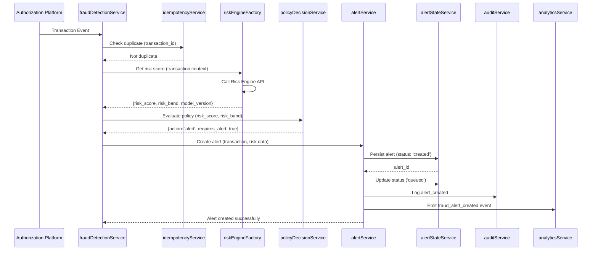

# Low-Level Design: Real-Time Fraud Detection Pipeline
**Epic ID:** QE-7362

## a. Architecture Mapping

- **Transaction Event Consumer** → AngularJS Service (fraudDetectionService)
- **Risk Engine Client** → AngularJS Factory (riskEngineFactory)
- **Policy Decision Engine** → AngularJS Service (policyDecisionService)
- **Alert Service** → AngularJS Service (alertService)
- **Alert State Management** → AngularJS Service (alertStateService)
- **Audit Logger** → AngularJS Service (auditService)
- **Analytics Tracker** → AngularJS Service (analyticsService)
- **Alert Dashboard Controller** → AngularJS Controller (alertDashboardController)
- **Alert List View** → AngularJS Directive (alertListDirective)

**Recommended Folder Structure:**
```
/app
  /modules
    /fraud-detection
      /controllers
      /services
      /factories
      /directives
      /models
      /views
```

## b. Component Specifications

| Name | Artifact Type | Responsibility | Key Dependencies |
|------|---------------|----------------|------------------|
| fraudDetectionService | Service | Orchestrates transaction ingestion, risk evaluation, and alert triggering workflow | riskEngineFactory, policyDecisionService, alertService, $http |
| riskEngineFactory | Factory | Provides API client for risk scoring engine with request/response mapping | $http, $q, configService |
| policyDecisionService | Service | Maps risk scores/bands to policy actions (approve/alert/step-up/hold/decline) | configService |
| alertService | Service | Creates canonical alert records and manages alert lifecycle state transitions | $http, alertStateService, auditService, analyticsService |
| alertStateService | Service | Persists and retrieves alert state (created/queued/delivered/viewed/confirmed/resolved/expired) | $http, $q |
| auditService | Service | Records alert lifecycle events to audit trail | $http |
| analyticsService | Service | Emits fraud_alert_created events with metadata | $http |
| alertDashboardController | Controller | Manages alert dashboard view state and user interactions | fraudDetectionService, alertService, $scope |
| alertListDirective | Directive | Renders real-time alert list with severity indicators and status | alertService |
| idempotencyService | Service | Checks duplicate transaction_id to prevent duplicate alert creation | $http, $q |

## c. Data Model

**Transaction Event Object:**
```javascript
{
  transaction_id: String,
  account_id: String,
  card_id: String,
  merchant: String,
  amount: Number,
  currency: String,
  timestamp: Date,
  channel: String,
  authorization_status: String
}
```

**Risk Assessment Object:**
```javascript
{
  risk_score: Number,
  risk_band: String, // 'low', 'medium', 'high', 'critical'
  model_version: String
}
```

**Fraud Alert Object:**
```javascript
{
  alert_id: String,
  transaction_id: String,
  customer_id: String,
  severity: String, // 'low', 'medium', 'high', 'critical'
  status: String, // 'created', 'queued', 'delivered', 'viewed', 'confirmed', 'reported', 'protected', 'resolved', 'expired'
  created_at: Date,
  expires_at: Date,
  risk_score: Number,
  risk_band: String,
  decision: String,
  transaction_details: Object
}
```

**Policy Decision Object:**
```javascript
{
  action: String, // 'approve', 'alert', 'step-up', 'hold', 'decline'
  reason: String,
  requires_alert: Boolean
}
```

## d. Data Flow

User (system) receives transaction event from Authorization Platform → fraudDetectionService consumes event and checks idempotency via idempotencyService → riskEngineFactory invokes Risk Engine API with transaction context → policyDecisionService evaluates risk score/band against thresholds and determines action → if requires_alert is true, alertService creates canonical fraud alert record → alertStateService persists alert state as 'created' then transitions to 'queued' → auditService logs alert creation event → analyticsService emits fraud_alert_created event → alertDashboardController refreshes view with new alert → alertListDirective updates UI to display alert with severity indicator.

## e. Primary Sequence Diagram



## f. Implementation Notes

- Use AngularJS 1.x dependency injection for all services, factories, and controllers with explicit annotation to avoid minification issues
- Implement HTTP interceptor for API authentication token injection and global error handling
- Use $q promises for asynchronous operations with proper error propagation and chaining
- Apply ES6 arrow functions, const/let, template literals, and destructuring in service implementations
- Implement idempotency check using transaction_id hash stored in local cache or backend endpoint before risk evaluation

## g. Error Handling

HTTP interceptor captures API errors; fraudDetectionService wraps operations in try/catch with user-friendly error notifications via toastr or modal service.

## h. Security Notes

Requires token-based authentication via existing SSO; all API calls use HTTPS; alert data encrypted in transit and at rest.