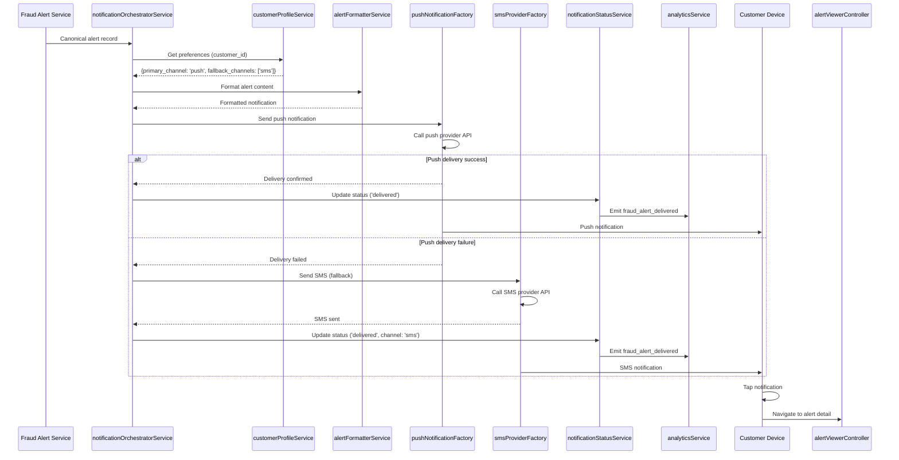

# Low-Level Design: Customer-Facing Fraud Alert Notification System
**Epic ID:** QE-7363

## a. Architecture Mapping

- **Notification Orchestrator** → AngularJS Service (notificationOrchestratorService)
- **Push Notification Provider** → AngularJS Factory (pushNotificationFactory)
- **SMS Provider** → AngularJS Factory (smsProviderFactory)
- **Email Provider** → AngularJS Factory (emailProviderFactory)
- **In-App Notification** → AngularJS Service (inAppNotificationService)
- **Customer Profile Client** → AngularJS Service (customerProfileService)
- **Alert Viewer Controller** → AngularJS Controller (alertViewerController)
- **Notification Preference Controller** → AngularJS Controller (notificationPreferenceController)
- **Alert Detail Directive** → AngularJS Directive (alertDetailDirective)
- **Notification Status Tracker** → AngularJS Service (notificationStatusService)

**Recommended Folder Structure:**
```
/app
  /modules
    /notifications
      /controllers
      /services
      /factories
      /directives
      /models
      /views
```

## b. Component Specifications

| Name | Artifact Type | Responsibility | Key Dependencies |
|------|---------------|----------------|------------------|
| notificationOrchestratorService | Service | Orchestrates multi-channel notification delivery with fallback logic | customerProfileService, pushNotificationFactory, smsProviderFactory, emailProviderFactory, inAppNotificationService, analyticsService |
| pushNotificationFactory | Factory | Sends push notifications via provider API and tracks delivery status | $http, $q, configService |
| smsProviderFactory | Factory | Sends SMS notifications via provider API with delivery confirmation | $http, $q, configService |
| emailProviderFactory | Factory | Sends email notifications via provider API with template rendering | $http, $q, configService |
| inAppNotificationService | Service | Displays in-app alerts with deep linking to alert detail view | $rootScope, $state |
| customerProfileService | Service | Retrieves customer notification preferences (channel priority, opt-in status) | $http, $q |
| notificationStatusService | Service | Tracks and updates notification delivery status (queued/delivered/failed) | $http, analyticsService |
| alertViewerController | Controller | Manages alert detail view rendering with transaction context and action buttons | alertService, $stateParams, $scope |
| notificationPreferenceController | Controller | Manages customer notification preference settings UI | customerProfileService, $scope |
| alertDetailDirective | Directive | Renders alert detail card with masked card number, amount, merchant, time, location, and action buttons | alertService |
| alertFormatterService | Service | Formats alert content with transaction context for each channel (push/SMS/email/in-app) | $filter |

## c. Data Model

**Notification Request Object:**
```javascript
{
  alert_id: String,
  customer_id: String,
  transaction_details: {
    masked_card: String, // e.g., "****1234"
    amount: Number,
    currency: String,
    merchant: String,
    timestamp: Date,
    location: String
  },
  severity: String,
  risk_message: String,
  actions: Array // ['confirm', 'report', 'block']
}
```

**Customer Notification Preferences Object:**
```javascript
{
  customer_id: String,
  primary_channel: String, // 'push', 'sms', 'email', 'in-app'
  fallback_channels: Array, // ['sms', 'email']
  push_enabled: Boolean,
  sms_enabled: Boolean,
  email_enabled: Boolean,
  in_app_enabled: Boolean,
  phone_number: String,
  email_address: String,
  device_tokens: Array
}
```

**Notification Status Object:**
```javascript
{
  notification_id: String,
  alert_id: String,
  channel: String,
  status: String, // 'queued', 'delivered', 'failed'
  delivered_at: Date,
  failure_reason: String,
  provider_response: Object
}
```

**Alert View Model:**
```javascript
{
  alert_id: String,
  transaction: {
    masked_card: String,
    amount: String, // formatted with currency
    merchant: String,
    time: String, // formatted timestamp
    location: String
  },
  severity: String,
  status: String,
  actions: Array,
  deep_link: String
}
```

## d. Data Flow

Fraud Alert Service publishes canonical alert record → notificationOrchestratorService receives alert → customerProfileService retrieves notification preferences → alertFormatterService formats alert content with masked card, amount, merchant, time, location → notificationOrchestratorService selects primary channel (push/SMS/email/in-app) → appropriate provider factory (pushNotificationFactory/smsProviderFactory/emailProviderFactory) sends notification → on failure, orchestrator attempts fallback channel → notificationStatusService records delivery status and emits analytics events (fraud_alert_sent, fraud_alert_delivered, fraud_alert_failed) → customer receives notification on device/client → alertViewerController renders alert detail view when user taps notification → alertDetailDirective displays transaction context and action buttons → alert state transitions from 'queued' to 'delivered' to 'viewed'.

## e. Primary Sequence Diagram



## f. Implementation Notes

- Use AngularJS 1.x dependency injection with explicit array notation for all components to ensure minification safety
- Implement HTTP interceptor for API authentication and error handling across all provider factories
- Use $q promises for asynchronous notification delivery with proper error propagation and retry logic
- Apply ES6 const/let, arrow functions, template literals for alert formatting, and destructuring in service implementations
- Implement deep linking using $state service with alert_id parameter to navigate from notification to alert detail view

## g. Error Handling

HTTP interceptor-based error capture for provider API failures; notificationOrchestratorService implements try/catch with fallback channel logic and user notification via toastr.

## h. Security Notes

Requires token-based auth via existing SSO; all provider API calls use HTTPS; no full card numbers transmitted (masked format only); encryption in transit and at rest.